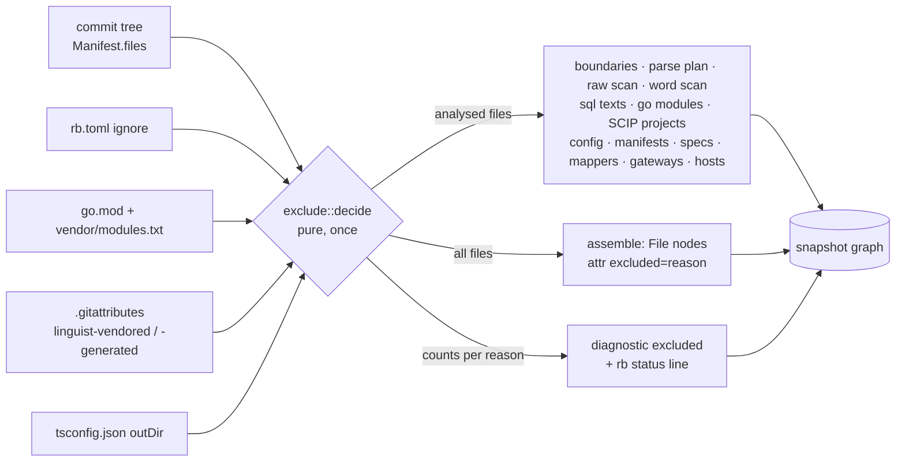

# M7e contract: input hygiene (stress batch D) (2026-10-13)

**Status:** contract and design written 2026-10-13 (go-ahead given for batch D); started. Branch `m7e-input-hygiene`, stacked on M7d (`79216ce`).

## Why

The stress campaign found that nothing keeps vendored or built code out of the analysis:

| Finding | Measured |
|---|---|
| F16 | go-gin-example: 1,020 of 1,073 files are `vendor/`, giving 14 extra projects (one labelled a deployable service), 8,786 of 8,939 symbols, and a `sql:` status line built entirely from vendored gorm. |
| F29 | The 1,059 ambiguous references are all in vendor (build-tag twins). |
| F22 | nestjs-realworld: 70 committed `dist/` files duplicate every symbol (`callers ArticleService` is ambiguous), and 954 of 1,102 unresolved references are there. |
| F13 | `rb.toml` `exclude` only drops manifests; a committed `node_modules/` gives 3,000 parsed files of noise. |

## Requirements

- **Functional:** decide once per commit which files are *excluded from analysis*. Excluded files keep their `File` node (ownership, `rb find`, codeowners coverage) and are invisible to every analysis stage. The user can add exclusions in `rb.toml`, and every exclusion is reported.
- **NFR 1 (determinism):** exclusion is a pure function of the commit tree. Two runs and two repo names give byte-identical dumps (as today).
- **NFR 2 (cost):** under 50 ms on the largest measured tree (mattermost, 16,184 files), and **0 blob reads** for excluded files beyond the config files that decide.
- **NFR 3 (no surprise):** repositories without vendored or build trees are byte-identical to M7d. That covers all 18 fixtures and 11 of 13 stress repos; only go-gin-example and nestjs-realworld are predicted to change.

## Design



**Where the decision lives (trade-off).**
- **Chosen: an `rb-indexer` module (`exclude.rs`) called right after `repo.manifest(rev)`.** It returns `path → reason`, and `index_commit` builds one `analysed: Vec<&FileEntry>` that replaces `&manifest.files` at its 14 analysis call sites.
- **Rejected: a flag on `rb-git`'s `FileEntry`.** That would put repository *policy* (rb.toml, tsconfig, gitattributes parsing) into the git tree reader, which today is policy-free, and would force blob reads inside `manifest()`.
- **Cost of the choice:** the 14 call sites change one argument each.

**Keep `File` nodes (trade-off).**
- **Keeping:** go-gin-example keeps 1,020 `File` nodes (+1,020 `IN_SERVICE` and `OWNED_BY` edges) but drops about 8,800 symbols, about 22,000 `CALLS`/`REFERENCES` and 14 projects, a net shrink of roughly 90%.
- **Dropping them too:** that would save the 1,020 nodes, but `rb find vendor/…` would answer "not found" for a file that exists, and CODEOWNERS coverage would silently change.

**Rule order and attribution.** Each excluded file is attributed to the **first** matching rule, so the per-reason counts sum to the excluded total:
1. `rb_toml`: `ignore = [globs]` (CODEOWNERS dialect, the same matcher as `exclude`), repo-wide.
2. `go_vendor`: `D/vendor/**` where `D/go.mod` and `D/vendor/modules.txt` both exist.
3. `node_modules`: any path segment `node_modules`.
4. `gitattributes`: a `.gitattributes` at directory `D` whose line sets `linguist-vendored` or `linguist-generated` (bare or `=true`) for a pattern, scoped to `D`.
5. `ts_out_dir`: a `tsconfig.json` at `D` with `compilerOptions.outDir` resolving to `D/O`, but **only compiler outputs** under it (`.js .mjs .cjs .jsx .d.ts .map`), never `.ts`/`.tsx` sources.

**Safety invariants (guards):**
- A rule from a config at `D` only excludes paths under `D` (an `outDir` with `..`, or resolving to `D` itself, is ignored).
- *(Dropped in review:)* "deciding config files are never excluded" is unnecessary. Decisions are computed from the full tree before anything is excluded, so excluding a config file cannot change what it decided.
- An `rb.toml` `ignore` glob that fails to parse fails the run, as `exclude` does (design §4.3: no silent fallback).

**Back-of-the-envelope.**
- *Cost:* mattermost has F = 16,184 paths. Rules 2, 3 and 5 are prefix and segment checks, O(F × prefixes) with fewer than 10 prefixes, so about 160k string compares, around 2 ms. Rules 1 and 4 are glob matches, O(F × G) with G ≤ 20 patterns (mattermost has no `.gitattributes`, laravel has 3 lines), so about 320k matches at roughly 100 ns each, around 32 ms worst case. That's within the 50 ms NFR.
- *Reads:* only `rb.toml`, `.gitattributes`, `tsconfig.json`, and `go.mod`/`modules.txt` *presence* (no read). That's 12 small blobs on mattermost.
- *Effect, go-gin-example:* 1,020/1,073 files excluded (95%). Nodes about 10,077 → about 1,300. Index 3.4 s / 378 MiB → under 1 s and under 100 MiB (predicted; measured at close).

## Core algorithm (LLD)

```text
decide(files, read) -> BTreeMap<path, reason>:
  rules  = rb_toml_ignore(read(rb.toml))                           # [(Pattern, "rb_toml")]
  vendor = { D/vendor/ | D/go.mod ∈ files ∧ D/vendor/modules.txt ∈ files }
  attrs  = for each D/.gitattributes: [(D, Pattern, "gitattributes") | line sets linguist-vendored|generated]
  outs   = for each D/tsconfig.json: D/O/ where O = compilerOptions.outDir, inside D, ≠ D
  for f in files (sorted):
     reason = first of:
        rb_toml        if any rule matches f.path
        go_vendor      if any v in vendor: f.path starts with v
        node_modules   if "node_modules" ∈ segments(f.path)
        gitattributes  if any (D,p): f.path under D ∧ p matches f.path relative to D
        ts_out_dir     if any o in outs: f.path starts with o ∧ ext(f) ∈ compiler outputs
     if reason: out[f.path] = reason
```

## Claims

| # | Claim | Test |
|---|---|---|
| S1 | `exclude::decide` implements the 5 rules in order, with the guards above. | `exclude.rs` units, one per rule and one per guard, each with a mutant |
| S2 | `index_commit` analyses only non-excluded files; excluded files keep `File` nodes with `excluded: <reason>`; one `excluded {reason, files}` diagnostic per reason. | indexer test over a temporary git repo |
| S3 | `rb status` prints `excluded: go_vendor 1020, …`. | rb-api render unit |
| S4 | The `rb.toml` `ignore` key is accepted by detection (`deny_unknown_fields`) and parsed with the shared glob dialect. | rb-git unit |

## Verification

- Tests first, with a mutant per rule and guard.
- Real-Docker suites: 0 failed, 0 skipped.
- Invariant against M7d: all 18 fixtures and 11 stress repos byte-identical. go-gin-example and nestjs-realworld diffs classified: every removed row must originate in an excluded path.
- Re-measure go-gin-example (time, RSS, nodes) and nestjs `callers ArticleService`.
- `PIPELINE` `m7e-1`. `CHANGELOG.md` gets M7a–M7e entries (M7a–M7d were missed).

## Residue (planned)

- `rb.toml` `include` to opt a default-excluded tree back in.
- `.gitattributes` macros (`binary`) and negations (`-linguist-vendored`).
- An `outDir` inherited through `extends`.
- Build-tag selection for non-vendored Go twins (F29 remainder).

## Result (amendment 1, 2026-10-13)

- **Phases 1–3** are as in `tasks/todo.md`. Mutants: m58–m72 killed (15). m63 is equivalent (an empty `outDir` gives the prefix `D//`, which matches no path); the guard is kept for intent. m62 first survived (the test lacked the file an escaping `outDir` would reach) and was fixed.
- **Verification:**
  - fmt and clippy clean; stub scan clean.
  - Workspace with DB and **real Docker** (`var/m7e/logs/p4-workspace.log`): **1,004 passed, 0 failed, 0 skipped**.
  - Invariant against M7d (`var/m7e/logs/invariant.txt`, sha256 `1d7107ba…`): **28/31 byte-identical**, all 18 fixtures and mattermost included. Every row of the 3 diffs is classified (identity-matched, not line-diffed):
    - **go-gin-example:** 42,860 removed rows all reference `vendor/` paths (8,786 symbols and their `DEFINED_IN`, 7,998 `CALLS`, 11,039 `REFERENCES`, 14 vendor projects, 14 SCIP jobs, 3 vendored gorm `QUERIES`).
    - **go-gin-example:** 22 packages declared only by vendored modules' `go.mod`, and `sqlite_master` (vendored gorm), removed.
    - **go-gin-example:** 5 packages (gin, gin-swagger, swag, template, unknwon/com) are now external `DEPENDS_ON` of the root `go.mod` (previously in-repo vendored projects).
    - **go-gin-example:** 323 `IN_SERVICE` re-pointed from vendor projects to the root service; 1,020 `File` nodes gained `excluded: go_vendor`.
    - **go-gin-example:** 12 own types became `orphan_eligible` (vendored mentions no longer keep them alive); 10 per-file `unresolved_references` counts changed (vendor candidates gone). The other 486 "modified" rows are line-diff alignment only (byte-identical).
    - **nestjs-realworld:** all 353 removed rows come from `dist/` (89 symbols, 59 `CONTAINS`, 8 `CALLS`, 35 diagnostics); 70 `File` nodes gained `excluded: ts_out_dir`.
    - **laravel-realworld:** 4 files excluded by its own `.gitattributes` (`*.js`/`*.css linguist-vendored`); 1 `unresolved_references` removed. **Prediction miss:** NFR 3 named only go-gin and nestjs; laravel's attributes were seen during design but not carried into the prediction. Rule 4 behaved as specified.
- **Measured on go-gin-example** (`var/m7e/logs/meas_*`):

  | | M7d | M7e |
  |---|---|---|
  | Index | 2.64 s | **0.64 s** |
  | Peak RSS | 359 MiB | **87 MiB** |
  | Nodes / edges | 10,077 / 33,282 | **1,259 / 1,572** |
  | Services | 15 | **1** |
  | Ambiguous references | 1,059 | **0** (F29 resolved by S2) |
  | `sql:` | 1 table (vendored gorm) | **0** |

  The status line reads `excluded from analysis: go_vendor 1020 files`.
- **nestjs-realworld:** `callers ArticleService` is now one symbol (was "matches 2"). Resolved share 5.4% → 27.1%. Status: `excluded from analysis: ts_out_dir 70 files`.
- **NFR 2** (under 50 ms) was not timed in isolation. The whole go-gin index (1,073 files) takes 0.64 s, and the exclusion pass is pure in-memory string work over the manifest. Recorded as unmeasured.
- `PIPELINE` `m7e-1`. `CHANGELOG.md` backfilled for M7a–M7d, with M7e added.
