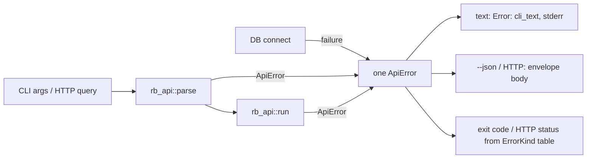

# M7f contract: the error contract and targets (stress batch E, part 1) (2026-10-13)

**Status:** contract written 2026-10-13; started. Branch `m7f-error-contract`, stacked on M7e (`be2d93d`). Batch E part 2 (honesty: F25, F30, F24) is M7g.

## Why

The stress campaign found these error-surface defects (repros `var/stress/repro/F4–F8,F14.sh`):

| Finding | What's wrong |
|---|---|
| F4 | Messages glue the parameter onto a non-predicate (`--repo no git repository found…`); positionals leak API names (`q is required`, `--from is required`); `--cols` errors say `--columns`. |
| F5 | `rb check` exits **1** on errors, which collides with "violations found"; its `--json` errors are plain text. |
| F6 | DB unreachable prints an anyhow Debug chain (`Caused by: 0: … 1: …`), exits 1, and gives no JSON envelope under `--json`. |
| F7 | `callers 'Db#load()'` is "nothing matches" while `rb find` resolves it to exactly one symbol. |
| F8 | Suggested commands aren't shell-quoted (`try \`rb find GET /x …\`` fails when pasted). |
| F14 | `rb cypher "MATCH (n) RETURN n"` fails with `agtype_value_to_text: unsupported argument agtype 6`. |
| obs. | `rb path` rejects `--json` (every other command takes it). |

## Error contract (after M7f)

| Kind | Exit | HTTP | New? |
|---|---|---|---|
| invalid_param | 2 | 400 | |
| not_found / no_live_snapshot / snapshot_not_retained | 3 | 404 / 404 / 410 | |
| ambiguous | 4 | 409 | |
| cypher / cypher_timeout | 5 | 422 | |
| **unavailable** (the database cannot be reached) | **6** | **503** | **new** |
| internal and server-only kinds | 1 | 5xx/4xx | |

- **`rb check`** keeps 0 (clean) and 1 (violations). **Every error exits 2**, as its help says, and errors go through the same envelope.

**Wording rules for `cli_text`:**
1. A flag parameter prints as its flag: `depth` → `--depth`, and `columns` → `--cols` (the CLI's name).
2. A positional prints as clap's usage name: `q` → `<TEXT>`, `endpoint`/`query` → `<QUERY>`, `target` → `<TARGET>`, `table` → `<TABLE>`, `name` → `<SERVICE>`, `from` → `<FROM>`, `to` → `<TO>`.
3. A detail is always a predicate. The repo directive reads `--repo is needed: no indexed repository matches this checkout ("x"); …`.

## Claims

| # | Claim | Where |
|---|---|---|
| S1 (F4) | The wording rules above; the `columns` → `--cols` mapping. | `rb-api/src/error.rs` `cli_text`; `rb-cli` repo directive messages |
| S2 (F6) | A failed DB connection is `unavailable`: a one-line cause and a hint (`is the database running? docker compose up -d`), the envelope under `--json`, exit 6; the server answers 503. No `Caused by:` chain reaches the user for it. | `rb-cli/src/main.rs` connect; `error.rs` kind |
| S3 (F5) | `rb check`: errors exit 2 and go through the envelope under `--json`; an unknown repo is `not_found`. | `rb-cli/src/main.rs` check |
| S4 (F7) | A target in symbol-key syntax (containing `#` or `(`) that resolves to nothing, but whose `find` rule (a case-insensitive substring of key or name) yields exactly **one** symbol, resolves to it; several give `ambiguous` with candidates; none stays `not_found`. Plain words are untouched (they already resolve by name, and a short word must not list half the graph). *Amended:* no `resolved_via` label; the answer already names the resolved symbol. | `rb-api` `pick_target` |
| S5 (F8) | Suggested commands quote their argument when it contains shell-special characters. | `rb-store`/`rb-api` messages |
| S6 (F14) | Cypher vertices, edges and paths render as their agtype text (JSON-like), not an internal error. | `rb-store` cypher |
| S7 (obs.) | `rb path --json` is accepted as `--format json`. | `rb-cli` |

## Verification

- Tests first per claim, with mutants.
- Goldens that pin old messages are re-blessed only after reading every hunk; each hunk must be one of the wording rules.
- Real-Docker suites: 0 failed, 0 skipped. Invariant against M7e: graphs are **byte-identical on all targets**, since this milestone changes no graph.
- The F4–F8 and F14 repro scripts are re-run and show the new behaviour.
- Records: CHANGELOG, IMPLEMENT, contract, todo, stress-findings, lessons (per the record-set lesson).

## Result (amendment 1, 2026-10-13)

- **Phases 1–4** are as in `tasks/todo.md`: 14 mutants killed (m73–m86). Four needed a stronger case first: m79 (exact cause), m81 (plain-fragment negative), m86 (a `1.0` scalar where `agtype_out` differs), and m85 (re-applied on the exact source text).
- **Phase 5:**
  - fmt and clippy clean; stub scan clean.
  - Real-Docker suites (`var/m7f/logs/p5-workspace.log`): 1,007 passed, 2 failed. Both failures were `rb-server` tests pinning the *incidental* kind of a request against an absent database (`500 internal`); S2 makes it `503 unavailable`. Their intents (queueing, transport limits) are unchanged, and both expectations were updated with a note. `rb-server` was re-run: 12/12. Total **1,009 passed, 0 failed, 0 skipped**.
  - No e2e or api golden pins a changed message: nothing re-blessed.
  - Invariant against M7e (`var/m7f/logs/invariant.txt`, sha256 `cb378626…`): **31/31 byte-identical**. No graph changed, as intended.
  - Repros (`var/m7f/logs/repros.txt`), re-run with the M7f binary:
    - F4: `--repo is needed: …`, `<FROM> is required`.
    - F5: `check` returns `unavailable`/`not_found` envelopes with exit 2.
    - F6: one-line `unavailable`, exit 6.
    - F7: `callers 'Db#load()'`, `'Db#load'` and `'load()'` resolve (exit 0).
    - F8: `try \`rb find 'GET /x' --kind endpoint\``.
    - F14: vertices, edges and paths render.
- **Residue:**
  - `RB_CYPHER_TIMEOUT_MS` errors still name `--timeout-ms` (the API cannot see where a value came from).
  - `find` with no matches still prints nothing (exit 0).
  - `service NAME --limit` is still refused.
  - Cypher writes are still refused with Postgres' read-only wording.
