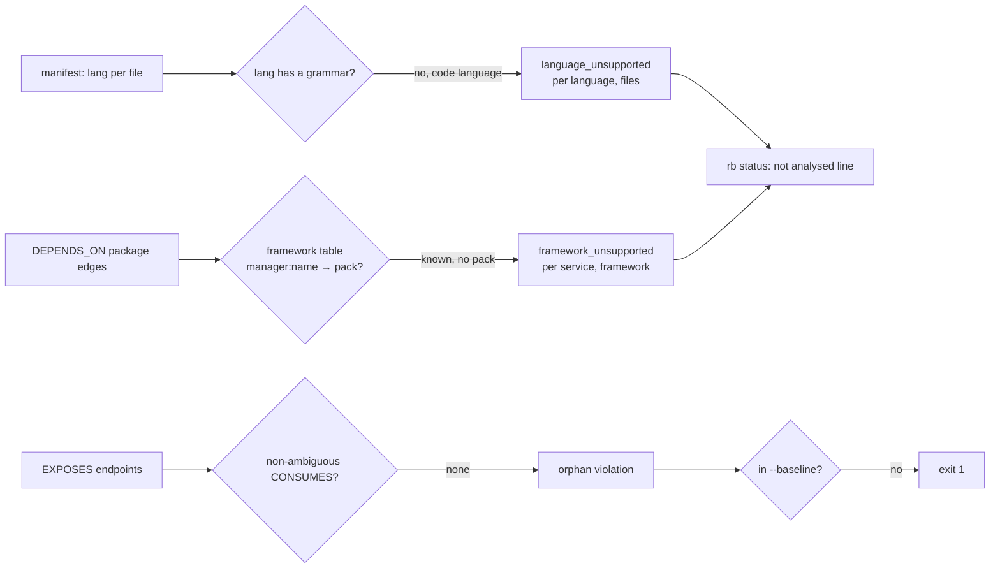

# M7g contract: honesty about what was not analysed (stress batch E, part 2) (2026-10-13)

**Status:** contract written 2026-10-13; implemented 2026-10-13 (amendment 1). Branch `m7g-honesty`, stacked on M7f (`83f720b`).

## Why

| Finding | What's wrong |
|---|---|
| F30 | Unsupported languages are silent zeros. laravel's 84 PHP files show as "other"; `rb status` says "code 0.0%… 0 routes" with no hint. |
| F25 | Frameworks without a pack (echo, flask, koa, routing-controllers, …) are indistinguishable from "this service has no routes". |
| F24 | `rb check orphan_endpoints` flags 12/12, 18/18, 13/14 and 44/50 endpoints on real repos, so it fails CI by default. Any `CONSUMES`, even an ambiguous one, clears an endpoint. |

## Design

**Trade-offs:**
- **F30, recognise more languages vs only count unknown extensions.** Adding `php`, `scala`, `swift`, `dart` and `elixir` to `language_for_path` changes the `lang` attribute of those `File` nodes and the service card's language counts. Those are the honest names, but laravel's dump changes. Counting unknown extensions instead would keep dumps byte-identical but still print "other". **Chosen:** recognise them. The change is limited to files of those languages and is classified at close.
- **F25, a framework table over `DEPENDS_ON` vs scanning imports.** Imports would catch frameworks with no manifest entry, but cost a facts scan per file. `DEPENDS_ON` already exists per service (npm, Maven, Gradle, Go, PyPI), so it's a table lookup, O(edges). **Chosen:** `DEPENDS_ON`. Frameworks reached only through an unread manifest (composer, csproj) stay silent: residue.
- **F24, rule semantics vs a baseline only.** A baseline alone hides the false positives. Requiring a non-ambiguous consumer also fixes the wrong-direction clearing. **Chosen:** both, plus a caveat line counting the client sites the gate cannot see.

**Numbers:**
- The framework table is about 15 entries; `DEPENDS_ON` is ≤ 330 edges on the measured repos, so negligible.
- Baseline file: one `rule<TAB>src<TAB>dst` line per accepted violation (mattermost has under 100).
- **NFR:** `rb check` stays within its Cypher timeout (2 s default). The new rule adds one `OPTIONAL MATCH` + `COUNT`, measured at close on mattermost.

## Claims

| # | Claim | Test |
|---|---|---|
| S1 (F30) | `language_for_path` recognises php, scala, swift, dart and elixir. Code files whose language has no grammar (rust, c, cpp, ruby and those five) are counted as one `language_unsupported {language, files}` per language. `rb status` prints `not analysed (no grammar): php 84 files`. | rb-git unit; indexer unit; CLI line unit |
| S2 (F25) | A service depending on a known framework without a pack gets `framework_unsupported {service, framework, package}`. The table covers echo, fiber, flask, django (views), koa, fastify, hapi, routing-controllers, nestjs (controllers), micronaut and quarkus. `rb status` lists them. | indexer unit; CLI line unit |
| S3 (F24) | `orphan_endpoints` requires a non-ambiguous `CONSUMES` (certainty above `ambiguous`), in both the Cypher rule and its relational twin, proven equal as before. `rb check --baseline FILE` ignores listed violations. `rb check` prints the client sites it cannot see (dynamic, unmatched). | check.rs twin/equality units; CLI baseline unit; e2e check goldens reviewed |

## Verification

- Tests first, with mutants.
- Real-Docker suites: 0 failed, 0 skipped.
- Invariant against M7f, every diff classified. Expected: laravel and any repo with php/scala/swift/dart/elixir files change `lang` attributes; graphs otherwise identical. New diagnostics appear (`language_unsupported`, `framework_unsupported`).
- Records: CHANGELOG, IMPLEMENT, contract, todo, stress-findings, lessons. `PIPELINE m7g-1`.

## Result (amendment 1, 2026-10-13)

- **Phases 1–3** are as in `tasks/todo.md`: mutants m87–m98 killed, except m93, which showed a dead PyPI arm (now deleted).
- **Phase 4:**
  - fmt and clippy clean; stub scan clean. `PIPELINE` `m7g-1`.
  - Real-Docker suites (`var/m7g/logs/p4-workspace.log`): 1,012 passed, 1 failed, 0 skipped. The failure was `check_gates` on the polyglot golden: billing's `POST /internal/mfa/email` has one consumer, `ambiguous` (2 candidates), so S3 now reports it as an orphan. That is the claim working as specified. The golden was re-blessed after reading the one-line hunk, and the test passes. Total **1,013 passed, 0 failed, 0 skipped**.
  - Invariant against M7f (`var/m7g/logs/invariant.txt`, sha256 `9bbcefa3…`): **27/31 byte-identical**. The 4 diffs, classified row by row:
    - express-typescript-boilerplate: + `framework_unsupported routing-controllers`.
    - go-clean-arch: + `framework_unsupported echo` (`github.com/labstack/echo/v4`, the `/vN` rule).
    - nestjs-realworld: + `framework_unsupported nestjs (controllers)`.
    - laravel-realworld: + `language_unsupported php 84`; its 84 `.php` `File` nodes gain `lang: php`. Nothing else changed, as predicted.
  - **`rb check` before and after** (M7f vs M7g binary, same graphs): orphan counts are unchanged on every measured repo (microservices-demo 8, spring-boot-microservices 13, fastapi 19, go-gin 18, mattermost 66, laravel, go-clean-arch and microblog 0). None of them has an endpoint whose only consumers are `ambiguous`, so S3's rule change shows only in the polyglot fixture. The note line now gives each repo its unlinked client sites (mattermost: 395, dynamic 122, unmatched 273).
  - **NFR:** `rb check` on mattermost takes 0.16 s (limit: 2 s).
- **F24 is partly fixed.** The rule is tightened, `--baseline` lets CI gate only new violations, and the note says what the rule cannot see. The real-repo false orphans the stress campaign read (gateway-routed calls, Thymeleaf pages, the webapp's JS) are still reported: residue for a coverage-gated rule.
- **Residue:**
  - Frameworks declared only in an unread manifest (composer, csproj) stay silent.
  - Kotlin and C# routes and clients, EF Core, gorm, TypeORM repository calls and SQLAlchemy queries are not read and not reported.
