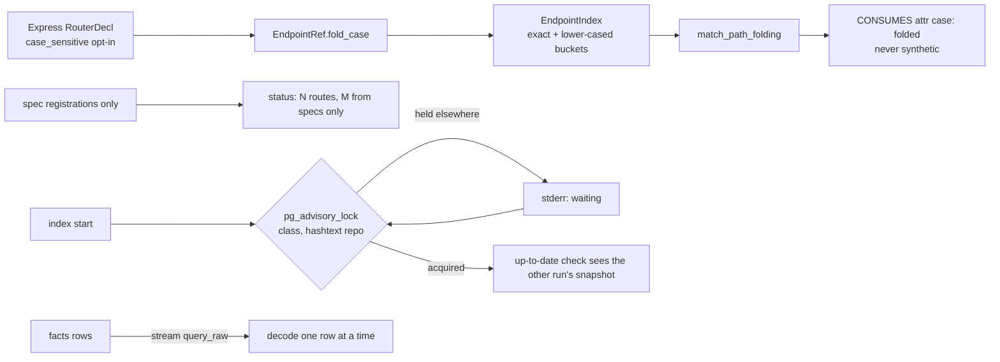

# M7i contract: precision and cost remainder (stress batch F, part 2) (2026-10-13)

**Status:** contract written 2026-10-13; implemented 2026-10-13 (amendment 1). Branch `m7i-precision-cost`, stacked on M7h (`735d3ae`). This is the last stress batch; an M7 close pass follows.

## Why

| Finding | What's wrong |
|---|---|
| F32 | Express matches paths case-insensitively by default, but stitching compares case-sensitively. bookcars calls `/api/Notifications/…` against `/api/notifications/…` (4 sites unmatched). |
| F31 | go-gin's "18 routes" include 3 that exist only in a stale swagger spec, and status doesn't say so. JSON spec spans are `[0,0,0,0]`. `callers v1.GetTags` says "(no callers found)" without saying it handles an endpoint. |
| O3 | Two concurrent `rb index` runs of one repository both do the full extraction and publish two snapshots. |
| U5 | `callers`/`impact` on a hub print 4,600–11,000 lines, and tests dominate them. |
| O4 | A cached `rb index` of mattermost peaks at 1.78 GiB against 1.55 GiB fresh (+15%). |
| O7 | One `unresolved_references` row per file (20,004 diagnostics on a 20k-file case). |

## Design

**Trade-offs:**
- **F32: fold at the router vs at the app.** Express decides case per router (`Router({ caseSensitive })`; the app's setting covers only the app's own router). **Chosen:** per registration router. A prefix matched by a parent with another setting is folded by the route's own router: residue, rare.
- **F32: reading the option's value.** A boolean literal reaches the facts as `Arg::Other` without its text. Reading it means an extractor change (`EXTRACTOR_VERSION`, so every cached fact is re-parsed). **Chosen:** any mention of the option keeps exact-case matching, which is today's behaviour, so the cost of not reading the value is only edges that are still missing, never false ones.
- **F31: "spec only" stored vs derived.** It is derivable at query time: frameworks `["openapi"]` and no `HANDLED_BY` edge. **Chosen:** derive it in the `http_coverage` query (no graph change).
- **O3: wait vs refuse.** A refusal makes CI scripts retry. Waiting turns the second run into "up to date" for free. **Chosen:** wait, with a stderr line. Hash collisions between names only make a run wait, never corrupt one.
- **U5: cut the walk vs cut the rows.** Cutting the walk would make the summary wrong. **Chosen:** walk as today (bounded by the `tree` cap), cut only the rows shown, and summarise everything found. Without `--limit` the output is byte-identical to M7h.
- **O7: aggregate vs keep.** Measured on mattermost: 7,669 of 8,350 diagnostics are `unresolved_references` rows, 6,695 of them with real unresolved calls or types. They are the only record of which files fail resolution. A row per file is linear and small (under 1 MB of rows on mattermost). **Chosen:** keep them; O7 is declined with these numbers.

**Numbers:**
- O4: mattermost's cached facts are about 300 MB of JSON (Go 239 MB, TS/JS 68 MB). Today they are held as query rows and a copied byte map while decoding. Streaming keeps one row at a time. Expected: the cached peak falls to or below the fresh peak (1.55 GiB). **NFR:** cached RSS ≤ fresh RSS + 5% on mattermost.
- O3: the lock is one `pg_advisory_lock` per run, so the cost is negligible.
- U5: summary computation is O(rows found) ≤ 5,000 (the `tree` cap).

## Claims

| # | Claim | Test |
|---|---|---|
| S1 (F32) | Express routers record a case-sensitive opt-in. An endpoint whose code registrations are all on folding Express routers matches client literals case-insensitively; such a `CONSUMES` says `case: folded` and is never `synthetic`. The candidate index agrees with a full scan over mixed-case literals. | frameworks units; routes unit; stitch units incl. the property test |
| S2 (F31) | `rb status` prints `http: N routes (M from specs only) in …` when M > 0. JSON specs give each operation the span of its path key. `callers` of a node that handles an endpoint names it after the target (`handles: GET /tags`), and an empty tree says its callers are HTTP clients (`rb path …`). JSON: `target_entry` on the callers answer only when non-empty. | store/CLI units; spec unit; render unit |
| S3 (O3) | `rb index` holds a per-repository session advisory lock from before its up-to-date check to its exit. A second run prints `waiting: another rb index of <repo> is running` and then proceeds (normally "up to date"). | store db test; e2e with a held lock |
| S4 (U5) | `callers` and `impact` take `--limit N` (1–5000) and `--exclude-tests`. With a limit that cuts: rows past N are not shown, `truncated` names `limit`, and the answer begins with a summary (callers found, per service, per entry kind). `--exclude-tests` leaves out callers in test files (and impacted nodes in test files from `breaks`/`affects`) and counts them. Without either flag, answers are byte-identical to M7h. CLI and HTTP agree. | store units; api parse units; api.rs parity sets |
| S5 (O4) | Cached facts are streamed and decoded a row at a time. | store db test (same facts); mattermost RSS before/after |
| S6 (O7) | Declined with the measurement above; no change. | — |

## Verification

- Tests first, with mutants.
- Real-Docker suites: 0 failed, 0 skipped.
- Invariant against M7h: changes only from S1 (new `CONSUMES` with `case: folded`, and buckets moving from unmatched) and S2 (JSON spec spans). Every diff is classified.
- bookcars: the 4 `/api/Notifications` sites link. go-gin: `rb status` shows the spec-only count.
- mattermost: a cached index's RSS before and after.
- Records: CHANGELOG, IMPLEMENT, contract, todo, stress-findings, lessons; README and usage guide.

## Result (amendment 1, 2026-10-13)

- **Phases 1–4** are as in `tasks/todo.md`. Mutants m123–m143 killed. Several needed a stronger test first:
  - m131 and m132: JSON key spans. The test now has decoys both inside and outside `paths`.
  - m133: the spec-only count. With one stale and one implemented endpoint, the count was the same under `EXISTS` and `NOT EXISTS`; the test now has two stale ones.
  - m142 and m143: `--limit` through the request layer. The parity test cannot see it, since both sides change together; an e2e assertion was added.
- **Phase 1 order:** S1 was implemented before this contract was written (the plan was otherwise followed). The contract records it as built.
- **Amendments:**
  - **S4, JSON:** following D4 (the normalised query fills every default), `callers` and `impact` envelopes now echo `"limit": null` and `"exclude_tests": false`. The contract's "byte-identical without the flags" holds for text only. Two JSON goldens gained those lines.
  - **S4, impact:** `impact` takes `--limit` but not `--exclude-tests`. Impact already lists tests in their own section, and filtering them out of `breaks`/`affects` would desynchronise the service and owner roll-ups.
  - **S2:** a handler's own endpoint is named in the callers header. One golden changed: `UserController#listUsers()` gains `(entry: endpoint GET /users)`.
- **Phase 5:**
  - fmt and clippy clean.
  - Real-Docker suites (`var/m7i/logs/p5-workspace.log`): 1,037 passed, 4 failed, 0 skipped. Three were the golden hunks above, each read and re-blessed. The fourth was the parity harness, which maps boolean parameters to bare flags and did not list `exclude_tests`; it was added. After the fixes the total is **1,041 passed, 0 failed, 0 skipped**.
  - Invariant against M7h (`var/m7i/logs/invariant.txt`, sha256 `cebfdc60…`): **29/31 byte-identical**. Both diffs were classified:
    - **bookcars:** +4 `CONSUMES` with `case: folded`, for the 4 `NotificationService` sites the stress campaign named (`/api/Notifications/…` → `/api/notifications/…`), and 4 `http_unmatched` removed; `http_coverage` moved by those 4.
    - **go-gin-example:** spans only. 12 `EXPOSES` evidence spans and 5 `spec_operation_unhandled` spans across `docs/swagger.json` and `docs/swagger/swagger.json` now name the path key, not `[0,0,0,0]`. With spans normalised the dumps are identical.
  - `rb status` on go-gin: `http: 18 routes (3 from specs only) in 1 services; …`.
  - **O4 on mattermost** (`var/m7i/logs/o4.txt`):

    | Run | Peak RSS |
    |---|---|
    | M7h cached | 2,148 / 2,188 MiB |
    | M7i cached | 1,658 / 1,653 MiB |
    | M7i fresh | 1,946 MiB |

    A cached run is now below a fresh one (NFR met). Recorded, not caused here: the fresh peak has drifted from M5's 1.55 GiB to 1.9 GiB.
- **O7** declined, as designed.
- `PIPELINE` `m7i-1` (graphs change: folded `CONSUMES`, JSON spec spans), so existing snapshots rebuild once.
- **Residue:**
  - The value of an Express `caseSensitive` option is not read (any mention keeps exact case).
  - A prefix matched by a parent router with another case setting is folded by the route's own router.
  - The fresh-index RSS drift since M5.

## Amendment 2 (2026-10-13, after evaluator pass 1)

- **S2:** the callers header names the target's entry marks, whatever they are (`test`, `main`, `endpoint …`), not only a handled endpoint. Showing them is deliberate, and the M7i contract's narrower wording is corrected here.
- **Residue:** Cypher refusals are classified partly by the server's English messages (`permission denied for …`, the column-list mismatch). A server with another `lc_messages` turns them back into plain `cypher:` refusals. That is still correct, only less specific.
- **Fixes after evaluator pass 1** are in M7j (`tasks/contract-m7j.md`): `case: folded` per candidate, the certainty histogram after `--limit`, JSON spans in one pass.

