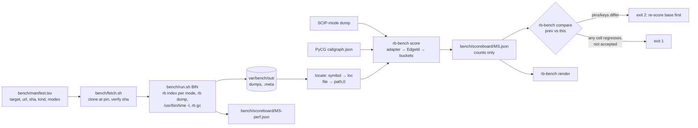

# M8a contract: an accuracy benchmark with answer keys, part 1 (2026-10-13)

**Status:** contract written 2026-10-13; started 2026-10-13. Branch `m8` (every M8 step commits there), from `main` at `eabfc80` (the merged M7 close, tree identical to `e08efcb`). **Part 2 (M8b)** takes microSecEnD, the blind hand keys and the `exact` sample. Its planned claims are at the end of this file.

## Why

| Gap | What's wrong today |
|---|---|
| No recall | Guards and samples check edges we already know about. Nothing says what share of real `CALLS`, endpoints, table accesses or service links rb finds. |
| Unchecked labels | `exact` is documented as "only from SCIP", but SQL, ORM, route and manifest producers also emit it. No measurement says how often an edge labelled `exact`, `heuristic` or `ambiguous` is right. |
| Lost tooling | Every measurement script lives in gitignored `var/`, and the usage guide already cites one that no longer exists. Numbers in contracts can't be re-run from a clean checkout. |
| No gate | The invariant shows *that* a graph changed, not whether it got better or worse. |

**What M8a can and cannot claim.**
- The only independent key in M8a is PyCG (Python `CALLS`).
- The SCIP reference measures how far Tier B agrees with Tier A, and only on call sites rb's parser already finds (`scip.rs:507`). It is not accuracy, and it cannot reveal missed sites.
- Endpoints, table access, service flows and `exact` precision get independent keys in M8b. Until then the scoreboard shows those classes as `no key`, not as a number.

## Requirements

- **Functional:**
  - `bench/run.sh BIN` indexes the pinned targets, and `rb-bench score` scores them against pinned keys. It reports per benchmark, target, mode (`noscip`/`scip`), edge class and certainty label, plus time and memory.
  - The scoreboard is committed at every milestone close.
  - `rb-bench compare` fails on a regression.
- **NFR 1, determinism.** One binary on one set of pins and keys gives a byte-identical accuracy scoreboard. Timing goes in a separate file.
- **NFR 2, cost.** A warm full run finishes in ≤ 20 min on the hardware of record (M5 D14). Scoring alone takes ≤ 30 s.
- **NFR 3, no silent exclusions.** Every gold item and every found edge lands in exactly one bucket. Gold goes to `tp`, `fn`, `out_of_scope{reason}` or `unmatchable{reason}`. Found edges go to `tp`, `fp`, `found_out_of_scope{reason}` or `found_unmatchable{reason}`. Zero in-scope gold gives `vacuous`. In-scope gold above zero with nothing found gives `precision 0, flagged` (lessons L429, L489).
- **NFR 4, re-runnable.** Everything needed to re-run is committed outside `var/`. External datasets are fetched at a pinned SHA and never vendored.

## Design



**Identity.** A SCIP key, an `rb-heuristic` key and `main.A.func` all name the same function differently, so keys can't be compared. Every endpoint of an edge is reduced to a **location identity**:
- A **symbol** becomes `(path, 1-based line of the name token, simple name)`, taken from its lowest `DEFINED_IN` evidence span. The other sites of a merged declaration are aliases.
- A **file** becomes `(path, 0, "<file>")`.

An edge's identity (`EdgeId`) is `(src loc, class, dst loc)`. Several dump rows with one `EdgeId` (one per provenance) collapse to one found edge. It keeps the highest certainty and records every provenance.

**Edge classes:**
- In M8a: `calls` (`CALLS` from a symbol) and `calls_file_scope` (`CALLS` from a file), scored separately.
- Defined now, keyed in M8b: `endpoints`, `handler_binding`, `table_queries`, `table_maps` and `service_flows`.

**Answer keys in M8a:**

| Key | Targets | Classes | Independence | Rows labelled |
|---|---|---|---|---|
| SCIP reference: `scip`-provenance `CALLS` from the same commit indexed with SCIP | stress repos with ≥ 1 SCIP-covered file | `calls`, `calls_file_scope` | Low: rb's own join, rb's own sites | `agreement` |
| PyCG micro-benchmark | every case at the pin (about 112, counted at fetch) | `calls` (Python) | High | `accuracy` |

**Trade-offs:**
- **Scorer as a Rust crate (`crates/rb-bench`) or a Python script.**
  - Python is quicker to write. But scripts in `var/` sit outside fmt, clippy, tests and mutants, and one is already lost.
  - A crate shares `EdgeKind` and `Certainty` with rb-model, so a new label can't drift silently. The dump reader needs only `serde_json`, which is already a workspace dependency.
  - **Chosen:** the crate. Shelling out to `rb`, `git` and `/usr/bin/time` stays in committed zsh.
- **Location identity or key identity.**
  - Keys differ by mode and are absent from external answer keys.
  - Location costs collisions when a name appears twice on one line. The goldens have none; any that do occur are counted as `unmatchable{location_collision}`, never merged.
  - **Chosen:** location identity.
- **Store counts or ratios.** Micro-averaging and the per-cell gate need `tp/fp/fn`, which can't be recovered from ratios.
  - **Chosen:** counts only; metrics are derived in `render` and `compare`.
- **SCIP as a reference.**
  - It costs nothing extra and gives thousands of edges per repo at the same pins.
  - But it shares rb's join and only covers rb's own sites.
  - **Chosen:** use it, labelled `agreement`, never `accuracy`.
- **Per-cell gate or an aggregate tolerance.**
  - Scores are deterministic, so any change is real. A 1 pp aggregate tolerance would hide one PyCG case collapsing, or SCIP coverage shrinking the gold.
  - **Chosen:** a per-cell gate on count movements in the bad direction, plus an accept file. The aggregate figures are printed for reading only.
  - Timing is noisy on a shared host (L293), so it only warns.

**Numbers (back of the envelope):**
- **Index runs per M8a pass:** 13 stress repos `noscip`, about 8 SCIP-covered repos in `scip`, and about 112 PyCG cases `noscip`. That is about 133 runs.
- **Warm wall time:**
  - Stress `noscip`: mattermost 29 s + 12 repos × about 3 s ≈ 65 s.
  - SCIP cached: 8 × about 30 s (M5: 24–50 s) ≈ 4 min.
  - PyCG: 112 × about 1.5 s (index, publish, AGE graph, dump) ≈ 3 min.
  - `rb gc` ≈ 1 min.
  - **≈ 9 min against the 20 min NFR.** The cold first run is dominated by SCIP fetch and build (M5: up to 10 min a repo), about 60–90 min, once.
- **Scoring cost:** mattermost is about 235 k dump rows × about 200 B ≈ 47 MB. At ≥ 200 MB/s for `serde_json` that is ≈ 0.25 s; all targets together come to under 5 s.
- **Scoreboard size:** about 133 targets × 2 classes × 2 modes, each cell with about 5 certainty counts, ≈ 1 k cells × about 120 B ≈ 120 KB per milestone.
- **Disk:**
  - Stress clones are about 1.1 GB and exist already; PyCG is under 5 MB.
  - SCIP caches are about 1 GiB per Java or TypeScript repo.
  - `run.sh` refuses to run under 6 GiB free.

## Core algorithm (LLD)

```
locate(dump) -> Map<NodeKey, Loc>        # symbol: lowest DEFINED_IN span → (path, l0+1, name); file: (path, 0, "<file>")
found(dump, class) -> Map<EdgeId, Found> # rows with equal EdgeId merge: max certainty, all provenances, all sites

score(gold: Set<EdgeId>, found: Map<EdgeId,Found>, scope) -> Cell
  for g in gold:
    match scope.classify(g):
      OutOfScope(r)  -> out_of_scope[r] += 1
      Unmatchable(r) -> unmatchable[r] += 1
      InScope        -> if g in found { tp[found[g].certainty] += 1 } else { fn += 1 }
  for (f, x) in found:
    match scope.classify(f):
      OutOfScope(r)  -> found_out_of_scope[r] += 1
      Unmatchable(r) -> found_unmatchable[r] += 1
      InScope        -> if f not in gold { fp[x.certainty] += 1 }   # tp already counted
  for site in call_sites(found where certainty == ambiguous):        # per evidence path:line
    ambiguous_sites += 1; if any(candidate in gold) { ambiguous_hits += 1 }
  assert Σgold buckets == |gold| and Σfound buckets == |found|
```

**The scope for each key:**
- **SCIP reference:** a source file is *covered* when its symbols carry `scip-` keys in the SCIP dump. This is derived, not stored. Gold and found outside covered files are `out_of_scope{not_covered}`. The covered-file share is a field of each cell.
- **PyCG:**
  - Callees outside the case are `out_of_scope{builtin|external}`.
  - Gold whose source is the module (`main`, or `pkg` for `pkg/__init__.py`) is `out_of_scope{module_scope}`. Heuristic rb emits no file-sourced `CALLS`, and this count is printed next to recall.
  - `<lambdaN>` nodes are `out_of_scope{lambda}`.

**PyCG name mapping:**
- Strip the `rb-heuristic . . . ` prefix.
- The path becomes dotted, without `.py`; `pkg/__init__.py` becomes `pkg`.
- `#` and `().` descriptors chain with `.`: `` `a/b.py`/C#f(). `` → `a.b.C.f` and `` `a/b.py`/check().helper(). `` → `a.b.check.helper`. Nested classes are `#`-chains.
- Keys that differ only by `(+n)` collapse to one name with the union of their edges.
- Constructors already line up: a class call resolves to `__init__` (`resolve.rs:1248`).

**Scoreboard schema (v1):**
```json
{"schema":1,"milestone":"m8a",
 "rb":{"commit":"<sha>","binary_sha256":"<sha256>"},
 "pins":{"pycg":"<sha>","targets":{"<name>":"<sha>"}},
 "keys":{"<key file path or 'scip:<target>'>":"<sha256>"},
 "cells":[{"bench":"pycg","target":"classes/base_class_calls_child","mode":"noscip","class":"calls",
   "label":"accuracy","gold":6,"tp":{"heuristic":3},"fn":1,"fp":{"ambiguous":1},
   "out_of_scope":{"module_scope":2},"unmatchable":{},"found_out_of_scope":{},"found_unmatchable":{},
   "ambiguous_sites":1,"ambiguous_hits":1,"covered_share":null}]}
```
Cells are sorted; keys are written sorted; there are no timestamps.

## Decisions

- **D1.** The benchmark measures; it does not fix. Findings go to a new `tasks/bench-findings.md`, shaped like `stress-findings.md`.
- **D2. The gate.** `rb-bench compare BASE HEAD [--accept FILE]`:
  - **exit 2** on an unreadable or mismatched schema, or when `pins` or `keys` differ. Changed keys mean the base binary is re-scored against the new keys first, so the two sides compare like with like.
  - **exit 1** when, in any cell not listed in the accept file, any of these happens:
    - `tp` falls;
    - any `fp`, `fn`, `out_of_scope`, `unmatchable`, `found_out_of_scope` or `found_unmatchable` count rises;
    - `gold` falls;
    - `covered_share` falls;
    - `ambiguous_hits / ambiguous_sites` falls;
    - a target or cell disappears, or turns `vacuous` or flagged.
  - **Any rise in `fp` at certainty `exact` is never acceptable** through the accept file.
  - Aggregate precision and recall (micro-averaged per benchmark × class × mode) are printed for reading only.
  - **Perf** (`-perf.json`) only warns: fresh wall time above 1.25× or peak RSS above 1.15× the previous run on the same hardware.
  - **Accept lines** read `milestone<TAB>cell<TAB>reason`. Only lines carrying the current milestone count; older ones are reported as stale.
- **D3.** `bench/` replaces the gitignored `var/m5` and `var/stress` scripts as the source of truth. The timing in `bench_index.sh` (`/usr/bin/time -l`, load at start and end, disk guard, binary sha256) and the pin check in `real_one.sh` are ported, not reinvented.

## Claims

| # | Claim | Test |
|---|---|---|
| S1 | `rb-bench` reads dump v2 and rejects another header version with a typed error. `locate` gives each symbol its lowest `DEFINED_IN` span as `(path, line+1, name)`, with the other sites as aliases, and gives each file `(path, 0, "<file>")`. Symbols without `DEFINED_IN`, and same-line same-name collisions, are `unmatchable{…}`. Rows with one `EdgeId` merge into the maximum certainty plus every provenance. | units on hand-written dump lines (a merged declaration, a two-provenance edge, a file source); mutants |
| S2 | `score` places every gold item and every found edge in exactly one bucket (NFR 3). Bucket sums equal `\|gold\|` and `\|found\|`, asserted at runtime and by a property test over random sets. Zero in-scope gold gives `vacuous`; zero found against non-zero gold gives `precision 0, flagged`. | units; property test; a mutant per bucket arm |
| S3 | Ambiguous edges are scored per call site (a hit when any candidate is gold) and per edge, separately. | units |
| S4 | **SCIP agreement.** For each stress target, the `scip`-mode `CALLS` edges with provenance `scip` in covered files form the reference, split into `calls` and `calls_file_scope`. The `noscip` run is scored within covered files only. Cells carry `covered_share` and are labelled `agreement`, and the SCIP job outcomes are recorded. A target with 0 covered files is `vacuous`, with the job's failure reason. | units on two hand-written dumps (SCIP and heuristic keys at the same locations, plus one file-sourced call); real run on ≥ 1 Java, 1 TS, 1 Go and 1 Python repo |
| S5 | **PyCG.** The cases are fetched at a pinned SHA, and their number is asserted equal to the case directories at the pin. Each case is copied into a git work tree with a fixed author and date (as `invariant.sh` does), indexed with `--no-scip` and dumped. Names map by the rule above. The scope rules above apply, and `module_scope`'s count is printed beside recall. | adapter units on 3 real cases' JSON (incl. a nested function, `__init__`, a package `__init__.py`); real run on all cases |
| S6 | **Certainty table (M8a part).** `rb-bench render --certainty` prints, per label, precision with n and source key: `heuristic` and `ambiguous` (as site hit rate) from PyCG, and their `agreement` rate from SCIP. `exact`, `synthetic` and the non-call classes show `no key (M8b)`; `dispatch` shows `n/a (not stored)`. | render golden |
| S7 | **Run.** `bench/run.sh BIN [--targets …]` sets its full environment at the top (L557) and refuses under 6 GiB free. It verifies each clone's SHA, records the binary's sha256, load and free disk in each `.meta`, and times fresh and cached `noscip` runs per stress target with `/usr/bin/time -l` (mattermost is the M5 continuity row). It removes its `bench_*` repos with `rb gc`, and is started detached (`nohup … & disown`, L281). | real full run; `--targets` dry run in the verification loop |
| S8 | **Scoreboard.** `rb-bench score` writes `bench/scoreboard/<ms>.json` (deterministic) and `<ms>-perf.json`. It asserts before writing that each benchmark has ≥ 1 non-vacuous cell per class it claims. Two runs of one binary give `cmp`-identical accuracy files. | real double run, `cmp` |
| S9 | **Gate.** `rb-bench compare` implements D2. | units: a `tp` drop fails; an `out_of_scope` rise fails; `covered_share` falling fails; an accepted cell passes; an exact-`fp` rise fails even when accepted; a stale accept line is reported; differing pins exit 2; a vanished target fails; perf only warns. Mutants on each condition. |
| S10 | **First scoreboard.** `bench/scoreboard/m8a.json` is committed for the closed M7 binary. Its `render` and `render --certainty` output is pasted into this contract's Result. Every PyCG case with recall < 50 % and every SCIP agreement cell under 80 % goes into `tasks/bench-findings.md` with its top miss forms. | Result section; findings file |
| S11 | **Docs.** `docs/usage-and-testing.md` gains an "Accuracy benchmark" section (fetch, run, score, compare, accept, classify). The verification template for future contracts gains: "Scoreboard against the previous close: `rb-bench compare` exit 0, or every accepted cell classified." The README's "exact only from SCIP" names every producer that assigns `exact`. | evaluator pass |

## Loop

- **Roles**, each in its own context:
  - **Planner:** this contract, which changes only by numbered amendments.
  - **Generator:** one phase at a time.
  - **Evaluator:** a fresh agent per phase, told the phase is broken. It writes `tasks/eval-m8a-pass<N>.md`. No role grades its own output.
- **State on disk:** this contract, the `tasks/todo.md` checklist, the scoreboards and `bench-findings.md`. A crashed session resumes from these alone.
- **Restart rule:** if an adapter leaves > 10 % of a key's gold `unmatchable`, stop. Amend the mapping rule, then delete the adapter and rewrite it; don't patch.

## Phases (≤ 5 source files each; verify, then pause)

1. **Core (S1–S3):** `crates/rb-bench/{Cargo.toml, src/lib.rs, src/dump.rs, src/score.rs}`. Tests first; mutants from the next free number.
2. **Scoreboard, render, gate (S6 render, S8 writing, S9):** `src/{scoreboard.rs, compare.rs, main.rs}`.
3. **Orchestration (S7):** `bench/{manifest.tsv, fetch.sh, run.sh}`, with stress pins from `var/stress/repos.tsv` plus mattermost.
4. **SCIP agreement (S4):** `src/adapters/scip_ref.rs`; real run.
5. **PyCG (S5):** `src/adapters/pycg.rs`; manifest rows; real run.
6. **Close (S8, S10, S11):**
   - Double run and `cmp`; render; findings; docs.
   - fmt and clippy; real-Docker suites; invariant against the M7 close (expected 31/31 byte-identical, since no indexer change).
   - Records, plus the M8b contract, written from the plan below.

## Verification

- Tests first, with mutants. A surviving mutant is a test bug until proven otherwise (L349).
- `cargo fmt --all --check`; `cargo clippy --workspace --all-targets -- -D warnings`; `RB_TEST_DATABASE_URL=postgresql://rb:rb@127.0.0.1:55433/rb cargo test --workspace --no-fail-fast -- --test-threads=1`.
  - Real-Docker suites: 0 failed, 0 skipped.
  - The global CLAUDE.md's `tsc` and `eslint` don't apply: this is a Rust workspace.
- Invariant against the M7 close: 31/31 byte-identical.
- Determinism: two full runs give `cmp`-identical accuracy scoreboards.
- Gate self-test:
  - `compare m8a.json m8a.json` exits 0.
  - A copy with one `exact` `fp` added exits 1, even when that cell is accepted.
  - A copy with a changed pin exits 2.
- Numbers in the Result come from `rb-bench render` output, never typed by hand (L3).
- Records: CHANGELOG, IMPLEMENT, contract, todo, `bench-findings.md` (new), lessons, README, usage guide. `PIPELINE m8a-1`.

## Part 2 plan (M8b; its own contract at M8a close)

| # | Planned claim |
|---|---|
| B1 | **microSecEnD.** The license is read and recorded before anything is fetched.<br>**Pins:** for each app, the last upstream commit at or before the date of the microSecEnD commit that added its model. An evidence item resolves when its file exists and the text at `line` contains the traceability `span`; an app is kept when ≥ 90 % of its items resolve, and otherwise excluded with its rate.<br>**Service mapping:** a model service maps to an rb service through its evidence file and `IN_SERVICE`, never by name.<br>**Infrastructural flows:** decided by a fixed stereotype list (gateway, service_discovery, configuration_server, message_broker, logging, monitoring) and counted `not_modelled`. Message-broker flows are `not_modelled` too, as are databases and external entities.<br>**Scored:** flows between internal services against `service_flows`, derived as `CONSUMES` source (a symbol through `DEFINED_IN`, or a file) → `IN_SERVICE`, then the endpoint's `@service`. `Endpoints` tagged values are scored against `endpoints`, normalised. |
| B2 | **Endpoint normalisation:**<br>- method uppercase, or `ANY` when absent;<br>- path parameters (`{x}`, `:x`, `<x>`) become `{}`;<br>- trailing `/` dropped, and duplicate `/` collapsed;<br>- the full effective path, including router, class and context prefixes. |
| B3 | **Hand keys, blind**, for 3 repos: one stress repo (dev set) plus two repos rb has never been run on. The new repos are chosen by rule (a Spring JPA, FastAPI raw SQL or Go `database/sql` stack with 20–150 endpoints plus tables) and pinned before rb ever runs on them.<br>**Line format:**<br>`ENDPOINT <METHOD> <full path> <file>:<handler name line \| handler start line if anonymous>`<br>`QUERIES <table> <ops> <file>:<line of the function holding the call site, 0 = file scope>`<br>`MAPS <table> <file>:<entity class line>`<br>Tables are compared by name; the schema counts only when it is written in the source. Endpoint existence and `handler_binding` are separate classes. |
| B4 | **Labelling process.**<br>- The labeller runs with only the pinned clone and the format; it has no access to `newide`, `tasks/` or `var/`.<br>- The adjudicator sees "A vs B" without knowing which side is rb, and also reviews a random 20 % of the agreements.<br>- The score before adjudication is reported alongside the final one.<br>- Transcripts and `adjudication.md` (append-only) are committed under `bench/keys/<target>/`.<br>- A key line changes only through an adjudication entry. |
| B5 | **`exact` sample.**<br>- 60 edges per producer family (`scip`, `sql_literal`/`sql_file`, `orm`, routes), pooled across the stress repos and stratified by repo, drawn by the M3b rule.<br>- An evaluator told each edge is false must prove it true with file:line.<br>- Verdicts go in `bench/samples/exact.tsv`, keyed by `EdgeId` and pin. Each binary redraws the sample and reuses verdicts for edges still present, and `compare` fails while any verdict is missing.<br>- Precision is reported with a Wilson 95 % interval: 0 errors in 60 bounds the error rate at about 5 % (the rule of three). M8b does not claim ≥ 99 %, which would need n ≈ 300. |
| B6 | **Certainty table complete:** `exact` comes from B3 and B5; `synthetic` and `heuristic` from B1 and B3 as well. |

## Residue (not in M8a or M8b)

- Judge (Java features), SWARM-CG, the SCAM 2018 JS set, and `golang.org/x/tools/cmd/callgraph` as an independent Go key. Each is a new adapter on the same identity and score core. Until one lands, Java, TS and Go `calls` have no independent key.
- PyCG in `scip` mode.
- Datastore nodes: rb models none, so microSecEnD databases stay `not_modelled`.
- A CI job: the bench needs Docker, network and minutes, so it runs at milestone close.

## Amendments

**Amendment 1 (2026-10-13, after evaluator pass 1, `tasks/eval-m8a-pass1.md`).**
- **Tier B emits file-sourced `CALLS`** (`resolve.rs:38-41`; mattermost `noscip` has 3,188, bookcars 245). The Identity paragraph's "Heuristic mode never does" was wrong. So PyCG gold whose source is the module (`main`, `pkg` for `pkg/__init__.py`) is **scored** in `calls_file_scope`, from `Loc::file(<module path>)`, not put `out_of_scope{module_scope}`. S5's scope rule changes accordingly.
- **Ambiguous sites (S3).** A site is one source and evidence span where some `ambiguous` edge was found; its candidates are every in-scope edge found there, of any merged certainty. rb keeps an edge's highest certainty, so a candidate that is also resolved at another site is no longer `ambiguous` itself. Without that rule, the evaluator's repro scored 0/1 instead of 1/1.
- **Aliases (S1)** are kept: `Locator::canonical` maps a merged declaration's other sites to its location. Collisions are checked over every site. A negative span is `unmatchable{negative_span}`, never line 0. `CALLS` from any non-file kind is `calls` with `unmatchable{not_locatable}`.
- **Schema (v1) as built:** `pins` is one flat map (dataset or target name to commit), and `covered` is `{files, of}` or null (counts, not a ratio). Fields are written in a fixed order; maps and cells are sorted.
- **Clean-up (S7):** rb has no command that deletes a repository, and `rb gc` removes only orphaned graphs. `bench/cleanup.sh` (ported from `var/m5/scripts/cleanup.sh`, restricted to `bench\_%`) deletes the `bench_*` repositories, then `rb gc --prefix bench_` runs.
- **PyCG at the pin has 119 cases** (the paper's 112 was an estimate; S5 asserts the count at fetch). Its license is Apache-2.0 (`LICENCE`).
- **Phase 2 split** into 2a (scoreboard, compare) and 2b (render, CLI), for the 5-files-per-batch rule.

**Amendment 2 (2026-10-13, phases 3–5).**
- **`keys` holds only fixed answer keys** (PyCG: `pycg:callgraph.json`, the sha256 over every case's path and `callgraph.json`). A SCIP reference is produced by the binary under test, so naming it a key would make `compare` refuse (exit 2) every SCIP-affecting change. It is guarded per cell by `gold` and `covered` instead (D2).
- **SCIP scope** requires the source *and* target files to be covered: SCIP never yields an edge into an uncovered file, so a Tier B edge there would count as a false disagreement. Each target's notes list every SCIP job's outcome from `rb status` (S4's "failure reason").
- **The PyCG caller rule** (from a probe of three real cases): rb gives a module-level assignment (`a = A()`) its own term symbol and sources its calls there. So a caller is the longest prefix of its key's chain that ends in a callable, and with none, the module's file scope. Lambdas, builtins, modules called as callees and callees outside the case are `out_of_scope` by name. A PyCG name with no rb symbol of that name is `unmatchable{no_rb_symbol}`, an rb miss that the key cannot locate independently.
- **Claims (S8)** are derived from the manifest (SCIP mode present gives `scip/calls`; a PyCG row gives both PyCG classes), and `perf` reads only the manifest's targets.
- **`bench/run.sh`** checks the 6 GiB floor before every run, not only at start, and runs from a copy of itself (lesson 2026-10-13).
- **Mutant m193** showed the root-package guard in the PyCG in-case test was dead (a callee never starts with the empty module's `.` prefix), so it was deleted.


## Result (amendments 3–4, 2026-10-13)

**Status:**
- **Met:** S1–S3 and S5–S11.
- **S4 is narrowed by amendment 4 to Go and TS:**
  - Agreement is measured for go_gin_example, go_clean_arch, mattermost and microservices_demo (Go) and bookcars, express_ts_boilerplate and mattermost (TS).
  - The Java, Kotlin and Python repos ran, but their SCIP jobs failed or do not exist, so their cells are `vacuous` with the reason in the notes (B4).
  - Python accuracy rests on PyCG.
- **Evaluator pass 2** (`tasks/eval-m8a-pass2.md`): FAIL, 2 blocking and 6 should-fix; all were answered in amendment 4.
- **The scoreboard:** `bench/scoreboard/m8a.json` (sha256 `df174337…`, 260 cells), scored for the M7 close binary (`e08efcb`, `var/m7j/bin/rb`, sha256 `a038653b…`) from run 4 with `m8a-perf.json` beside it. Both tables are pasted from `rb-bench render` output.

Scoreboard m8a (rb e08efcb801c28422afab450251ee0ba093cd57f3, binary a038653b8478887f32088d8682ff445064ef1cd655e5718cdb755c9a48acc303)

| Bench | Class | Mode | Label | Targets (scored / flagged / vacuous) | Gold | In scope | TP | FP | FN | Precision | Recall | Out of scope | Unmatchable |
|---|---|---|---|---|---|---|---|---|---|---|---|---|---|
| pycg | calls | noscip | accuracy | 9 / 22 / 88 | 60 | 48 | 12 | 1 | 36 | 92.3% | 25.0% | builtin 4, external 2, lambda 6 | – |
| pycg | calls_file_scope | noscip | accuracy | 75 / 30 / 14 | 204 | 186 | 94 | 1 | 92 | 98.9% | 50.5% | builtin 5, external 10, lambda 3 | – |
| scip | calls | noscip | agreement | 6 / 0 / 5 | 35660 | 35657 | 17734 | 6147 | 17923 | 74.3% | 49.7% | not_covered 3 | – |
| scip | calls_file_scope | noscip | agreement | 3 / 0 / 8 | 1371 | 386 | 373 | 1 | 13 | 99.7% | 96.6% | not_covered 985 | – |

No key yet (M8b): endpoints, handler_binding, table_queries, table_maps, service_flows.

| Label | Accuracy (independent keys) | Agreement (SCIP) |
|---|---|---|
| exact | no key (M8b) | no edges |
| dispatch | n/a (not stored) | n/a (not stored) |
| synthetic | no key (M8b) | no edges |
| heuristic | 99.1% of 106 edges | 74.7% of 24179 edges |
| ambiguous | site hit 100.0% of 1 sites; 50.0% of 2 edges | site hit 100.0% of 71 sites; 75.0% of 76 edges |

- **Reading the tables:**
  - **PyCG** is the only independent key. Tier B's call edges are rarely wrong (precision 92–99 %), but it finds a quarter of function-to-function calls and half of module-level calls. Most misses need data flow (`tasks/bench-findings.md` B5).
  - **SCIP agreement** is dominated by mattermost: 33,312 of the 35,660 reference edges.
  - **Mattermost's disagreements are a reference gap.** 6,108 of its 6,147 "disagreements" (99.4 %) are calls from `server/` into the separate Go module `server/public/`. The SCIP join never links those (B1, a real SCIP-mode recall loss), and none of its 17,157 misses crosses that boundary.
  - **Off mattermost,** Tier B has **0** edges SCIP lacks and finds 62–94 % of SCIP's (B2, B3).
  - **Coverage gaps:** 6 of the 11 SCIP targets are vacuous (B4).
- **S1–S3, core:**
  - **Reader:** every N and E row of every golden dump round-trips. Pass 1 also round-tripped 58 dumps, including 31 invariant dumps; mattermost parses in 177 ms.
  - **Locator:** 0 `no_defined_in` and 0 `unknown_node` on every golden and real dump. mattermost has 6 `location_collision` symbols (a minified bundle), so 3 of its `CALLS` are unmatchable.
  - **Aliases:** a merged declaration's other sites are aliases. Since amendment 4 they are used by the SCIP agreement too.
- **S4–S5, keys:**
  - **SCIP:** scored on 11 targets, with each job's outcome in the score notes.
  - **PyCG:** 119 cases at `8d5dc408` (Apache-2.0), all dumped and scored. `unmatchable` is 0 in total, well inside the 10 % restart rule.
  - **Independent re-derivation (pass 2):** a separate location matcher and a name-based PyCG scorer reproduced every cell, and 7 PyCG cases were judged by hand.
- **S6, S9, S11:**
  - **Certainty table:** above.
  - **Gate self-tests on the real scoreboard:**
    - `compare m8a m8a` exits 0.
    - One added `exact` `fp` exits 1 even when its cell is accepted.
    - Another PyCG pin exits 2.
    - The run 1 → run 2 scorer change printed exactly its two expected `changed` lines and failed on the rise.
    - The amendment-4 re-score changed exactly the express and mattermost cells pass 2 predicted, all from the alias fix.
  - **Gate rules:** since amendment 4, a right edge losing certainty also fails.
  - **Docs:** usage guide §5.5 (with the verification line for future contracts), and the README's and guide's `exact` wording.
- **S7, S8, run and determinism:** four full runs of the M7 binary.
  - **Run 1 (cold SCIP):** 3,199 s of SCIP across 11 targets.
  - **Runs 2 and 3 (warm):** 2 min 42 s each including PyCG (log file birth to last write).
  - **Fresh vs cached:** in every run, all 13 `noscip` pairs gave identical dumps.
  - **Scoring determinism:**
    - Runs 2 and 3 scored `cmp`-identically (`45ae7d44…`, the earlier scorer).
    - Run 4 scored twice with the final scorer is `cmp`-identical, with identical notes.
  - **Run 4 used the hardened `run.sh`:**
    - exit 0, 0 failures;
    - a fake-binary failure run exited 1, left no dumps, and still cleaned up;
    - the process-group timeout leaves no child behind.
  - **Clean-up:** every run left 0 `bench_*` repositories and no self-copy.
- **S10, findings:** `tasks/bench-findings.md` B1–B6.
  - Every PyCG case under 50 % recall: 44 of 105 non-vacuous, counted per case over both classes.
  - Every SCIP agreement cell under 80 %: bookcars 62.5 %, express 69.2 %, go_clean_arch 75.5 %, mattermost 48.5 %.
- **Mutants:** `bench/mutants/m8a.json` holds m151–m200, re-runnable with `python3 -I bench/mutants/run.py bench/mutants/m8a.json`. All 49 live specs are KILLED against the final code (run twice); m193 is retired because the code it targeted was dead and has been deleted. Specs stale after amendment 1 (m153, m155–m160, m162) were rewritten to the same intent.
- **Verification loop:**
  - fmt and clippy (`-D warnings`, workspace) clean; stub scan clean.
  - Real-Docker suites: **1,094 passed, 0 failed, 0 ignored** (`var/m8a/logs/workspace.log`, before amendment 4). After amendment 4 only `crates/rb-bench` and `bench/` changed, and rb-bench's 51 tests pass.
- **The invariant is vacuous by construction, so it was not run (lesson L489).** The `rb` built from the M8a tree is byte-identical to the M7 close binary (both sha256 `a038653b…`, `var/m8a/bin/rb.sha256`): M8a adds a crate that `rb` does not depend on.

**Amendment 3 (close).**
- A PyCG lambda is `out_of_scope{lambda}` as a caller too, as S5 says for every `<lambdaN>` node. Before this it was `unmatchable{no_rb_symbol}` (2 gold edges); mutants m197–m198.

**Amendment 4 (after evaluator pass 2).**
- **Aliases in scoring:** SCIP agreement maps every Tier B endpoint through the SCIP side's aliases (`Locator::canonical`). SCIP merges declarations Tier B keeps apart (express's static and instance `User#hashPassword`). Pass-1 finding 2 had been fixed in form only. All found sides share one merge rule (`Side::insert`); m199.
- **S4 narrowed** to Go and TS (above). Java and Python agreement need B4 fixed first.
- **The gate** fails when the right edges at or above any label fall (exact → heuristic, heuristic → ambiguous); m200.
- **`bench/run.sh`:**
  - a target's old outputs are removed before it runs;
  - the exit is 1 on any failed run or dump, and 9 on a refusal;
  - clean-up and self-copy removal run on every exit path;
  - the timeout kills the whole process group;
  - `rb doctor` must pass before anything runs (Docker's current context is used and proven there).
- **Tests and notes:** S5 has two more real-case tests (`imports/init_func_import` for a package `__init__.py`, `functions/imported_call`). A target with no SCIP job says so in its note.
- **Perf of record:** run 4, warm: mattermost `--no-scip` fresh 24.7 s / 1.68 GiB, cached 18.1 s / 1.55 GiB. Across runs 1, 3 and 4, fresh varied over 20.9–24.7 s and 1.68–1.87 GiB on the shared host (B6).

**Residue:**
- B1 (the cross-module SCIP join) depresses mattermost's agreement until it is fixed.
- Six SCIP targets are vacuous (B4).
- `calls_file_scope` agreement scores only files with SCIP-keyed symbols: 985 of its 1,371 reference edges start in files without symbols.
- M8b keys: microSecEnD, the blind hand keys and the `exact` sample (`tasks/contract-m8b.md`).
