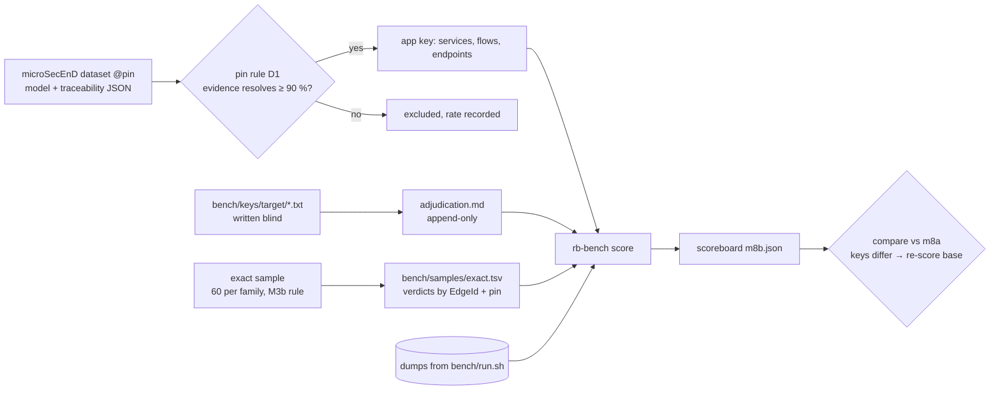

# M8b contract: an accuracy benchmark with answer keys, part 2 (2026-10-13)

**Status:** contract written 2026-10-13 from M8a's Part 2 plan (`tasks/contract-m8a.md`) and M8a's result; implemented 2026-10-14 (amendment 1) on branch `m8`, after the M8a commit `6c059ea`. Evaluator pass 1 (`tasks/eval-m8b-pass1.md`) FAIL answered 2026-10-15 (amendment 2); close after a verification-only re-check.

## Why

| Gap after M8a | What's missing |
|---|---|
| Classes without a key | `endpoints`, `handler_binding`, `table_queries`, `table_maps` and `service_flows` render as `no key (M8b)`. |
| `exact` unmeasured | M8a's only independent key (PyCG) holds no `exact` edges, and SCIP agreement can't judge SCIP. The README's corrected claim names producers of `exact` (SQL, ORM, routes, manifests) that nothing has checked. |
| Java has no key at all | Every Java/Kotlin SCIP job failed (`bench-findings.md` B4), so Spring code, rb's main target, is measured nowhere. |

## Design



**Identity beyond symbols.** M8a's `Locator` places symbols and files only (`not_locatable` otherwise).
- **Endpoints** become `(METHOD, normalised path, service dir)`: method uppercase or `ANY`; `{x}`, `:x` and `<x>` become `{}`; no trailing or duplicate `/`; the full effective path.
- **Tables** become the table name, plus the schema only when the source writes one (`schema_assumed`).
- **Services** become their directory (the rb `Service` key).
- **Classes:**
  - `endpoints`: existence.
  - `handler_binding`: endpoint to handler location.
  - `table_queries`: the function holding the call site to the table, with `ops` scored apart.
  - `table_maps`: entity class to table.
  - `service_flows`: service to service, derived from `CONSUMES` and the endpoint's `@service`.

**Trade-offs:**
- **microSecEnD pins by date, or by asking the authors.** The dataset gives no commits; its evidence URLs point at `master`. A date rule is reproducible today but can pick a commit where some lines moved. The ≥ 90 % evidence-resolve check makes that drift visible per app, and an app that fails is excluded with its rate rather than scored wrongly. **Chosen:** the date rule plus the check.
- **Blind hand keys, or reviewing rb's output.** Reviewing anchors the labeller on what rb found and hides exactly the misses we want counted. Blind keys cost more labelling, and disagreements need an adjudicator who does not know which side is rb. **Chosen:** blind keys on 3 repos only.
- **An `exact` sample of 60 or of 300 per family.** With 0 errors in n, the 95 % upper bound on the error rate is about 3/n: 5 % at 60, 1 % at 300. About 300 verdicts for 5 families is about 1,500 source reads, too many for one milestone. **Chosen:** 60 per family, a Wilson interval reported, and no ≥ 99 % claim.

**Numbers:**
- microSecEnD has 17 apps × about 10 services and about 20 flows; the clones are estimated under 300 MB and measured at fetch.
- Hand keys: 3 repos × 20–150 endpoints plus tables.
- The `exact` sample: 5 families × 60 = 300 verdicts, about 1 minute of source reading each, so about 5 h of evaluator time across agents.
- **NFR:** a warm full run (M8a's targets plus microSecEnD) stays ≤ 20 min; scoring stays ≤ 30 s.

## Decisions

- **D1. Pins.** For each microSecEnD app, the last upstream commit on its default branch at or before the date of the microSecEnD commit that added the app's model. An evidence item resolves when its file exists at the pin and the text at its `line` contains the traceability `span`; `heuristic` and `implicit` items are counted, not resolved. An app is kept at ≥ 90 % resolved. The dataset itself is pinned at the SHA fetched first.
- **D2. Infrastructural flows** are decided by a fixed stereotype list: `gateway`, `service_discovery`, `configuration_server`, `message_broker`, `logging`, `monitoring_server`, `monitoring_dashboard`, `local_logging`. They are `out_of_scope{not_modelled}`, as are message-broker flows, databases and external entities, each with its count.
- **D3. Hand-key repos:** one stress repo (spring_boot_microservices, labelled `dev set`) plus two repos rb has never run on. The two are chosen by rule (Spring JPA, FastAPI raw SQL or Go `database/sql`; 20–150 endpoints plus tables) and pinned before rb first runs on them. The choice and the pin are recorded before any index.

## Claims

| # | Claim | Test |
|---|---|---|
| T1 | microSecEnD's license is read and recorded before any fetch row is committed. Pins follow D1, and each app's resolve rate is in the manifest notes. | manifest unit; Result |
| T2 | A model service maps to an rb service through its evidence file's `IN_SERVICE`, never by name; a service with no resolving evidence is `unmatchable{no_evidence_file}`. Flows between internal services score `service_flows`; `Endpoints` tagged values score `endpoints` (identity above); D2's items are `not_modelled`. | adapter units on 2 apps' real JSON |
| T3 | Hand keys (D3) use the line format below and are written by a labeller that sees only the pinned clone and the format: no access to the repository's `tasks/`, `var/` or rb. Every key line parses and resolves to an existing file:line at the pin. | parser unit; resolve unit |
| T4 | Disagreements after the first score go to an adjudicator who sees "A vs B" without knowing which side is rb, and who also reviews a random 20 % of agreements. Entries are appended to `bench/keys/<target>/adjudication.md` with file:line evidence, and a key line changes only through an entry. The score before adjudication is reported beside the final one. Transcripts are committed under `bench/keys/<target>/`. | process; Result |
| T5 | The `exact` sample draws 60 edges per family (`scip`, `sql_literal`/`sql_file`, `orm`, routes, manifest), pooled across stress repos and stratified by repo, by the M3b rule. Each is judged by an evaluator told the edge is false, who must prove it true with file:line. Verdicts are keyed by `EdgeId` and pin in `bench/samples/exact.tsv`, and reused for edges still present. `compare` fails while any drawn edge lacks a verdict. | sampler unit (M3b indices); Wilson unit; gate unit |
| T6 | `render --certainty` fills `exact` from T3 and T5 (with Wilson 95 % intervals), and `synthetic`/`heuristic` from T2 and T3. | render golden |
| T7 | The first M8b scoreboard compares with `m8a.json` after re-scoring the M8a binary against the new keys (exit 2 otherwise), and every changed cell is classified. | Result |

**Hand key line format:**
```
ENDPOINT <METHOD> <full path> <file>:<handler name line | handler start line if anonymous>
QUERIES <table> <ops,comma> <file>:<line of the function holding the call site, 0 = file scope>
MAPS <table> <file>:<entity class line>
```

## Verification

- Tests first, with mutants from the next free number (M8a ended at m200); specs in `bench/mutants/m8b.json`.
- fmt and clippy clean; real-Docker suites 0 failed, 0 skipped.
- Scoreboard determinism: two runs `cmp`-identical.
- Records: CHANGELOG, IMPLEMENT, contract, todo, `bench-findings.md`, lessons, usage guide §5.5.

## Residue (planned)

- Judge, SWARM-CG, SCAM 2018 JS and `x/tools/cmd/callgraph` (an independent Go key).
- An `exact` sample big enough for ≥ 99 % (n ≈ 300 per family).
- Fixing B1 (cross-module SCIP join) and B4 (SCIP fetch failures): rb fixes, not benchmark work.

## Amendments

**Amendment 1 (2026-10-14, while building; each forced by the data).**
- **Mutant numbering:** M8a ended at m200, not m198. M8b's mutants are m201–m228, in `bench/mutants/m8b.json`.
- **T1 / D1, the evidence check.** Spans are column ranges, not text, so an item resolves when its file exists at the pin, its line exists and its span's end column fits on the line.
  - **Branch:** the one the app's evidence URLs name most often, else the default branch.
  - **Doubled prefix:** a `<ref>/<ref>/` path is tried without the doubled part.
  - **Dataset errors:** a file that exists in no commit of any branch is counted apart. It is config-repository evidence filed under the app's URL, and no pin could resolve it. This was measured, not assumed: such files are absent from every branch's history.
  - **Result:** 12 of 17 apps are kept. The rule and its output are in `bench/pin_microsecend.py` and the manifest's comment lines. Before the dataset-error rule only 8 passed, so the rule matters.
- **D2, infrastructural services.** The stereotype list wrongly included `local_logging`, which 41 services carry, internal ones included. The adjudication of a service's role uses the dataset's own `internal` / `infrastructural` stereotypes, and `database` for datastores. Message flows are `message_*` flow stereotypes.
- **T2:**
  - **Name join:** the model and its traceability file name services differently (`account_service` / `account-service`), so they are joined with `_` and `-` treated as equal. rb services are still reached only through evidence files.
  - **Trailing commas:** two traceability files have them, and they are removed.
  - **Endpoints:** gold paths lose query strings. `Endpoints` give no method, so both sides compare as (service, `ANY`, path). Only internal services whose model gives an `Endpoints` list are scored; others are `out_of_scope{no_endpoint_list}` (mse_piomin lists none).
  - **Service map:** a file rb did not index (a config file) takes the service with the longest directory prefix, rb's own rule.
  - **Units:** T2's "adapter units on 2 apps' real JSON" are a trimmed real model shape plus the real run over all 12 apps.
- **D3:** the new hand-key repositories are `callicoder/spring-security-react-ant-design-polls-app` (Spring JPA) at `362fad90` and `zhashkevych/todo-app` (Go, sqlx over `database/sql`) at `1789ed69`.
  - **Chosen by rule:** both are absent from the project's records and the shared database.
  - **Sizes:** about 15 mappings and 7 entities; 15 routes and 5 tables.
  - **Pinned** before rb's first run on them.
- **T3 / T4:**
  - **Files:** one `key.txt` per target (not separate `endpoints`/`tables` files). The labeller's reasoning is in `labelling.md`.
  - **Transcripts:** raw transcripts stay in `var/bench/labels/<target>/`, because they contain whole third-party source files. The committed record is `labelling.md`, `adjudication.md` and the audit (each transcript touched no path outside its checkout and its own output files).
  - **Adjudication:** the effective key is `key.txt` plus `adjudication.md`'s append-only `- ADD`/`- REMOVE` entries. `bench/adjudicate.py` replays the verdicts, and a self-test target showed it emits every entry kind.
  - **Statements:** produced by `rb-bench statements`. Disputes and about one in five agreements are written alike in hash order. Lines use `?` where a side states no handler and `*` where it states no ops.
- **T5:**
  - **Identity:** verdicts are keyed by rb's own edge identity (`rb_model::diff::EdgeId`), not by location, so `MIGRATES` and `DEPENDS_ON` (to tables, to packages) carry over too.
  - **Families:** `manifest` is `DEPENDS_ON` from a manifest; `routes` is `EXPOSES`/`HANDLED_BY`; `scip` is drawn from SCIP dumps, the rest from `noscip`.
  - **orm:** has only 9 `exact` edges, so all 9 are judged.
  - **Scoreboard:** tallies go in a `samples` section (`right`, `wrong`, `missing`), which deserialises to empty for M8a's file.
- **Normalisation:** a gin catch-all (`*any`) is a path parameter (`{}`), as in rb's keys.

**Amendment 2 (2026-10-15, after evaluator pass 1, `tasks/eval-m8b-pass1.md`: 1 blocking, 4 should-fix, 3 notes).**

- **F1 (blocking) + F2, microSecEnD overrides.** The evaluator's 6 wrong-path
  endpoints (piggymetrics context-path, B14) and 19 model artifacts (bare
  class prefixes, Feign-client paths on the wrong service) are confirmed
  against the source at each pin and corrected by append-only override files,
  replayed by the amendment-1 mechanism (`msecend::apply_overrides`,
  `run.rs:325-330`):
  `bench/keys/microsecend/{mse_piggymetrics,mse_fernandoabcampos,mse_koushikkothagal,mse_mdeket,mse_anilallewar,mse_rohitghatol}.md`.
  Each entry cites its file:line evidence and the blind verdict in
  `var/bench/labels/mse_*/verdicts.md` (the verdicts were recorded during the
  build; the committed files are what the scorer reads). Piggymetrics keeps
  `/accounts/{}` and `/statistics/{}` in gold: the S1/S2 and S4/S5 verdicts
  split on the model's `{accountName}` param name (the code serves `{name}`),
  which the contract's `{}` normalisation does not distinguish, and both
  normalised endpoints are genuinely served (currently fn: rb emits no
  prefixed path). The 4 no-leading-slash joins (`{taskId}`, `{userName}`) and
  the 5 Spring Data REST endpoints are real rb misses and stay fn.
- **F3, certainty double-count.** The code already excluded `table_ops` from
  `render_certainty` (amendment-1 tree, `render.rs:108-109`, test
  `table_ops_are_not_counted_as_edges`); the evaluator read the old numbers
  in the Result. The Result, B11 and CHANGELOG below quote the tool's current
  output (`synthetic` 66.7 % of 24 edges, `heuristic` 99.2 % of 118).
- **F4, stale statements.** `rb-bench statements` already prints concrete
  places (no bare `?`; test `statements_cover_every_dispute_and_name_no_side`).
  The committed `statements.txt` files equal current output byte-for-byte
  (the v1 files differ only by the `*any` normalisation and renumbering). All
  three keys were re-adjudicated over the current statements (69/17/11 TRUE,
  3/20/20 FALSE); every key-held statement TRUE, every rb-only one FALSE, so
  no entries. Recorded as second sections in each `adjudication.md`.
  Result:184's blanket sentence is replaced by the per-target counts.
- **F5, audit.** The transcripts exist: `labeller.jsonl` and
  `adjudicator-v1.jsonl` per hand-key target, `judge-*.jsonl` per `exact`
  family (prompts embedded as each file's first message; the judge prompt
  begins "ASSUME EACH EDGE IS FALSE"). Audit (`/tmp/audit.py`, kept in the
  session transcript): every `command` in all seven files runs with its `cd`
  inside a `var/bench/repos/*` checkout or `var/bench/labels/exact` (own edge
  lists); none touches `tasks/`, `crates/`, `bench/keys`, `bench/samples` or
  `bench/manifest.tsv`.
- **N6, sample composition.** The `exact` families are mattermost-heavy
  (`scip` 54/60, `sql` 58/60, `routes` 32/60 e2e webhook servers, all judged
  TRUE). One test-code rule now governs both the sample and B7: a route
  registered only in test code is wrong (B7's 2 misses stay the only ones;
  the 32 e2e webhook servers are production servers under test harnesses and
  stay TRUE). Composition is stated beside the bounds in the Result.
- **N7, dev set.** `spring_boot_microservices` is the D3 dev set and stays
  pooled in the hand-key totals; the Result marks it.
- **N8, wording.** B9 says 12 of 13 hk_todo bindings are method values (the
  13th is the `/swagger/*any` library handler). The CHANGELOG's "every
  certainty label" excepts `dispatch` (not stored). T2's
  `unmatchable{no_evidence_file}` fires only with no root service (a
  single-service repo falls back to `.`; `structural.rs:106-108`). D1's span
  check (end column fits the line) barely detects drift; the 90 % gate is
  weak evidence of pin quality, recorded here rather than strengthened.

## Result (2026-10-14; corrected 2026-10-15 by amendment 2)

**Status:** T1–T7 met.
- **The scoreboard:** `bench/scoreboard/m8b.json` (sha256 `d7346ffb…`, 314 cells plus the `exact` sample), the same M7 close binary as M8a, with `m8b-perf.json`.
- **Committed as:** branch `m8`, after the M8a commit `6c059ea`.
- **Tables:** pasted from `rb-bench render` output (after amendment 2's re-score).

Scoreboard m8b (rb e08efcb801c28422afab450251ee0ba093cd57f3, binary a038653b8478887f32088d8682ff445064ef1cd655e5718cdb755c9a48acc303)

| Bench | Class | Mode | Label | Targets (scored / flagged / vacuous) | Gold | In scope | TP | FP | FN | Precision | Recall | Out of scope | Unmatchable |
|---|---|---|---|---|---|---|---|---|---|---|---|---|---|
| handkey | endpoints | noscip | accuracy | 3 / 0 / 0 | 39 | 39 | 39 | 2 | 0 | 95.1% | 100.0% | – | – |
| handkey | handler_binding | noscip | accuracy | 2 / 1 / 0 | 39 | 39 | 26 | 0 | 13 | 100.0% | 66.7% | – | – |
| handkey | table_maps | noscip | accuracy | 2 / 0 / 1 | 10 | 10 | 10 | 0 | 0 | 100.0% | 100.0% | – | – |
| handkey | table_ops | noscip | accuracy | 2 / 1 / 0 | 54 | 54 | 24 | 32 | 30 | 42.9% | 44.4% | – | – |
| handkey | table_queries | noscip | accuracy | 2 / 1 / 0 | 54 | 54 | 24 | 8 | 30 | 75.0% | 44.4% | – | – |
| handkey_raw | endpoints | noscip | accuracy | 3 / 0 / 0 | 39 | 39 | 39 | 2 | 0 | 95.1% | 100.0% | – | – |
| handkey_raw | handler_binding | noscip | accuracy | 2 / 1 / 0 | 39 | 39 | 26 | 0 | 13 | 100.0% | 66.7% | – | – |
| handkey_raw | table_maps | noscip | accuracy | 2 / 0 / 1 | 10 | 10 | 10 | 0 | 0 | 100.0% | 100.0% | – | – |
| handkey_raw | table_ops | noscip | accuracy | 2 / 1 / 0 | 54 | 54 | 24 | 32 | 30 | 42.9% | 44.4% | – | – |
| handkey_raw | table_queries | noscip | accuracy | 2 / 1 / 0 | 54 | 54 | 24 | 8 | 30 | 75.0% | 44.4% | – | – |
| microsecend | endpoints | noscip | accuracy | 10 / 1 / 1 | 62 | 62 | 47 | 6 | 15 | 88.7% | 75.8% | – | – |
| microsecend | service_flows | noscip | accuracy | 3 / 6 / 3 | 285 | 14 | 4 | 0 | 10 | 100.0% | 28.6% | database 9, external 30, messaging 4, not_modelled 228 | – |
| pycg | calls | noscip | accuracy | 9 / 22 / 88 | 60 | 48 | 12 | 1 | 36 | 92.3% | 25.0% | builtin 4, external 2, lambda 6 | – |
| pycg | calls_file_scope | noscip | accuracy | 75 / 30 / 14 | 204 | 186 | 94 | 1 | 92 | 98.9% | 50.5% | builtin 5, external 10, lambda 3 | – |
| scip | calls | noscip | agreement | 6 / 0 / 5 | 35660 | 35657 | 17734 | 6147 | 17923 | 74.3% | 49.7% | not_covered 3 | – |
| scip | calls_file_scope | noscip | agreement | 3 / 0 / 8 | 1371 | 386 | 373 | 1 | 13 | 99.7% | 96.6% | not_covered 985 | – |

| Label | Accuracy (independent keys) | Agreement (SCIP) |
|---|---|---|
| exact | 93.8% of 130 edges | no edges |
| dispatch | n/a (not stored) | n/a (not stored) |
| synthetic | 66.7% of 24 edges | no edges |
| heuristic | 99.2% of 118 edges | 74.7% of 24179 edges |
| ambiguous | site hit 100.0% of 1 sites; 50.0% of 2 edges | site hit 100.0% of 71 sites; 75.0% of 76 edges |

| `exact` sample family | Right / judged | Wilson 95 % | Without a verdict |
|---|---|---|---|
| manifest | 60 / 60 | 94.0–100.0 % | 0 |
| orm | 9 / 9 | 70.1–100.0 % | 0 |
| routes | 58 / 60 | 88.6–99.1 % | 0 |
| scip | 57 / 60 | 86.3–98.3 % | 0 |
| sql | 59 / 60 | 91.1–99.7 % | 0 |

**Reading the tables:**
- **`exact` is right on 122 of 130 edges** the independent keys judge: 6 misses are rb endpoints without their config-server context path (B14), 2 are routes registered in test code (B7). The sample bounds every family's error rate at 95 %: `manifest` ≥ 94.0 % right, `sql` ≥ 91.1 %, `routes` ≥ 88.6 % (B8: spec annotations), `scip` ≥ 86.3 % (B13), `orm` ≥ 70.1 % (9 of 9). Composition: `scip` is 54/60 mattermost, `sql` 58/60, `routes` 32/60 mattermost e2e webhook servers (production servers under test harnesses, judged TRUE under the one test-code rule: only a route registered *only* in test code is wrong).
- **`synthetic` is 16 of 24 edges (66.7 %).** All 8 wrong ones are the repository-type convention (B11); `table_ops` rows restate the same 8 edges once per op and are excluded from the certainty table.
- **`heuristic` is 117 of 118.**
- **Hand keys** (spring_boot_microservices is the D3 dev set, pooled):
  - endpoints 39 of 39, with 2 extra test routes;
  - entity mappings 10 of 10;
  - handler bindings 26 of 39: 12 of hk_todo's 13 routes use gin method values (B9; the 13th is the `/swagger/*any` library handler);
  - table access 24 of 54: hk_todo's `fmt.Sprintf` SQL, B10.
- **microSecEnD:**
  - endpoints: precision 88.7 %, recall 75.8 % (62 gold after 19 key-error removals; 6 fp are the unprefixed context-path forms; 15 fn are 4 true prefixed paths rb misses, 4 no-leading-slash joins, 5 Spring Data REST, and 2 already-listed prefixed forms rb misses);
  - service flows: 4 of the 14 the key can judge (B12).

**By claim:**
- **T1:** license Apache-2.0, dataset at `63653e09`. The 12 kept apps are pinned in the manifest with their resolve rates (91.7–100 %); the 5 excluded are at 80–87 %. D1's span check is weak evidence of pin quality (amendment 2, N8).
- **T2:** every internal service of the 12 apps maps to its own rb service (36 of 36). Six apps carry endpoint overrides (`bench/keys/microsecend/*.md`); `unmatchable{no_evidence_file}` fires only with no root service to fall back to.
- **T3:** 27, 37 and 39 key lines; each resolves to a file:line at its pin (checked by `rb-bench score`). Transcript audits are clean (amendment 2, F5).
- **T4:**
  - Second adjudications over re-generated statements: 31, 37 and 72 statements (was 30, 35, 68); verdicts 11/17/69 TRUE and 20/20/3 FALSE.
  - Every key-held statement was judged TRUE and every rb-only one FALSE, so there are no entries and `handkey_raw` equals `handkey` (the v1 `?` statement that read as a counterexample is now concrete-handlered and key-held).
  - Caveat: the labeller and adjudicator are one model family.
- **T5:**
  - 249 drawn edges (60 × 4 families plus 9 `orm`); 249 verdicts, 0 missing.
  - Judges were told every edge is false until proven (prompt's first line: "ASSUME EACH EDGE IS FALSE"); their transcripts are audited (amendment 2, F5).
  - The gate fails on a missing verdict, and on one more wrong `exact` edge even when its cell is accepted (self-tests on `m8b.json`).
- **T6:** the certainty table above. `handkey_raw` and `table_ops` are not counted twice (the latter fixed before pass 1; its numbers corrected here).
- **T7:**
  - `compare m8a.json m8b.json` exits 2 (new pins and keys).
  - The re-scored base is `m8b.json` itself, the binary being unchanged.
  - **All 260 M8a cells are identical** in it; 54 cells are new.
  - Changed cells between the two M8b scorings are exactly the 6 microsecend endpoint cells the overrides touch (fernando/koushik/mdeket fn → 0, anilallewar/rohitghatol fn −1, piggymetrics 6 tp → 6 fp with 4 new prefixed fn); every other cell identical.

**Verification:**
- **Determinism:** two scorings `cmp`-identical (accuracy and perf).
- **Tests:** rb-bench 79 tests (76 at pass 1; the table_ops, statements and overrides guards); fmt and clippy clean.
- **Mutants:** m201–m229, all killed (29 specs, full battery re-run). m213, m214, m219 and m223 survived first; four missing tests were added. m228 rewritten after the `table_ops` clause made its target line stale; m229 covers the `table_ops` exclusion (evaluator F3).
- **Real-Docker suites:** **1,122 passed, 0 failed, 0 ignored** (`var/m8b/logs/workspace.log`; M7's 1,047 plus rb-bench's 75 tests as compiled at the suite's start). The scorer fixes after it compiled touch only `render` filtering and statement text, covered by rb-bench's re-run: 79 passed; workspace clippy and fmt are clean.
- **Invariant:** vacuous by construction (L489). M8b changes no `rb` code: `git diff e08efcb -- crates` touches only `crates/rb-bench`.

**Residue:**
- An independent Go call key (`x/tools/cmd/callgraph`), Judge, SWARM-CG and SCAM 2018.
- An `exact` sample of n ≈ 300 per family, for a ≥ 99 % claim.
- A second, different-family adjudicator.
- The rb fixes B1, B4, B7–B10, B12–B14 belong to an rb milestone, not the benchmark.
