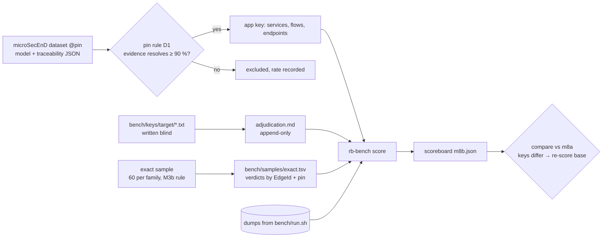

# M8b contract: an accuracy benchmark with answer keys, part 2 (2026-10-13)

**Status:** contract written 2026-10-13 from M8a's Part 2 plan (`tasks/contract-m8a.md`) and M8a's result. It starts after the M8a close, on branch `m8`, after the M8a commit.

## Why

| Gap after M8a | What's missing |
|---|---|
| Classes without a key | `endpoints`, `handler_binding`, `table_queries`, `table_maps` and `service_flows` render as `no key (M8b)`. |
| `exact` unmeasured | M8a's only independent key (PyCG) holds no `exact` edges, and SCIP agreement can't judge SCIP. The README's corrected claim names producers of `exact` (SQL, ORM, routes, manifests) that nothing has checked. |
| Java has no key at all | Every Java/Kotlin SCIP job failed (`bench-findings.md` B4), so Spring code, rb's main target, is measured nowhere. |

## Design



**Identity beyond symbols.** M8a's `Locator` places symbols and files only (`not_locatable` otherwise).
- **Endpoints** become `(METHOD, normalised path, service dir)`: method uppercase or `ANY`; `{x}`, `:x` and `<x>` become `{}`; no trailing or duplicate `/`; the full effective path.
- **Tables** become the table name, plus the schema only when the source writes one (`schema_assumed`).
- **Services** become their directory (the rb `Service` key).
- **Classes:**
  - `endpoints`: existence.
  - `handler_binding`: endpoint to handler location.
  - `table_queries`: the function holding the call site to the table, with `ops` scored apart.
  - `table_maps`: entity class to table.
  - `service_flows`: service to service, derived from `CONSUMES` and the endpoint's `@service`.

**Trade-offs:**
- **microSecEnD pins by date, or by asking the authors.** The dataset gives no commits; its evidence URLs point at `master`. A date rule is reproducible today but can pick a commit where some lines moved. The ≥ 90 % evidence-resolve check makes that drift visible per app, and an app that fails is excluded with its rate rather than scored wrongly. **Chosen:** the date rule plus the check.
- **Blind hand keys, or reviewing rb's output.** Reviewing anchors the labeller on what rb found and hides exactly the misses we want counted. Blind keys cost more labelling, and disagreements need an adjudicator who does not know which side is rb. **Chosen:** blind keys on 3 repos only.
- **An `exact` sample of 60 or of 300 per family.** With 0 errors in n, the 95 % upper bound on the error rate is about 3/n: 5 % at 60, 1 % at 300. About 300 verdicts for 5 families is about 1,500 source reads, too many for one milestone. **Chosen:** 60 per family, a Wilson interval reported, and no ≥ 99 % claim.

**Numbers:**
- microSecEnD has 17 apps × about 10 services and about 20 flows; the clones are estimated under 300 MB and measured at fetch.
- Hand keys: 3 repos × 20–150 endpoints plus tables.
- The `exact` sample: 5 families × 60 = 300 verdicts, about 1 minute of source reading each, so about 5 h of evaluator time across agents.
- **NFR:** a warm full run (M8a's targets plus microSecEnD) stays ≤ 20 min; scoring stays ≤ 30 s.

## Decisions

- **D1. Pins.** For each microSecEnD app, the last upstream commit on its default branch at or before the date of the microSecEnD commit that added the app's model. An evidence item resolves when its file exists at the pin and the text at its `line` contains the traceability `span`; `heuristic` and `implicit` items are counted, not resolved. An app is kept at ≥ 90 % resolved. The dataset itself is pinned at the SHA fetched first.
- **D2. Infrastructural flows** are decided by a fixed stereotype list: `gateway`, `service_discovery`, `configuration_server`, `message_broker`, `logging`, `monitoring_server`, `monitoring_dashboard`, `local_logging`. They are `out_of_scope{not_modelled}`, as are message-broker flows, databases and external entities, each with its count.
- **D3. Hand-key repos:** one stress repo (spring_boot_microservices, labelled `dev set`) plus two repos rb has never run on. The two are chosen by rule (Spring JPA, FastAPI raw SQL or Go `database/sql`; 20–150 endpoints plus tables) and pinned before rb first runs on them. The choice and the pin are recorded before any index.

## Claims

| # | Claim | Test |
|---|---|---|
| T1 | microSecEnD's license is read and recorded before any fetch row is committed. Pins follow D1, and each app's resolve rate is in the manifest notes. | manifest unit; Result |
| T2 | A model service maps to an rb service through its evidence file's `IN_SERVICE`, never by name; a service with no resolving evidence is `unmatchable{no_evidence_file}`. Flows between internal services score `service_flows`; `Endpoints` tagged values score `endpoints` (identity above); D2's items are `not_modelled`. | adapter units on 2 apps' real JSON |
| T3 | Hand keys (D3) use the line format below and are written by a labeller that sees only the pinned clone and the format: no access to the repository's `tasks/`, `var/` or rb. Every key line parses and resolves to an existing file:line at the pin. | parser unit; resolve unit |
| T4 | Disagreements after the first score go to an adjudicator who sees "A vs B" without knowing which side is rb, and who also reviews a random 20 % of agreements. Entries are appended to `bench/keys/<target>/adjudication.md` with file:line evidence, and a key line changes only through an entry. The score before adjudication is reported beside the final one. Transcripts are committed under `bench/keys/<target>/`. | process; Result |
| T5 | The `exact` sample draws 60 edges per family (`scip`, `sql_literal`/`sql_file`, `orm`, routes, manifest), pooled across stress repos and stratified by repo, by the M3b rule. Each is judged by an evaluator told the edge is false, who must prove it true with file:line. Verdicts are keyed by `EdgeId` and pin in `bench/samples/exact.tsv`, and reused for edges still present. `compare` fails while any drawn edge lacks a verdict. | sampler unit (M3b indices); Wilson unit; gate unit |
| T6 | `render --certainty` fills `exact` from T3 and T5 (with Wilson 95 % intervals), and `synthetic`/`heuristic` from T2 and T3. | render golden |
| T7 | The first M8b scoreboard compares with `m8a.json` after re-scoring the M8a binary against the new keys (exit 2 otherwise), and every changed cell is classified. | Result |

**Hand key line format:**
```
ENDPOINT <METHOD> <full path> <file>:<handler name line | handler start line if anonymous>
QUERIES <table> <ops,comma> <file>:<line of the function holding the call site, 0 = file scope>
MAPS <table> <file>:<entity class line>
```

## Verification

- Tests first, with mutants from the next free number (M8a ended at m198); specs in `bench/mutants/m8b.json`.
- fmt and clippy clean; real-Docker suites 0 failed, 0 skipped.
- Scoreboard determinism: two runs `cmp`-identical.
- Records: CHANGELOG, IMPLEMENT, contract, todo, `bench-findings.md`, lessons, usage guide §5.5.

## Residue (planned)

- Judge, SWARM-CG, SCAM 2018 JS and `x/tools/cmd/callgraph` (an independent Go key).
- An `exact` sample big enough for ≥ 99 % (n ≈ 300 per family).
- Fixing B1 (cross-module SCIP join) and B4 (SCIP fetch failures): rb fixes, not benchmark work.
