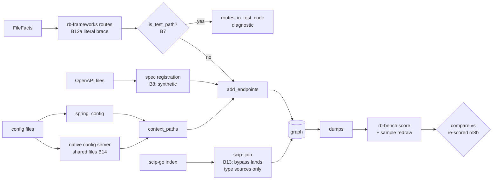

# M9a contract: `exact` precision from the M8 benchmark (2026-10-16)

**Status:** implemented; evaluator pass 1 PASS answered (amendment 3); pass 2 pending. The contract was written 2026-10-16 from `tasks/plan-m9.md` §4 "M9a" and `tasks/bench-findings.md` B7, B8, B11, B12 (part a), B13, B14. Every root cause below was re-read in the code at branch `m9` (`0453fda`) and checked against the M8 dumps (`var/bench/out/a038653b8478/`). Commits go on branch `m9`.

## Why

M8b's independent keys judge 130 `exact` edges and find 8 wrong (93.8 %). The `exact` sample finds 2 wrong `routes` edges and 3 wrong `scip` edges. Each wrong edge has one diagnosed cause:

| Finding | What is wrong | Measured in M8b |
|---|---|---|
| B7 | Routes registered in test files become `exact` endpoints. | hk_todo endpoints: 2 `exact` fp |
| B8 | A spec operation with no code route is an `exact` endpoint, even when the code serves another method or path. | sample `routes`: 2 FALSE (go_gin_example) |
| B13 | A Go method that satisfies an interface method gets `IMPLEMENTS` to the interface type. | sample `scip`: 2 of 3 FALSE (mattermost) |
| B14 | Context paths set in a config server's shared files are not applied. | piggymetrics endpoints: 6 `exact` fp, 6 fn |
| B12a | `value = "{taskId}"` (no leading slash) reads as an empty Java array. | anilallewar, rohitghatol: 2 fn each |
| B11 | A repository type's inherited CRUD is a `synthetic` `QUERIES`; the blind keys count it wrong. | 8 `synthetic` fp (convention) |

## Root causes, verified (file:line at `0453fda`)

- **B7.** `routes::add_endpoints` loops over every file's route facts (`crates/rb-indexer/src/routes.rs:487`), test files included. `rb_model::is_test_path` (`crates/rb-model/src/lib.rs:197`) is already the shared test rule for DI (`di.rs:296` and 14 more sites), RTA (`rta.rs:551`), liveness (`liveness.rs:242`) and `rb impact` (`rb-store/src/code.rs:321`), but not for routes. Over all 27 `noscip` dumps (352 `EXPOSES`), exactly 4 endpoints have only test-file evidence: hk_todo `GET /identity` (`pkg/handler/middleware_test.go`), `POST /sign-up` (`auth_test.go`), and mattermost `ANY /succeeds-after-retry`, `ANY /fails-forever` (`server/channels/app/download_test.go`). No endpoint mixes test and non-test evidence.
- **B8.** OpenAPI operations become registrations with `path_certainty: Certainty::Exact` (`routes.rs:854`, inside `add_spec_endpoints`; interface mappings at `:884`, unregistered proto RPCs at `:814`). An endpoint takes the best registration's certainty (`routes.rs:1070-1075`). The 2 FALSE sample edges come from the generated spec files `docs/swagger.json`, `docs/swagger.yaml` and `docs/swagger/swagger.{json,yaml}`. rb reads no `@Router` comments (no match for `@Router` in `crates/rb-frameworks/src`). go_gin_example has 3 spec-only endpoints, all wrong: `GET /auth`, `POST /api/v1/tags/import`, and the undrawn `POST /api/v1/tags/export` (the code serves `POST /tags/export`).
- **B13.** In `scip::join`, the M6d S9 bypass (`scip.rs:649-652`) sends the target to the interface type when the holder declares no supertypes. The source stays `source_key`, the method (`scip.rs:704-712`). On mattermost, 1,704 of 2,455 `scip` `IMPLEMENTS` edges have this method-to-type shape (go_clean_arch 25 of 30, microservices_demo 3 of 6). For 340 of the 342 distinct (holder type, interface) pairs, scip-go's own type relationship already gives the type-level edge (e.g. `SqlChannelMemberHistoryStore# → ChannelMemberHistoryStore#`). The other 2 pairs are partial implementations: `baseSetting` has 5 of `Setting`'s 8 methods (`pluginapi/experimental/panel/settings/base_setting.go:10-26`) and `blockBase` has 4 of `Block`'s 5 (`shared/markdown/blocks.go:28-31`).
- **B13, third edge.** `ElasticsearchInterfaceTestSuite# → IndexerJobInterface#` is type-sourced. It comes from scip-go's relationship on the type, which the bypass accepts without a walk. The suite (`elasticsearch_test.go:33-40`) has no `MakeWorker`. The same shape gives 264 `IMPLEMENTS` from 5 `*Suite#` test types on mattermost (38 to `AppIface#`). **A separate cause; M9a does not fix it** (recorded as B13b).
- **B14.** `config_file` (`crates/rb-indexer/src/lib.rs:447-472`) returns `None` for `config/src/main/resources/shared/account-service.yml` (its directory is not `src/main/resources`), so `spring_config` (`lib.rs:659`) never reads it. The file is only scanned for Feign keys (`is_settings_file`, `lib.rs:484`). `context_paths` is built from local files only (`lib.rs:1066-1073`). The config server reads `classpath:/shared` under the `native` profile (`config/src/main/resources/application.yml`). A context path that applies is `synthetic` (`routes.rs:531-536`, contract M4a amendment 4); without one the route is `exact`.
- **B12a.** `mapping_paths` (`crates/rb-frameworks/src/routes.rs:528`) treats any value starting with `{` and with no items as an array. A string literal `"{taskId}"` (`literal: true`) is read as an empty array and gives `[""]`. The route then lands on the class path: rb's `GET / @task-webservice` carries both `TaskController.java:37` and `:48`. Only 4 sites in scored targets have this form.
- **B11.** `QUERIES` from a Spring Data repository type with all four ops, `synthetic`, provenance `orm` (e.g. hk_polls `PollRepository#`). rb's output does not explain the convention (`java-spring-jpa/table-deps-users.txt` shows `UserRepository#  read+insert+update+delete … [synthetic …]`).

## Plan corrections

1. **B7:** option A does not lose the mattermost e2e routes. The 32 judged webhook servers live in `e2e-tests/**/webhook_serve.js`, which `is_test_path` does not match. Option B ("only when the service has non-test sources") is not needed. A rule applied to every test file touches 4 endpoints on the bench.
2. **B8:** the mechanism is generated OpenAPI files, not `@Router` comments. Plan option B ("cap only comment-extracted `@Router`") would change nothing. There are 3 wrong spec-only endpoints, not 2.
3. **B13:** plan option A (re-source the method edge to its holder) would turn 1,695 method edges into duplicates of type edges that already exist. It would also create 2 new false `exact` edges (`baseSetting# → Setting#`, `blockBase# → Block#`). It also cannot fix the third edge, whose source is already a type.
4. **B14:** the shared file is not "assigned to service `config`". It is not read as Spring configuration at all. Remote config does not rank *below* local config: Spring Cloud Config's remote sources override local files by default. The file is matched by the client's `spring.application.name`, not by directory name.
5. **Targets:** "122/130 → 130/130" is wrong. The 6 B14 edges become `synthetic` tp, the 2 B7 edges vanish, and B12a adds 4 `exact` tp: predicted **126/126**. "routes 60/60, scip 60/60" cannot be promised. The sample is a function of the dumps (`crates/rb-bench/src/sample.rs:1-6`), so removing edges redraws it. Replaying the sampler over the M8 dumps with M9a's removals reproduces M8b's 249 draws exactly and then gives **25 `routes` and 55 `scip` drawn edges with no verdict**. They must be judged before the gate passes.
6. **Gate mechanics:** new verdicts change the `exact:verdicts` key hash, so `compare m8b.json m9a.json` exits 2. The base is re-scored first (D6).
7. **Scope:** M9a also changes `bench/mutants/run.py`. It only mutates `crates/rb-bench/src`, and it counts a build error as KILLED (lesson "uncompilable mutants give no verdict").

## Design



**State, derived state, invariants.**
- **B7.** State: route facts per file (unchanged). Derived: the endpoint stage's input, minus test files. Invariant: no endpoint, `EXPOSES`, `HANDLED_BY`, mount prefix or composed prefix rests on a test file, and each test file with route facts is counted.
- **B8.** State: spec operations (unchanged). Derived: an OpenAPI operation's registration is `synthetic`; the endpoint keeps the best registration. Invariant: `exact` `EXPOSES` needs a code registration (a route or an interface mapping). Proto RPCs are unchanged.
- **B13.** State: SCIP symbol information (unchanged). Derived: under the bypass, only a type source makes an edge. Invariant: an `IMPLEMENTS` edge never runs from a method to a type, and every dropped relationship is counted in `relationships_dropped`.
- **B14.** State: config file texts (already in `Content.config`). Derived: one more source for `context_paths`. Invariant: a context path from a shared file is `synthetic`, never `exact`, and each application is reported by a diagnostic.
- **B12a.** Invariant: a Java string literal is a path, whatever its first character. Only a non-literal `{…}` is an array.

**Trade-offs, with this system's numbers.**
- **B7, filter at the input or in the route loop.** The loop alone would leave test files feeding mounts (`Composer`), gin group compositions and gRPC server attribution. An input filter rejects all of them in one place (lesson "reject the trick at the input"). Measured cost: 4 of 352 `EXPOSES`. Mounts leave no evidence in the dumps, so any extra removal shows only in the invariant diff, where it is classified. **Chosen:** the input.
- **B8, `synthetic` or `heuristic` for spec-only.** A spec is a stated document. That is what `synthetic` means here (context paths, M4a amendment 4). `heuristic` would also cap `CONSUMES` into spec-only endpoints, which M6f stitches `synthetic` by operation name. Both labels leave the bench's 3 wrong edges unjudged, since go_gin_example has no endpoint key. **Chosen:** `synthetic`. Blast radius: 3 edges × 2 modes on the bench, and 1 golden row (`contract-packs` `POST /users`).
- **B13, drop or re-source.** Re-sourcing duplicates 1,695 type edges with method evidence and adds 2 false `exact` edges. Dropping removes 1,732 edges bench-wide and loses only the 2 partial pairs, which are not implementations. The interface method has no node, so the method-level fact cannot be stored either way. Go methods are never orphan-eligible (`liveness.rs:329`), so `rb impact` loses no seed. **Chosen:** drop and count.
- **B14, which files and which clients.** Matching any `<svc>.yml` anywhere risks unrelated YAML. **Chosen:** read only what a config server provably serves: the `native` profile is active, `search-locations` lists `classpath:` directories, and there is exactly one such server in the repository. Clients are matched by `spring.application.name`. On the bench this touches only piggymetrics. apssouza22 has a native server, but its shared files set no context path, and it is excluded from the manifest anyway.

**NFRs.**
- Warm full bench ≤ 20 min (M8b NFR). Scoring ≤ 30 s. Two scorings are `cmp`-identical.
- `compare --perf` prints no perf warning against `m8b-perf.json` (wall ≤ 1.25×, RSS ≤ 1.15×). For mattermost `noscip-fresh` (24.73 s, 1,801,732,096 B) that means ≤ 30.9 s and ≤ 1.93 GiB. A warning is re-measured once. If it persists, it blocks the close.
- New work is linear: B14 is one pass over config files, B13 is one kind check per relationship, B7 is one path test per file.

## Decisions

- **D1 (B7).** The endpoint stage (every reader of `routes::Inputs::routes`: routes, routers and mounts, gin compositions, interface routes, gRPC server registrations) sees no file for which `rb_model::is_test_path` holds. Each such file with at least one route fact gets one `routes_in_test_code` diagnostic, detail `{"routes": n}`. Its other route diagnostics are not emitted.
- **D2 (B8).** An OpenAPI operation's own registration is `synthetic`. Interface-mapping registrations (M6f S4b) and proto RPCs keep their certainty. `spec_operation_unhandled` is unchanged.
- **D3 (B13).** Under the bypass, a source definition that is not a type (`is_type`, `scip.rs:1278`) is dropped and counted in `relationships_dropped` (and `_in_project`). No new coverage field, so scip-status goldens change only where the case occurs.
- **D4 (B14).**
  - **The server:** the one service whose effective configuration has `spring.profiles.active` containing `native` and `spring.cloud.config.server.native.search-locations` (or `searchLocations`). Each comma-separated `classpath:` entry maps to `<server>/src/main/resources/<dir>/`. `file:` entries and entries holding `{` are not read.
  - **More than one such server:** nothing is applied, and one `config_server_ambiguous` diagnostic lists them.
  - **Clients:** config clients (the existing `config_client` reason), other than the server, with an effective `spring.application.name`.
  - **Files read:** `<name>.properties|yml|yaml` and `application.properties|yml|yaml` in each location, unconditional documents only. Only `server.servlet.context-path` is taken.
  - **Precedence, lowest first:** local files < remote `application.*` < remote `<name>.*`.
  - **Output:** the prefixed path is `synthetic` (unchanged rule), plus one `config_server_context_path` diagnostic `{service, file, context_path}` per client it applies to. `config_unread` and `prefix_maybe_incomplete` are unchanged.
- **D5 (B11).** Documentation only. README "Follow data", the usage guide §4 and the design doc state that a repository type's own `QUERIES` row stands for the CRUD it inherits, not a query it states. No graph or output change: a text marker would churn goldens and the JSON contract without moving a cell. Attribution to callers stays open. No key is edited (lesson "blind keys stay blind").
- **D6 (gate).** New verdicts are appended to `bench/samples/exact.tsv` under M8b T5's protocol: judges are told "ASSUME EACH EDGE IS FALSE", transcripts go in `var/bench/labels/exact-m9a/` and are audited, and existing lines are never edited. The base is re-scored with HEAD's `rb-bench` over the M8 dumps against the new verdicts (`var/m9a/m8b-rescored.json`). It must equal `m8b.json` except for `keys["exact:verdicts"]`. `compare` runs against it.

## Claims

| # | Claim | Test |
|---|---|---|
| C1 | B7 per D1. A gin route in `x_test.go`, a Spring route under `src/test/java`, an Express route in `a.spec.ts`, and a gin group composed from a test-file call site give no endpoint and no prefix. Their production twins stay, and the diagnostic counts each test file. | unit `routes_in_test_files_are_not_endpoints` (new) |
| C2 | B8 per D2. `GET /missing` (spec only) is `synthetic`. `GET /users` and `POST /users`, joined to code routes, stay `exact`. Interface roll-down is unchanged. | unit `spec_operations_become_endpoints_and_join_code_routes` (expectation changed first), `spec_operations_on_interfaces_roll_down_to_implementors` (unchanged, green); e2e contract-packs: only `EXPOSES . -> HTTP POST /users` moves `exact` → `synthetic` (must-exist and dump) |
| C3 | B13 per D3. A method's relationship to an interface method gives no edge and adds 1 to `relationships_dropped`. A struct's relationship to the interface gives `Card# Implements Payer#`. The hostile-heritage case stays empty. | unit `go_implicit_satisfaction_lands_on_the_type_not_the_method` (renamed from `go_implicit_satisfaction_needs_no_declared_heritage`, expectation changed first), `hostile_heritage_takes_no_bypass`; e2e go-chi-sqlx: the `Card#Pay()`/`Cash#Pay()` → `Payer#` lines move from must-exist to must-not-exist; scip-status `relationships dropped 2 (2 in project, 0 anonymous)` |
| C4 | B13's third edge and its 264-edge class are out of scope. The invariant shows them unchanged, and bench-findings records B13b with the count. | invariant diff; records |
| C5 | B14 per D4. Covered: a piggymetrics-shaped tree; the git backend; a name that differs from the directory; two native servers; local vs remote precedence; shared `application.yml` vs `<name>.yml`; a non-client service of the same name; `file:` and `{application}` locations. Each row asserts the path, the `synthetic` label and the diagnostic. | unit `config_server_shared_files_set_client_context_paths` (new); `spring_context_paths_are_synthetic` (unchanged) |
| C6 | B12a. Class `/` + `"{taskId}"` → `GET /{}`. No class + `"{id}"` → `/{}`. `@GetMapping({})` → the class path. A two-element array still gives two paths. | unit `spring_literal_paths_starting_with_a_brace_are_paths` (new, rb-frameworks) |
| C7 | B11 per D5. The text is in README, the usage guide and the design doc. The 8 `synthetic` fp stay, unchanged. | evaluator reads; cell unchanged |
| C8 | `PIPELINE` `m7j-1` → `m9a-1` before the verify build. The binary of record is built from a clean `crates/`, and indexing a scratch repository records `m9a-1`. | Result: `git rev-parse HEAD`, sha256, scratch check |
| C9 | Invariant over the 38 target dumps (27 `noscip`, 11 `scip`) and the PyCG case dumps, base `a038653b8478`, by row identity, byte counts asserted non-zero. Every differing row is in a C1–C6 bucket; 0 unclassified. | `var/m9a/logs/invariant.txt` |
| C10 | Scoreboard: every drawn `exact` edge has a verdict. `compare var/m9a/m8b-rescored.json bench/scoreboard/m9a.json --accept bench/accept-m9a.tsv` exits 0, and every `changed` line is classified against the edge-set diff (lesson "never attribute a metric change without diffing edge sets"). Two scorings are `cmp`-identical. | Result, pasted tool output |
| C11 | NFRs above. | `compare --perf` output |
| C12 | Mutants m230–m247 all KILLED, none STALE or INVALID; m8b.json's 29 re-run KILLED under the new runner. | battery output |

**Predicted movement (predicted from the M8 dumps and keys; the close reports the measured diff of every cell and classifies it).**

| Cell (`bench:target:mode:class`) | m8b | Predicted m9a | Claim |
|---|---|---|---|
| `handkey:hk_todo:noscip:endpoints` (and `handkey_raw`) | tp exact 13, fp exact 2 | tp exact 13, fp 0 | C1 |
| `microsecend:mse_piggymetrics:noscip:endpoints` | tp 0, fp exact 6, fn 6 | tp synthetic 6, fp 0, fn 0 | C5 |
| `microsecend:mse_anilallewar:noscip:endpoints` | tp exact 4, fn 2 | tp exact 6, fn 0 | C6 |
| `microsecend:mse_rohitghatol:noscip:endpoints` | tp exact 4, fn 2 | tp exact 6, fn 0 | C6 |
| `microsecend:mse_piggymetrics:noscip:service_flows` | fn 2 | possible: up to 2 heuristic tp (Feign `/statistics/{}` and `/accounts/{}` now match) | C5 |
| `microsecend:mse_{anilallewar,rohitghatol}:noscip:service_flows` | fn 1 each | possible: tp +1 through the new `/{}` endpoints | C6 |
| the other 306 to 309 of the 314 cells | | identical | |

- **Aggregates (predicted):** handkey endpoints P 95.1 % → 100 %. microSecEnD endpoints P 88.7 % → 100 % (57/57), R 75.8 % → 91.9 % (57/62; the 5 fn left are B12b, Spring Data REST).
- **Certainty table (predicted):** `exact` 122/130 → 126/126. `synthetic` 16/24 → 22/30 (73.3 %).
- **Sample (predicted):** `manifest` 60/60, `orm` 9/9 and `sql` 59/60 keep their draw, since their pools do not change. `routes` (pools: mattermost 68 → 64, go_gin_example 18 → 15) and `scip` (mattermost 54,764 → 53,060, go_clean_arch 171 → 146, microservices_demo 363 → 360) are redrawn: 25 and 55 edges to judge, 0 of the 264 suite edges drawn.
- **`compare` (predicted):** no regression, so the accept file holds only its header. Any line added must name its cell, the diff that explains it, and the claim.

## Phases

Rules for every phase:
- The failing test is written and seen failing before the fix.
- One file, one edit per message.
- No `git checkout --` (undo with the edit tool).
- `cargo build -p rb-cli` before any e2e run.
- No `cargo` while a container suite runs.
- Every bless is followed by `git diff` of the golden, row by row.

**P0. Harness and baseline.**
- **Files:** `bench/mutants/run.py`.
- **Action:** A spec may name `crate` (default `rb-bench`) and `test` (a filter), and is applied to `crates/<crate>/src/<file>`. The command is `cargo test -q -p <crate> --lib [test]`; rb-bench keeps its own. KILLED needs a failing test in the output (`test result: FAILED` or `panicked at`); a build error is INVALID. After replacing, the runner asserts that `new` occurs. The cache key covers every crate a spec names. Then re-score the M8 dumps with HEAD's rb-bench using M8b's arguments.
- **Verify:** fresh `python3 -I bench/mutants/run.py bench/mutants/m8b.json --jobs 4` gives 29 KILLED. A throwaway spec with a type error reports INVALID. The re-score is `cmp`-identical to `bench/scoreboard/m8b.json`.
- **Done:** the three outputs are in the Result.

**P1. B12a.**
- **Files:** `crates/rb-frameworks/src/routes.rs`.
- **Action:** C6 test first (fails with `GET /`), then the fix at `routes.rs:528`.
- **Verify:** `cargo test -p rb-frameworks --lib`; mutants m230–m231.
- **Done:** green, both mutants killed.

**P2. B7 and B8.**
- **Files:** `crates/rb-indexer/src/routes.rs`, `crates/rb-indexer/src/lib.rs` (only if the filter sits at the call site), `crates/rb-cli/tests/e2e.rs` (contract-packs doc comment), contract-packs goldens.
- **Action:** the C1 test first, and the C2 expectation changed first; then D1 and D2.
- **Verify:** `cargo test -p rb-indexer --lib routes`. Re-bless the contract-packs e2e and diff the goldens: only the `POST /users` rows change. Mutants m232–m235.
- **Done:** green, diff classified.

**P3. B13.**
- **Files:** `crates/rb-indexer/src/scip.rs`, go-chi-sqlx goldens.
- **Action:** the C3 test first, then D3.
- **Verify:** `cargo test -p rb-indexer --lib scip`. Re-bless the go-chi-sqlx SCIP e2e: the diff is 2 `IMPLEMENTS` rows and the counter. Mutants m236–m238.
- **Done:** green, diff classified.

**P4. B14.**
- **Files:** `crates/rb-indexer/src/lib.rs`.
- **Action:** the C5 test first, then D4.
- **Verify:** `cargo test -p rb-indexer --lib config_server`. Probe: index `var/bench/repos/mse_piggymetrics` with `target/debug/rb --no-scip` as repo `t_m9a_pigg`; the 11 Spring `EXPOSES` carry `/accounts`, `/statistics`, `/notifications` or `/uaa` and are `synthetic`. Then delete the repo. Mutants m239–m247.
- **Done:** green, probe output in the Result.

**P5. Close the code.**
- **Files:** `crates/rb-indexer/src/lib.rs` (`PIPELINE`), `bench/mutants/m9a.json`, `README.md`, `docs/usage-and-testing.md`, `docs/repository-brain-design.md`.
- **Action:** `PIPELINE` `m9a-1`; B11 text (D5); behaviour notes for B7, B8 and B14; usage guide §5.4 (runner `crate` field) and §5.5 (re-score the base when verdicts are added).
- **Verify:**
  - `cargo fmt --all --check && cargo clippy --workspace --all-targets -- -D warnings && echo CLEAN`.
  - The full real-Docker run of usage guide §5.2 (`RB_TEST_DATABASE_URL=…55433`), log kept: 0 failed, `grep -c 'skipping:'` = 0.
  - `SELECT name, checkout FROM rb.repo` is identical before and after.
  - Both batteries all KILLED, re-run after the last fmt.
- **Done:** committed on `m9`.

**P6. Bench.**
- **Build:** `var/m9a/bin/rb` from the committed tree. The script refuses a dirty `crates/` or `migrations/`, and prints HEAD with the sha256.
- **Run:** `nohup bench/run.sh var/m9a/bin/rb` (detached).
- **Invariant:** C9.
- **Sample:** `rb-bench sample` lists the drawn edges with no verdict; they are judged per D6.
- **Score:** twice, then `cmp`. Write `bench/scoreboard/m9a.json` and `m9a-perf.json`.
- **Gate:** re-score the base (D6), then `compare` with `--accept bench/accept-m9a.tsv --perf`.
- **Done:** C9–C11 hold, and measured and predicted cells sit side by side.

**P7. Records and evaluators.**
- **Records:** `CHANGELOG.md`, `IMPLEMENT.md`, this contract's Result, `tasks/todo.md`, `tasks/bench-findings.md` (B7, B8, B12a, B13 and B14 fixed, with measured numbers; B13b added; B11 documented), `tasks/lessons.md`, `README.md` (status line), usage guide, design doc milestone row.
- **Evaluators:** pass 1 (full, hostile) and pass 2 (verification only).

## Mutants (`bench/mutants/m9a.json`, from m230)

Each spec mutates one line that survives a reflow and cannot break compilation. A kill counts only from a compiling tree.

| Id | Crate | Mutation | Killed by |
|---|---|---|---|
| m230 | rb-frameworks | brace guard back to `!arg.value.starts_with('{')` alone | `spring_literal_paths_starting_with_a_brace_are_paths` |
| m231 | rb-frameworks | non-literal `{}` read as a path | same |
| m232 | rb-indexer | the test-path filter → `false` | `routes_in_test_files_are_not_endpoints` |
| m233 | rb-indexer | `routes_in_test_code` not pushed | same |
| m234 | rb-indexer | OpenAPI registration back to `Certainty::Exact` | `spec_operations_become_endpoints_and_join_code_routes` |
| m235 | rb-indexer | `EXPOSES` takes `.min()` of registrations | same, and `spec_operations_on_interfaces_roll_down_to_implementors` |
| m236 | rb-indexer | non-type guard removed (methods land on the interface) | `go_implicit_satisfaction_lands_on_the_type_not_the_method` |
| m237 | rb-indexer | guard drops type sources too | same |
| m238 | rb-indexer | the drop not counted | same |
| m239 | rb-indexer | `native` profile gate removed | `config_server_shared_files_set_client_context_paths` |
| m240 | rb-indexer | client name from the service directory | same |
| m241 | rb-indexer | single-server gate removed | same |
| m242 | rb-indexer | local beats remote | same |
| m243 | rb-indexer | remote `application.*` beats `<name>.*` | same |
| m244 | rb-indexer | config-client gate removed | same |
| m245 | rb-indexer | `file:` locations read | same |
| m246 | rb-indexer | `{…}` locations read | same |
| m247 | rb-indexer | context-path certainty `Synthetic` → `Exact` (`routes.rs:535`) | same, and `spring_context_paths_are_synthetic` |

No M9a mutant touches a database write.

## Verification (closing bar)

- Tests first. Mutants m230–m247 killed; m8b.json re-run killed.
- fmt and clippy clean. The real-Docker suites: 0 failed, 0 skipped, full log kept. The shared DB's `rb.repo` is unchanged.
- `PIPELINE` `m9a-1`. The binary of record is built from the last code change (C8).
- Invariant C9: every differing row classified.
- Scoreboard against the previous close: `rb-bench compare` exit 0, or every accepted cell classified.
- Every changed cell is reported measured beside predicted.
- Scoreboard determinism: two scorings `cmp`-identical.
- Evaluator pass 1, then pass 2 (verification only).

## Out of scope (M9b, M9c)

- **M9b:**
  - B1, the cross-module SCIP join.
  - B9, Go cross-file receiver methods and gin method values.
  - B10, `fmt.Sprintf` table constants.
  - B12b, `@RepositoryRestResource` endpoints.
  - B13b, scip-go's type relationships on `*Suite#` test types (264 edges): read the raw index before choosing a fix.
- **M9c:** B2, B3 and B5 (Tier B call recall).
- **M9d:** B4 (SCIP fetch failures).
- **Residue recorded here:**
  - Unregistered proto RPCs stay `exact` (4 in contract-packs, 0 on the bench). This is the B8 question for `.proto`, with no measured error.
  - Boot 1 `server.context-path` and `contextPath`.
  - Profile-specific remote files (`<name>-<profile>.yml`) and git backends.
  - Attributing inherited CRUD to callers (B11).
  - **D1 follows `is_test_path` exactly (evaluator pass 1, E5).** `is_test_path` is shared by DI, RTA, liveness and `rb impact`, so M9a does not change it. Production routes it matches by name lose their endpoint and get only a `routes_in_test_code` diagnostic: `jsvc/src/main/java/com/ex/test/DiagController.java` (a production package named `test` under `src/main`), `jsvc/src/main/java/com/ex/AbTest.java`, `web/src/routes/tests/index.ts` (mounted at `/lab`, so `GET /lab/results` is lost), and `web/src/helpers.spec.ts` (mounted at `/spec`). The other way round, `gosvc/testdata/fixture.go` stays an `exact` endpoint `GET /from-testdata` under its own service `gosvc/testdata`, though Go never compiles `testdata/`. The bench has none of these outside mattermost's `e2e-tests` (kept on purpose, plan correction 1). The cost is recall, not precision. A later fix would let `src/main/` override directory names and add `testdata/`.
  - **B14 inputs outside D4 (evaluator pass 1, E6).** A client's `spring.cloud.config.name`, which Spring uses before `spring.application.name`, is not read. `context-path: delta` (no leading `/`) gives `/delta/x`, a value Spring refuses at startup. `optional:classpath:` and `classpath*:` locations are not read. D4 orders every remote `application.*` below any `<name>.*`, whatever the location; Spring Boot orders by location first. The two differ only when several locations each hold both files.

## Amendments

Append each amendment after the previous one's last sentence (lesson of 2026-10-11).

**Amendment 1 (2026-10-16, after P0–P4, commits `9d27a56`..`2b5e956`).**
- **C3's counter was wrong.** The go-chi-sqlx status reads `relationships dropped 2 (0 in project, 0 anonymous)`, not `(2 in project …)`. `in_project` counts a drop only when both ends have a Tree-sitter definition, and the interface method `Payer#Pay.` has none. A non-zero `in_project` means the join failed to anchor a definition both sides know, so 0 is correct here. The golden holds `0 in project`.
- **D1 covers one more reader.** The gin call-site scan in `param_compositions` reads `Inputs::files`, not `Inputs::routes`, so a gin group composed in a test file still prefixed a route after the routes filter. Both readers now go through one `serves()` test, so mutant m232 bites both places.
- **P0 also fixed a runner race.** With `--jobs 4` the four pool threads took the first four specs, all assigned to worktree 0, and mutated one tree at once. Each worktree now runs its specs in sequence.
- **D4 choices the contract left open.** Within one search location `.properties` beats YAML, and a later location beats an earlier one. Both follow Spring Boot's config-location rules, which the native backend uses. An empty `server.servlet.context-path` counts as none, as for local files.
- **Probe (P4).** Indexing piggymetrics gives 11 `EXPOSES`, all `synthetic`, under `/accounts`, `/statistics`, `/notifications` and `/uaa`, and 4 `config_server_context_path` diagnostics. `rb diff` against the pre-P4 snapshot shows 3 new heuristic Feign `CONSUMES` (`/uaa/users`, `/statistics/{}`, `/accounts/{}`); the table above predicted up to 2 for the scored `service_flows` cell. The probe repository was deleted and `rb.repo` is unchanged.

**Amendment 2 (2026-10-16, P6, binary from `7a82313`).**
- **The base was restored.** The M8 base's mattermost dumps (`var/bench/out/a038653b8478/mattermost.{noscip,scip}.jsonl`) were deleted at 03:19 by a process outside this session's agents. The mattermost `.jsonl` in `var/m7e/inv/` went too. With the user's approval both dumps were regenerated from the M8 binary `var/m7j/bin/rb` (sha256 `a038653b…`), and only those two `.jsonl` files were written. The regenerated runs report the original counts: `noscip` 58,506 nodes, 169,043 edges, 8,350 diagnostics; `scip` 58,445 nodes, 161,561 edges, 5,788 diagnostics. The `scip` run's `rb status` body is identical line for line. Re-scoring the restored base with the M8b verdicts is byte-identical to `bench/scoreboard/m8b.json` and `m8b-perf.json` (`var/m9a/m8b-rescore-restored{,-perf}.json`).
- **Disk.** Free space fell to 2.4 GiB, under `run.sh`'s 6 GiB floor. With the user's approval `cargo clean` freed 48.0 GiB before the build of record.
- **One accept line.** `compare` reports `microsecend:mse_piggymetrics:noscip:service_flows: found_out_of_scope{not_in_model} 0 → 1`. The invariant shows the edge behind it: a `heuristic` `CONSUMES` `AuthServiceClient#createUser() → HTTP POST /uaa/users @auth-service`, which replaces the `http_unmatched` at the Feign client (`AuthServiceClient.java:12`). auth-service serves `POST /users` under the context path `/uaa` from `config/src/main/resources/shared/auth-service.yml:12`, so the flow is real. The model has it (account_service → auth_service, `feign_connection`) but marks auth_service infrastructural, so the scorer puts it out of scope. It is neither `exact` nor wrong. Amendment 1's probe recorded it as the third Feign `CONSUMES`. The line is in `bench/accept-m9a.tsv`, and the orchestrator reviewed and accepted it (C5).
- **Perf warnings, re-measured.** `compare --perf` warned on 14 `noscip-fresh` walls, all on small targets (hk_todo 0.3 → 0.6 s, the largest base wall 0.7 s). mattermost raised none. `var/m9a/logs/perf-ab.txt` re-measured hk_todo, mse_callista and hk_polls, alternating the M8 and M9a binaries, 3 runs each:
  - hk_todo runs 2–3: M8 0.19 and 0.19 s, M9a 0.20 and 0.20 s.
  - mse_callista runs 2–3: M8 0.26 and 0.24 s, M9a 0.29 and 0.23 s.
  - hk_polls runs 1–3: M8 0.30, 0.30, 0.30 s, M9a 0.29, 0.28, 0.32 s.
  - CPU time is 0.05–0.12 s on both sides. M9a's first mse_callista run took 1,036.59 s wall on 0.07 s CPU; the machine slept during it, so it is not rb's time.
  - The other 11 warned targets were re-measured the same way afterwards (`var/m9a/scripts/perf_ab2.sh`, `var/m9a/logs/perf-ab2.txt`, 66 runs, all exit 0). Mean walls, M8 vs M9a: anilallewar 0.47 / 0.44 s, fernandoabcampos 0.22 / 0.20, jferrater 0.22 / 0.22, koushikkothagal 0.22 / 0.21, mdeket 0.26 / 0.26, mudigal 0.33 / 0.33, piggymetrics 0.55 / 0.59 (1.07×, the one target that now reads config-server files), piomin 0.31 / 0.31, rohitghatol 0.51 / 0.50, shabbirdwd53 0.36 / 0.33, yidongnan 0.31 / 0.31.
  - None of the 14 warnings persisted on re-measure, so under the NFR rule they do not block.
- **Predicted vs measured, where they differ.**
  - `handkey:hk_todo:noscip:handler_binding` (and `handkey_raw`): `found_out_of_scope{test} 1 → 0` was not predicted. The base's `HANDLED_BY` from `GET /identity` to `TestHandler_userIdentity()` (`middleware_test.go`) was already out of scope as `test`. C1 removes the endpoint, so its binding goes with it.
  - `microsecend:mse_{anilallewar,rohitghatol}:noscip:service_flows` are unchanged, against "possible: tp +1".
  - C8's method: the contract asked for a scratch repository. P6 instead indexed hk_todo with both binaries: the M9a binary records `"pipeline": "m9a-1"` and the M8 binary `"pipeline": "m7j-1"` (`perf-ab.txt`). The repositories were removed (`repositories left like bench\_%: 0`).
- **C4's count was mixed.** The contract says 264 `IMPLEMENTS` from 5 `*Suite#` test types, 38 to `AppIface#`. A recount over both mattermost `scip` dumps gives 277 from 5 types, 38 to `AppIface#`, the same in M8 and M9a. 264 of them (36 to `AppIface#`) come from the 4 types declared in `_test.go` files: `MmctlUnitTestSuite#` 136, `MmctlE2ETestSuite#` 84, `OpensearchInterfaceTestSuite#` 27, `ElasticsearchInterfaceTestSuite#` 17. The fifth, `CommonTestSuite#` (13, 2 to `AppIface#`), is declared in `server/enterprise/elasticsearch/common/test_suite.go`, which `is_test_path` does not match. B13b records both counts.

**Amendment 3 (2026-10-16, evaluator pass 1 answered; code `624da45`).** Pass 1 (`tasks/eval-m9a-pass1.md`) gave PASS with 4 should-fix findings and 4 notes. Each is answered below. Logs are in `var/m9a/logs/`.
- **E3 (fixed, test first).** Spring Cloud Config's remote sources rank above local files. Spring serves an empty `server.servlet.context-path` at the root: Spring's YAML loader reads a null as `""`, and the servlet factory takes `""` as the root context. The remote loop skipped empty values while searching, so a lower path survived. Now the highest value found wins, empty included, and an empty value removes the client's context path. The `config_server_context_path` diagnostic still names the file, with `context_path` `""`.
  - Red before the fix (`e3-red.log`): only the evaluator's `svc-e` shape (remote `""` over local `/local-eps`, which gave `/app/x`) and a remote `<name>.yml` `""` over a remote `application.yml` `/app` failed.
  - Local files already behaved this way: their merge takes the highest value, then drops an empty one. New rows pin it: `application.yml` `""` over `bootstrap.yml` `/boot`; `application-dev.properties` `key=` over `/base`; `application-dev.yml` null over `/base`. All pass on unchanged local code.
  - `PIPELINE` `m9a-1` → `m9a-2`. The bench has no such case: the r2 dumps equal r1's (below).
- **E1 (tests).** `config_server_shared_files_set_client_context_paths` now has one client per rule:
  - `.properties` over YAML in one location;
  - a later location over an earlier one, with padded entries and a trailing `/`;
  - profile-gated YAML and `.properties` documents ignored;
  - a server that is itself a named config client keeps its route;
  - an absent key overrides nothing, and an empty value clears;
  - camelCase `searchLocations`;
  - a server at the repository root.

  `routes_in_test_files_are_not_endpoints` counts 2 routes in one test file. Mutants m248–m260 cover the evaluator's e02–e12, with e03 re-expressed against the new code as m249, plus m259 (the E3 clear) and m260 (an absent key counts as empty). None is equivalent. The evaluator's own specs re-run with e01, e02 and e04–e12 KILLED, and e03 STALE because its line was replaced (`mutants-eval-r2.log`).
- **E2 (runner).** Outside rb-bench a spec must name its `test` filter, or it is INVALID. With a filter, KILLED needs a failing test whose name contains it (`---- <name> stdout ----`); failures only outside the filter are INVALID. Shown in `e2e-runner-check.log` (specs in `e2-throwaway.json`):
  - an rb-indexer spec with no filter: INVALID;
  - m201's mutation with the filter `wilson_intervals`: INVALID, `failures only outside the filter: structural::tests::paths_normalise`;
  - the same mutation with no filter: KILLED (the rb-bench control);
  - the runner's verdict on the evaluator's `…_stay_fast` failure under a `config_server…` filter: INVALID.
- **E4 (records).** "18 citations spot-checked" is replaced by a script over all of them. `var/m9a/scripts/check_citations.py` → `citations.txt`:
  - It reads all 80 new verdicts, the same lines as the judges' `verdicts-*.tsv`, at their pins. All 3 checkouts are at their pins.
  - 259 citations: OK 258, MISMATCH 1, UNRESOLVED 0. Control with every cited line moved +7: OK 64, MISMATCH 190, UNRESOLVED 5.
  - The MISMATCH is reported, not fixed: exact.tsv line 276 cites `src/cartservice/src/services/CartService.cs:41` for "overrides EmptyCart", but `EmptyCart` is at line 45 (line 41 is the `{` of `GetCart`). The override exists, so the verdict TRUE stands.
  - Amendment 2's disk figures were seen only in the session's tool output. `disk.txt` records them with that source.
- **E5, E6 (notes).** Recorded with their cases in "Residue recorded here". `is_test_path` is unchanged.
- **E7 (note).** No change: the Result already reports the missed `service_flows` predictions.
- **E8 (note).** The re-measure scripts `perf_ab3.sh` and `perf_ab4.sh` print with `print -r --` and emit no `bad option`.
- **Verification (code commit).**
  - fmt and clippy CLEAN (`fmt-clippy-r2.log`).
  - Unit tests (`unit-*-r2.log`): rb-indexer 357/0, rb-frameworks 204/0, rb-bench 79/0.
  - Real-Docker e2e (`e2e-r2.log`): 52 passed, 0 failed, 0 `skipping:`. A first attempt (`e2e-r2-try1.log`) failed 2 scip-java tests. Its `--no-cache` step hit `repo.maven.apache.org:443 failed to respond` in the fetch phase, and the second test replayed the cached failure. Per the lesson of 2026-10-11, the row was cleared by a `--force --no-cache` index of the same fixture layout (`t_scipfix`, scip-java ok). Both tests then passed, and the full suite passed.
  - `rb.repo` identical before and after (`repo-{before,after}-r2.txt`).
  - Batteries: m9a 31/31 KILLED (`mutants-m9a-r2.log`), m8b 29/29 KILLED (`mutants-m8b-r2.log`).
- **Binary of record (r2).** `var/m9a/bin/rb`, sha256 `2e36cd607eab2ac472886238d18e27ba3d3d0340d5835aa480e9a5fb4b047f17`, built from `624da45a6a9e748f0a5a77e70f8a18efb8db6e83` with `crates/` and `migrations/` clean (`build-r2.log`). The r1 binary is kept as `var/m9a/bin/rb.r1`. Bench: `var/bench/out/2e36cd607eab/`, `failures: 0`, all 27 `noscip` fresh/cached pairs identical, 0 `bench_` repositories left (`bench-run-r2.log`).
- **r2 diff.** By row identity, `var/m9a/scripts/r2diff.py` finds all 157 dumps identical to r1's `05a600c9ff2d`: 0 differing rows (`r2-diff.txt`). The same script over the M8 base and r1 gives the invariant's 1,866 rows in 10 dumps, so the 0 is not vacuous.
- **Score and gate.**
  - Two scorings are `cmp`-identical (`var/m9a/score/m9a-r2-second{,-perf}.json`). `bench/scoreboard/m9a.json` differs from r1's only in `rb` (commit and binary sha).
  - `rb-bench sample`: 0 drawn edges without a verdict, and the drawn list is byte-identical to r1's (`sample-missing-r2.txt`).
  - `compare` against `var/m9a/m8b-rescored.json` exits 0 with the same 14 `changed` lines and 1 `accepted` line as r1 (`compare-r2.txt`).
- **Perf warnings, re-measured.**
  - `compare --perf` warned on all 27 `noscip-fresh` walls, mattermost included (24.7 → 39.4 s). The run's load was 3.95–6.0, and scoring took 8.5 s against r1's 1.44 s.
  - `perf_ab3.sh` (`perf-ab3.txt`) alternated the M8, r1 and r2 binaries, 3 runs each, on the 27 targets. 234 runs exited 0. spring_boot_microservices exited 1 on all three binaries in 0.01 s: its 42-character repository name was too long.
  - r2 against M8, mean wall: within 0.68–1.19× on 24 targets. go_gin_example was 1.27×, from one 1.55 s run. mattermost was 32.09 against 31.61 s (1.02×), with one ~50 s run on each binary.
  - `perf_ab4.sh` (`perf-ab4.txt`, M8 vs r2, all runs exit 0): go_gin_example 0.49 / 0.49 s (5 runs); spring_boot_microservices median 0.41 / 0.42 s (5 runs); mattermost 22.88 / 23.82 s (3 runs, 1.04×), max RSS 1,990,934,528 / 1,951,055,872 B.
  - No warning persists, and mattermost is inside the NFR (≤ 30.9 s, ≤ 1.93 GiB). The bench run's own mattermost RSS, 2,041,479,168 B, is under the 1.15× limit.

## Result

**Commits (branch `m9`):** `fb8f827` contract, `9d27a56` P0, `5f139da` P1, `d68a6ec` P2, `244ed90` P3, `2b5e956` P4, `d299183` P5, `7a82313` M9b contract and todo, `cd912d4` P6/P7 records, `55fbed0` perf re-measure, `624da45` the pass 1 answer (E1–E4), then the re-close commit `M9a: re-close after evaluator pass 1`.

**Binary of record (C8):** `var/m9a/bin/rb`, sha256 `2e36cd607eab2ac472886238d18e27ba3d3d0340d5835aa480e9a5fb4b047f17`, built from `624da45a6a9e748f0a5a77e70f8a18efb8db6e83` with `crates/` and `migrations/` clean (`var/m9a/logs/build-r2.log`). `PIPELINE` `m9a-2`. Bench outputs: `var/bench/out/2e36cd607eab/`, `failures: 0`, all 27 `noscip` fresh/cached dump pairs identical (`var/m9a/logs/bench-run-r2.log`), and all 157 dumps identical by row to the first run's (amendment 3). The first binary of record (`05a600c9…`, from `7a82313`, `PIPELINE` `m9a-1`, outputs `var/bench/out/05a600c9ff2d/`) is kept as `var/m9a/bin/rb.r1`. The numbers below come from the first run and hold unchanged for r2.

**Claims.**

| # | Met | Evidence |
|---|---|---|
| C1 | met | Unit test green (`var/m9a/logs/test.log`). Invariant C1: 22 rows (hk_todo 8; mattermost 7 `noscip`, 7 `scip`), all test-file endpoints and their `routes_in_test_code` diagnostics (`invariant.txt`). hk_todo endpoints `fp exact 2 → 0` (`compare.txt`). |
| C2 | met | Unit tests and the contract-packs golden (`test.log`). Invariant C2: 6 rows, go_gin_example's 3 spec-only `EXPOSES` `exact` → `synthetic` in each mode (`invariant.txt`). |
| C3 | met | Unit test and the go-chi-sqlx golden (`test.log`). Invariant C3: 1,740 rows, which are 1,732 removed method → type `IMPLEMENTS` plus 8 `scip_status` rows. Per target the removed edges equal the `relationships_dropped` delta: microservices_demo 3, go_clean_arch 25, mattermost 1,704 (`invariant.txt`; recount over both dumps). |
| C4 | met | The `*Suite#` `IMPLEMENTS` on mattermost are the same in both dumps: 277 from 5 types, 38 to `AppIface#`. No such row is in the invariant diff. B13b recorded in `tasks/bench-findings.md`. |
| C5 | met | Unit test (`test.log`). Invariant C5: 78 piggymetrics rows. Endpoints `tp synthetic 0 → 6`, `fp exact 6 → 0`, `fn 6 → 0`. One accepted out-of-scope flow (amendment 2). |
| C6 | met | Unit test (`test.log`). Invariant C6: 10 rows each for mse_anilallewar and mse_rohitghatol. Endpoints `tp exact 4 → 6`, `fn 2 → 0` in each. |
| C7 | met (evaluator reads) | The B11 text is in README, the usage guide and the design doc (P5, `d299183`). `synthetic` stays 8 wrong: 16/24 → 22/30 (`certainty-m9a.txt`); `table_queries` cells unchanged. |
| C8 | met | HEAD, sha256 and `PIPELINE` above (`build-r2.log`); `perf-ab.txt` recorded `m9a-1` against `m7j-1` for the first binary; `PIPELINE` `m9a-2` after E3 (amendment 3). |
| C9 | met | 157 dumps compared (27 `noscip`, 11 `scip`, 119 PyCG cases), all non-empty; 0 unclassified (`invariant.txt`). |
| C10 | met | Every family has 0 edges without a verdict (`certainty-m9a.txt`; r2: `sample-missing-r2.txt`). `compare` exits 0 with one accepted line (`compare.txt`; r2: `compare-r2.txt`, the same lines). Two more scorings, `var/m9a/score/m9a-{second,third}.json` and their perf files, were `cmp`-identical to the r1 scoreboards; for r2, `var/m9a/score/m9a-r2-second{,-perf}.json` is `cmp`-identical to the committed ones. The 80 new verdicts' citations are checked in `citations.txt` (amendment 3, E4). |
| C11 | met | mattermost within the NFR; 14 small-target wall warnings re-measured without persisting (amendment 2). The warm run wrote its outputs from 04:03:00 to 04:05:48, under 20 min. Scoring took 1.44 s (`var/m9a/score/time3.txt`). r2: `compare --perf` warned on all 27 `noscip-fresh` walls under a load of 4–6 (mattermost 39.35 s). A/B/C re-measures put r2 within 1.04× of M8 on mattermost (23.82 / 22.88 s, ≤ 30.9 s) and found no persisting warning (`perf-ab3.txt`, `perf-ab4.txt`, amendment 3). Scoring took 8.51 s under that load (`var/m9a/score/r2-time1.txt`), under 30 s. The perf table below is the first run's. |
| C12 | met | m230–m247: 18 of 18 KILLED (`mutants-m9a.log`); m8b.json: 29 of 29 KILLED (`mutants-m8b.log`); none STALE or INVALID. After pass 1, under the stricter runner (E2): m230–m260 31 of 31 KILLED (`mutants-m9a-r2.log`), m8b 29 of 29 KILLED (`mutants-m8b-r2.log`). |

**Invariant (C9, `var/m9a/logs/invariant.txt`).** Base `a038653b8478`, head `05a600c9ff2d`. 119 of 119 PyCG cases identical. Buckets: C1 22, C2 6, C3 1,740, C5 78, C6 20, META 0, unclassified 0. Differing targets: microservices_demo `scip` (C3 5), go_gin_example `noscip` and `scip` (C2 3 each), go_clean_arch `scip` (C3 27), mattermost `noscip` (C1 7) and `scip` (C1 7, C3 1,708), mse_anilallewar (C6 10), mse_rohitghatol (C6 10), mse_piggymetrics (C5 78), hk_todo (C1 8). Every other dump is byte-identical.

**Cells, measured beside predicted.** 8 of the 314 cells changed; 306 are identical.

| Cell (`bench:target:mode:class`) | Base (re-scored m8b) | Predicted | Measured | Claim |
|---|---|---|---|---|
| `handkey:hk_todo:noscip:endpoints` (and `handkey_raw`) | tp exact 13, fp exact 2 | fp 0 | fp exact 2 → 0 | C1 |
| `handkey:hk_todo:noscip:handler_binding` (and `handkey_raw`) | found_out_of_scope{test} 1 | identical | found_out_of_scope{test} 1 → 0 | C1, not predicted |
| `microsecend:mse_piggymetrics:noscip:endpoints` | tp 0, fp exact 6, fn 6 | tp synthetic 6, fp 0, fn 0 | tp synthetic 0 → 6, fp exact 6 → 0, fn 6 → 0 | C5 |
| `microsecend:mse_anilallewar:noscip:endpoints` | tp exact 4, fn 2 | tp exact 6, fn 0 | tp exact 4 → 6, fn 2 → 0 | C6 |
| `microsecend:mse_rohitghatol:noscip:endpoints` | tp exact 4, fn 2 | tp exact 6, fn 0 | tp exact 4 → 6, fn 2 → 0 | C6 |
| `microsecend:mse_piggymetrics:noscip:service_flows` | fn 2 | up to 2 heuristic tp | tp heuristic 0 → 2, fn 2 → 0, found_out_of_scope{not_in_model} 0 → 1 (accepted) | C5 |
| `microsecend:mse_{anilallewar,rohitghatol}:noscip:service_flows` | fn 1 each | possible tp +1 | unchanged | C6 |

**Gate (`var/m9a/logs/compare.txt`).** `rb-bench compare var/m9a/m8b-rescored.json bench/scoreboard/m9a.json --accept bench/accept-m9a.tsv --perf` printed (the accept reason is elided here; it is in `bench/accept-m9a.tsv`):

```
changed handkey:hk_todo:noscip:endpoints: fp exact 2 → 0
changed handkey:hk_todo:noscip:handler_binding: found_out_of_scope{test} 1 → 0
changed handkey_raw:hk_todo:noscip:endpoints: fp exact 2 → 0
changed handkey_raw:hk_todo:noscip:handler_binding: found_out_of_scope{test} 1 → 0
changed microsecend:mse_anilallewar:noscip:endpoints: tp exact 4 → 6
changed microsecend:mse_anilallewar:noscip:endpoints: fn 2 → 0
changed microsecend:mse_piggymetrics:noscip:endpoints: tp synthetic 0 → 6
changed microsecend:mse_piggymetrics:noscip:endpoints: fp exact 6 → 0
changed microsecend:mse_piggymetrics:noscip:endpoints: fn 6 → 0
changed microsecend:mse_piggymetrics:noscip:service_flows: tp heuristic 0 → 2
changed microsecend:mse_piggymetrics:noscip:service_flows: fn 2 → 0
changed microsecend:mse_piggymetrics:noscip:service_flows: found_out_of_scope{not_in_model} 0 → 1
accepted microsecend:mse_piggymetrics:noscip:service_flows: found_out_of_scope{not_in_model} 0 → 1 (…)
changed microsecend:mse_rohitghatol:noscip:endpoints: tp exact 4 → 6
changed microsecend:mse_rohitghatol:noscip:endpoints: fn 2 → 0
exit=0
```

The 14 perf warnings follow in the log (amendment 2). The re-scored base (D6, `var/m9a/m8b-rescored.json`) differs from `m8b.json` only in `keys["exact:verdicts"]`; its pins and cells are equal.

**Aggregates (from `compare.txt`).**
- handkey endpoints: P 95.1 % → 100.0 %, R 100.0 % (handkey_raw the same). Predicted P 100 %.
- microsecend endpoints: P 88.7 % → 100.0 %, R 75.8 % → 91.9 % (57 of 62; the contract attributes the 5 fn left to B12b). As predicted.
- microsecend service_flows: R 28.6 % → 42.9 % (4 → 6 of 14), P 100.0 %. This follows from piggymetrics' 2 new tp.
- Every other aggregate is unchanged.

**Certainty table (`var/m9a/logs/certainty-m8b.txt`, `certainty-m9a.txt`).**

| Label | m8b | m9a | Predicted |
|---|---|---|---|
| `exact` | 93.8 % of 130 | 100.0 % of 126 | 126/126 |
| `synthetic` | 66.7 % of 24 | 73.3 % of 30 | 22/30 (73.3 %) |
| `heuristic` | 99.2 % of 118; agreement 74.7 % of 24,179 | 99.2 % of 120; agreement 74.7 % of 24,179 | not stated (the 2 piggymetrics flows) |
| `ambiguous` | site hit 100.0 % of 1; 50.0 % of 2 edges | unchanged | unchanged |
| `dispatch` | not stored | not stored | |

**Sample families.**

| Family | m8b | m9a | Wilson 95 % (m9a) | Without a verdict |
|---|---|---|---|---|
| manifest | 60 / 60 | 60 / 60 | 94.0–100.0 % | 0 |
| orm | 9 / 9 | 9 / 9 | 70.1–100.0 % | 0 |
| routes | 58 / 60 | 60 / 60 | 94.0–100.0 % | 0 |
| scip | 57 / 60 | 60 / 60 | 94.0–100.0 % | 0 |
| sql | 59 / 60 | 59 / 60 | 91.1–99.7 % | 0 |

The run redrew 80 edges, as predicted: 25 `routes` (go_gin_example 5, mattermost 17, microservices_demo 3) and 55 `scip` (mattermost 54, microservices_demo 1). 4 blind judges, told to assume each edge false, judged all 80 TRUE. All 259 file:line citations in their evidence were checked against the pinned source by script: 258 OK, 1 MISMATCH (a judge's off-by-4 line on `CartService.cs`, verdict unaffected; `var/m9a/logs/citations.txt`, amendment 3). The earlier "18 spot-checked" had no record. The disk figures of amendment 2 are in `var/m9a/logs/disk.txt` with their source. The verdicts are appended to `bench/samples/exact.tsv` (81 added lines, none edited); inputs and transcripts are in `var/bench/labels/exact-m9a/`. No `*Suite#` `IMPLEMENTS` edge was drawn.

**Perf (`bench/scoreboard/m9a-perf.json` against `m8b-perf.json`).**

| mattermost | m8b wall | m9a wall | m8b peak RSS | m9a peak RSS |
|---|---|---|---|---|
| `noscip-fresh` | 24.73 s | 21.49 s | 1,801,732,096 B | 1,869,234,176 B |
| `noscip-cached` | 18.07 s | 14.5 s | 1,663,696,896 B | 1,733,443,584 B |
| `scip` | 21.54 s | 18.9 s | 2,135,392,256 B | 2,379,431,936 B |

`noscip-fresh` sits inside the NFR (≤ 30.9 s, ≤ 1.93 GiB). The small-target warnings are in amendment 2.

**Verification (P5, `var/m9a/logs/`).** Real-Docker suites: 1,129 passed, 0 failed, 0 `skipping:` (`test.log`, exit 0). fmt and clippy CLEAN (`fmt-clippy.log`). Mutants as in C12. `SELECT name, checkout FROM rb.repo` identical before and after P5 (`repo-before.txt`, `repo-after.txt`) and P6 (`repo-before-p6.txt`, `repo-after-p6.txt`).
