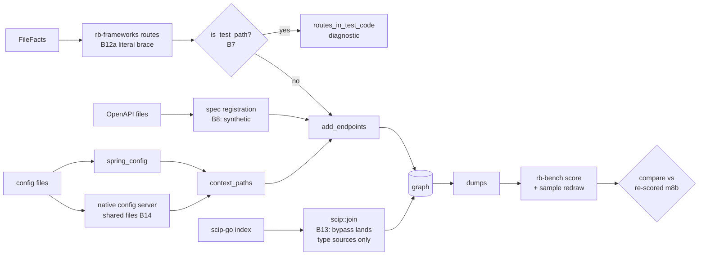

# M9a contract: `exact` precision from the M8 benchmark (2026-10-16)

**Status:** contract written 2026-10-16 from `tasks/plan-m9.md` §4 "M9a" and `tasks/bench-findings.md` B7, B8, B11, B12 (part a), B13, B14. Every root cause below was re-read in the code at branch `m9` (`0453fda`) and checked against the M8 dumps (`var/bench/out/a038653b8478/`). Not yet implemented. Commits go on branch `m9`.

## Why

M8b's independent keys judge 130 `exact` edges and find 8 wrong (93.8 %). The `exact` sample finds 2 wrong `routes` edges and 3 wrong `scip` edges. Each wrong edge has one diagnosed cause:

| Finding | What is wrong | Measured in M8b |
|---|---|---|
| B7 | Routes registered in test files become `exact` endpoints. | hk_todo endpoints: 2 `exact` fp |
| B8 | A spec operation with no code route is an `exact` endpoint, even when the code serves another method or path. | sample `routes`: 2 FALSE (go_gin_example) |
| B13 | A Go method that satisfies an interface method gets `IMPLEMENTS` to the interface type. | sample `scip`: 2 of 3 FALSE (mattermost) |
| B14 | Context paths set in a config server's shared files are not applied. | piggymetrics endpoints: 6 `exact` fp, 6 fn |
| B12a | `value = "{taskId}"` (no leading slash) reads as an empty Java array. | anilallewar, rohitghatol: 2 fn each |
| B11 | A repository type's inherited CRUD is a `synthetic` `QUERIES`; the blind keys count it wrong. | 8 `synthetic` fp (convention) |

## Root causes, verified (file:line at `0453fda`)

- **B7.** `routes::add_endpoints` loops over every file's route facts (`crates/rb-indexer/src/routes.rs:487`), test files included. `rb_model::is_test_path` (`crates/rb-model/src/lib.rs:197`) is already the shared test rule for DI (`di.rs:296` and 14 more sites), RTA (`rta.rs:551`), liveness (`liveness.rs:242`) and `rb impact` (`rb-store/src/code.rs:321`), but not for routes. Over all 27 `noscip` dumps (352 `EXPOSES`), exactly 4 endpoints have only test-file evidence: hk_todo `GET /identity` (`pkg/handler/middleware_test.go`), `POST /sign-up` (`auth_test.go`), and mattermost `ANY /succeeds-after-retry`, `ANY /fails-forever` (`server/channels/app/download_test.go`). No endpoint mixes test and non-test evidence.
- **B8.** OpenAPI operations become registrations with `path_certainty: Certainty::Exact` (`routes.rs:854`, inside `add_spec_endpoints`; interface mappings at `:884`, unregistered proto RPCs at `:814`). An endpoint takes the best registration's certainty (`routes.rs:1070-1075`). The 2 FALSE sample edges come from the generated spec files `docs/swagger.json`, `docs/swagger.yaml` and `docs/swagger/swagger.{json,yaml}`. rb reads no `@Router` comments (no match for `@Router` in `crates/rb-frameworks/src`). go_gin_example has 3 spec-only endpoints, all wrong: `GET /auth`, `POST /api/v1/tags/import`, and the undrawn `POST /api/v1/tags/export` (the code serves `POST /tags/export`).
- **B13.** In `scip::join`, the M6d S9 bypass (`scip.rs:649-652`) sends the target to the interface type when the holder declares no supertypes. The source stays `source_key`, the method (`scip.rs:704-712`). On mattermost, 1,704 of 2,455 `scip` `IMPLEMENTS` edges have this method-to-type shape (go_clean_arch 25 of 30, microservices_demo 3 of 6). For 340 of the 342 distinct (holder type, interface) pairs, scip-go's own type relationship already gives the type-level edge (e.g. `SqlChannelMemberHistoryStore# → ChannelMemberHistoryStore#`). The other 2 pairs are partial implementations: `baseSetting` has 5 of `Setting`'s 8 methods (`pluginapi/experimental/panel/settings/base_setting.go:10-26`) and `blockBase` has 4 of `Block`'s 5 (`shared/markdown/blocks.go:28-31`).
- **B13, third edge.** `ElasticsearchInterfaceTestSuite# → IndexerJobInterface#` is type-sourced. It comes from scip-go's relationship on the type, which the bypass accepts without a walk. The suite (`elasticsearch_test.go:33-40`) has no `MakeWorker`. The same shape gives 264 `IMPLEMENTS` from 5 `*Suite#` test types on mattermost (38 to `AppIface#`). **A separate cause; M9a does not fix it** (recorded as B13b).
- **B14.** `config_file` (`crates/rb-indexer/src/lib.rs:447-472`) returns `None` for `config/src/main/resources/shared/account-service.yml` (its directory is not `src/main/resources`), so `spring_config` (`lib.rs:659`) never reads it. The file is only scanned for Feign keys (`is_settings_file`, `lib.rs:484`). `context_paths` is built from local files only (`lib.rs:1066-1073`). The config server reads `classpath:/shared` under the `native` profile (`config/src/main/resources/application.yml`). A context path that applies is `synthetic` (`routes.rs:531-536`, contract M4a amendment 4); without one the route is `exact`.
- **B12a.** `mapping_paths` (`crates/rb-frameworks/src/routes.rs:528`) treats any value starting with `{` and with no items as an array. A string literal `"{taskId}"` (`literal: true`) is read as an empty array and gives `[""]`. The route then lands on the class path: rb's `GET / @task-webservice` carries both `TaskController.java:37` and `:48`. Only 4 sites in scored targets have this form.
- **B11.** `QUERIES` from a Spring Data repository type with all four ops, `synthetic`, provenance `orm` (e.g. hk_polls `PollRepository#`). rb's output does not explain the convention (`java-spring-jpa/table-deps-users.txt` shows `UserRepository#  read+insert+update+delete … [synthetic …]`).

## Plan corrections

1. **B7:** option A does not lose the mattermost e2e routes. The 32 judged webhook servers live in `e2e-tests/**/webhook_serve.js`, which `is_test_path` does not match. Option B ("only when the service has non-test sources") is not needed. A rule applied to every test file touches 4 endpoints on the bench.
2. **B8:** the mechanism is generated OpenAPI files, not `@Router` comments. Plan option B ("cap only comment-extracted `@Router`") would change nothing. There are 3 wrong spec-only endpoints, not 2.
3. **B13:** plan option A (re-source the method edge to its holder) would turn 1,695 method edges into duplicates of type edges that already exist. It would also create 2 new false `exact` edges (`baseSetting# → Setting#`, `blockBase# → Block#`). It also cannot fix the third edge, whose source is already a type.
4. **B14:** the shared file is not "assigned to service `config`". It is not read as Spring configuration at all. Remote config does not rank *below* local config: Spring Cloud Config's remote sources override local files by default. The file is matched by the client's `spring.application.name`, not by directory name.
5. **Targets:** "122/130 → 130/130" is wrong. The 6 B14 edges become `synthetic` tp, the 2 B7 edges vanish, and B12a adds 4 `exact` tp: predicted **126/126**. "routes 60/60, scip 60/60" cannot be promised. The sample is a function of the dumps (`crates/rb-bench/src/sample.rs:1-6`), so removing edges redraws it. Replaying the sampler over the M8 dumps with M9a's removals reproduces M8b's 249 draws exactly and then gives **25 `routes` and 55 `scip` drawn edges with no verdict**. They must be judged before the gate passes.
6. **Gate mechanics:** new verdicts change the `exact:verdicts` key hash, so `compare m8b.json m9a.json` exits 2. The base is re-scored first (D6).
7. **Scope:** M9a also changes `bench/mutants/run.py`. It only mutates `crates/rb-bench/src`, and it counts a build error as KILLED (lesson "uncompilable mutants give no verdict").

## Design

**State, derived state, invariants.**
- **B7.** State: route facts per file (unchanged). Derived: the endpoint stage's input, minus test files. Invariant: no endpoint, `EXPOSES`, `HANDLED_BY`, mount prefix or composed prefix rests on a test file, and each test file with route facts is counted.
- **B8.** State: spec operations (unchanged). Derived: an OpenAPI operation's registration is `synthetic`; the endpoint keeps the best registration. Invariant: `exact` `EXPOSES` needs a code registration (a route or an interface mapping). Proto RPCs are unchanged.
- **B13.** State: SCIP symbol information (unchanged). Derived: under the bypass, only a type source makes an edge. Invariant: an `IMPLEMENTS` edge never runs from a method to a type, and every dropped relationship is counted in `relationships_dropped`.
- **B14.** State: config file texts (already in `Content.config`). Derived: one more source for `context_paths`. Invariant: a context path from a shared file is `synthetic`, never `exact`, and each application is reported by a diagnostic.
- **B12a.** Invariant: a Java string literal is a path, whatever its first character. Only a non-literal `{…}` is an array.

**Trade-offs, with this system's numbers.**
- **B7, filter at the input or in the route loop.** The loop alone would leave test files feeding mounts (`Composer`), gin group compositions and gRPC server attribution. An input filter rejects all of them in one place (lesson "reject the trick at the input"). Measured cost: 4 of 352 `EXPOSES`. Mounts leave no evidence in the dumps, so any extra removal shows only in the invariant diff, where it is classified. **Chosen:** the input.
- **B8, `synthetic` or `heuristic` for spec-only.** A spec is a stated document. That is what `synthetic` means here (context paths, M4a amendment 4). `heuristic` would also cap `CONSUMES` into spec-only endpoints, which M6f stitches `synthetic` by operation name. Both labels leave the bench's 3 wrong edges unjudged, since go_gin_example has no endpoint key. **Chosen:** `synthetic`. Blast radius: 3 edges × 2 modes on the bench, and 1 golden row (`contract-packs` `POST /users`).
- **B13, drop or re-source.** Re-sourcing duplicates 1,695 type edges with method evidence and adds 2 false `exact` edges. Dropping removes 1,732 edges bench-wide and loses only the 2 partial pairs, which are not implementations. The interface method has no node, so the method-level fact cannot be stored either way. Go methods are never orphan-eligible (`liveness.rs:329`), so `rb impact` loses no seed. **Chosen:** drop and count.
- **B14, which files and which clients.** Matching any `<svc>.yml` anywhere risks unrelated YAML. **Chosen:** read only what a config server provably serves: the `native` profile is active, `search-locations` lists `classpath:` directories, and there is exactly one such server in the repository. Clients are matched by `spring.application.name`. On the bench this touches only piggymetrics. apssouza22 has a native server, but its shared files set no context path, and it is excluded from the manifest anyway.

**NFRs.**
- Warm full bench ≤ 20 min (M8b NFR). Scoring ≤ 30 s. Two scorings are `cmp`-identical.
- `compare --perf` prints no perf warning against `m8b-perf.json` (wall ≤ 1.25×, RSS ≤ 1.15×). For mattermost `noscip-fresh` (24.73 s, 1,801,732,096 B) that means ≤ 30.9 s and ≤ 1.93 GiB. A warning is re-measured once. If it persists, it blocks the close.
- New work is linear: B14 is one pass over config files, B13 is one kind check per relationship, B7 is one path test per file.

## Decisions

- **D1 (B7).** The endpoint stage (every reader of `routes::Inputs::routes`: routes, routers and mounts, gin compositions, interface routes, gRPC server registrations) sees no file for which `rb_model::is_test_path` holds. Each such file with at least one route fact gets one `routes_in_test_code` diagnostic, detail `{"routes": n}`. Its other route diagnostics are not emitted.
- **D2 (B8).** An OpenAPI operation's own registration is `synthetic`. Interface-mapping registrations (M6f S4b) and proto RPCs keep their certainty. `spec_operation_unhandled` is unchanged.
- **D3 (B13).** Under the bypass, a source definition that is not a type (`is_type`, `scip.rs:1278`) is dropped and counted in `relationships_dropped` (and `_in_project`). No new coverage field, so scip-status goldens change only where the case occurs.
- **D4 (B14).**
  - **The server:** the one service whose effective configuration has `spring.profiles.active` containing `native` and `spring.cloud.config.server.native.search-locations` (or `searchLocations`). Each comma-separated `classpath:` entry maps to `<server>/src/main/resources/<dir>/`. `file:` entries and entries holding `{` are not read.
  - **More than one such server:** nothing is applied, and one `config_server_ambiguous` diagnostic lists them.
  - **Clients:** config clients (the existing `config_client` reason), other than the server, with an effective `spring.application.name`.
  - **Files read:** `<name>.properties|yml|yaml` and `application.properties|yml|yaml` in each location, unconditional documents only. Only `server.servlet.context-path` is taken.
  - **Precedence, lowest first:** local files < remote `application.*` < remote `<name>.*`.
  - **Output:** the prefixed path is `synthetic` (unchanged rule), plus one `config_server_context_path` diagnostic `{service, file, context_path}` per client it applies to. `config_unread` and `prefix_maybe_incomplete` are unchanged.
- **D5 (B11).** Documentation only. README "Follow data", the usage guide §4 and the design doc state that a repository type's own `QUERIES` row stands for the CRUD it inherits, not a query it states. No graph or output change: a text marker would churn goldens and the JSON contract without moving a cell. Attribution to callers stays open. No key is edited (lesson "blind keys stay blind").
- **D6 (gate).** New verdicts are appended to `bench/samples/exact.tsv` under M8b T5's protocol: judges are told "ASSUME EACH EDGE IS FALSE", transcripts go in `var/bench/labels/exact-m9a/` and are audited, and existing lines are never edited. The base is re-scored with HEAD's `rb-bench` over the M8 dumps against the new verdicts (`var/m9a/m8b-rescored.json`). It must equal `m8b.json` except for `keys["exact:verdicts"]`. `compare` runs against it.

## Claims

| # | Claim | Test |
|---|---|---|
| C1 | B7 per D1. A gin route in `x_test.go`, a Spring route under `src/test/java`, an Express route in `a.spec.ts`, and a gin group composed from a test-file call site give no endpoint and no prefix. Their production twins stay, and the diagnostic counts each test file. | unit `routes_in_test_files_are_not_endpoints` (new) |
| C2 | B8 per D2. `GET /missing` (spec only) is `synthetic`. `GET /users` and `POST /users`, joined to code routes, stay `exact`. Interface roll-down is unchanged. | unit `spec_operations_become_endpoints_and_join_code_routes` (expectation changed first), `spec_operations_on_interfaces_roll_down_to_implementors` (unchanged, green); e2e contract-packs: only `EXPOSES . -> HTTP POST /users` moves `exact` → `synthetic` (must-exist and dump) |
| C3 | B13 per D3. A method's relationship to an interface method gives no edge and adds 1 to `relationships_dropped`. A struct's relationship to the interface gives `Card# Implements Payer#`. The hostile-heritage case stays empty. | unit `go_implicit_satisfaction_lands_on_the_type_not_the_method` (renamed from `go_implicit_satisfaction_needs_no_declared_heritage`, expectation changed first), `hostile_heritage_takes_no_bypass`; e2e go-chi-sqlx: the `Card#Pay()`/`Cash#Pay()` → `Payer#` lines move from must-exist to must-not-exist; scip-status `relationships dropped 2 (2 in project, 0 anonymous)` |
| C4 | B13's third edge and its 264-edge class are out of scope. The invariant shows them unchanged, and bench-findings records B13b with the count. | invariant diff; records |
| C5 | B14 per D4. Covered: a piggymetrics-shaped tree; the git backend; a name that differs from the directory; two native servers; local vs remote precedence; shared `application.yml` vs `<name>.yml`; a non-client service of the same name; `file:` and `{application}` locations. Each row asserts the path, the `synthetic` label and the diagnostic. | unit `config_server_shared_files_set_client_context_paths` (new); `spring_context_paths_are_synthetic` (unchanged) |
| C6 | B12a. Class `/` + `"{taskId}"` → `GET /{}`. No class + `"{id}"` → `/{}`. `@GetMapping({})` → the class path. A two-element array still gives two paths. | unit `spring_literal_paths_starting_with_a_brace_are_paths` (new, rb-frameworks) |
| C7 | B11 per D5. The text is in README, the usage guide and the design doc. The 8 `synthetic` fp stay, unchanged. | evaluator reads; cell unchanged |
| C8 | `PIPELINE` `m7j-1` → `m9a-1` before the verify build. The binary of record is built from a clean `crates/`, and indexing a scratch repository records `m9a-1`. | Result: `git rev-parse HEAD`, sha256, scratch check |
| C9 | Invariant over the 38 target dumps (27 `noscip`, 11 `scip`) and the PyCG case dumps, base `a038653b8478`, by row identity, byte counts asserted non-zero. Every differing row is in a C1–C6 bucket; 0 unclassified. | `var/m9a/logs/invariant.txt` |
| C10 | Scoreboard: every drawn `exact` edge has a verdict. `compare var/m9a/m8b-rescored.json bench/scoreboard/m9a.json --accept bench/accept-m9a.tsv` exits 0, and every `changed` line is classified against the edge-set diff (lesson "never attribute a metric change without diffing edge sets"). Two scorings are `cmp`-identical. | Result, pasted tool output |
| C11 | NFRs above. | `compare --perf` output |
| C12 | Mutants m230–m247 all KILLED, none STALE or INVALID; m8b.json's 29 re-run KILLED under the new runner. | battery output |

**Predicted movement (predicted from the M8 dumps and keys; the close reports the measured diff of every cell and classifies it).**

| Cell (`bench:target:mode:class`) | m8b | Predicted m9a | Claim |
|---|---|---|---|
| `handkey:hk_todo:noscip:endpoints` (and `handkey_raw`) | tp exact 13, fp exact 2 | tp exact 13, fp 0 | C1 |
| `microsecend:mse_piggymetrics:noscip:endpoints` | tp 0, fp exact 6, fn 6 | tp synthetic 6, fp 0, fn 0 | C5 |
| `microsecend:mse_anilallewar:noscip:endpoints` | tp exact 4, fn 2 | tp exact 6, fn 0 | C6 |
| `microsecend:mse_rohitghatol:noscip:endpoints` | tp exact 4, fn 2 | tp exact 6, fn 0 | C6 |
| `microsecend:mse_piggymetrics:noscip:service_flows` | fn 2 | possible: up to 2 heuristic tp (Feign `/statistics/{}` and `/accounts/{}` now match) | C5 |
| `microsecend:mse_{anilallewar,rohitghatol}:noscip:service_flows` | fn 1 each | possible: tp +1 through the new `/{}` endpoints | C6 |
| the other 306 to 309 of the 314 cells | | identical | |

- **Aggregates (predicted):** handkey endpoints P 95.1 % → 100 %. microSecEnD endpoints P 88.7 % → 100 % (57/57), R 75.8 % → 91.9 % (57/62; the 5 fn left are B12b, Spring Data REST).
- **Certainty table (predicted):** `exact` 122/130 → 126/126. `synthetic` 16/24 → 22/30 (73.3 %).
- **Sample (predicted):** `manifest` 60/60, `orm` 9/9 and `sql` 59/60 keep their draw, since their pools do not change. `routes` (pools: mattermost 68 → 64, go_gin_example 18 → 15) and `scip` (mattermost 54,764 → 53,060, go_clean_arch 171 → 146, microservices_demo 363 → 360) are redrawn: 25 and 55 edges to judge, 0 of the 264 suite edges drawn.
- **`compare` (predicted):** no regression, so the accept file holds only its header. Any line added must name its cell, the diff that explains it, and the claim.

## Phases

Rules for every phase:
- The failing test is written and seen failing before the fix.
- One file, one edit per message.
- No `git checkout --` (undo with the edit tool).
- `cargo build -p rb-cli` before any e2e run.
- No `cargo` while a container suite runs.
- Every bless is followed by `git diff` of the golden, row by row.

**P0. Harness and baseline.**
- **Files:** `bench/mutants/run.py`.
- **Action:** A spec may name `crate` (default `rb-bench`) and `test` (a filter), and is applied to `crates/<crate>/src/<file>`. The command is `cargo test -q -p <crate> --lib [test]`; rb-bench keeps its own. KILLED needs a failing test in the output (`test result: FAILED` or `panicked at`); a build error is INVALID. After replacing, the runner asserts that `new` occurs. The cache key covers every crate a spec names. Then re-score the M8 dumps with HEAD's rb-bench using M8b's arguments.
- **Verify:** fresh `python3 -I bench/mutants/run.py bench/mutants/m8b.json --jobs 4` gives 29 KILLED. A throwaway spec with a type error reports INVALID. The re-score is `cmp`-identical to `bench/scoreboard/m8b.json`.
- **Done:** the three outputs are in the Result.

**P1. B12a.**
- **Files:** `crates/rb-frameworks/src/routes.rs`.
- **Action:** C6 test first (fails with `GET /`), then the fix at `routes.rs:528`.
- **Verify:** `cargo test -p rb-frameworks --lib`; mutants m230–m231.
- **Done:** green, both mutants killed.

**P2. B7 and B8.**
- **Files:** `crates/rb-indexer/src/routes.rs`, `crates/rb-indexer/src/lib.rs` (only if the filter sits at the call site), `crates/rb-cli/tests/e2e.rs` (contract-packs doc comment), contract-packs goldens.
- **Action:** the C1 test first, and the C2 expectation changed first; then D1 and D2.
- **Verify:** `cargo test -p rb-indexer --lib routes`. Re-bless the contract-packs e2e and diff the goldens: only the `POST /users` rows change. Mutants m232–m235.
- **Done:** green, diff classified.

**P3. B13.**
- **Files:** `crates/rb-indexer/src/scip.rs`, go-chi-sqlx goldens.
- **Action:** the C3 test first, then D3.
- **Verify:** `cargo test -p rb-indexer --lib scip`. Re-bless the go-chi-sqlx SCIP e2e: the diff is 2 `IMPLEMENTS` rows and the counter. Mutants m236–m238.
- **Done:** green, diff classified.

**P4. B14.**
- **Files:** `crates/rb-indexer/src/lib.rs`.
- **Action:** the C5 test first, then D4.
- **Verify:** `cargo test -p rb-indexer --lib config_server`. Probe: index `var/bench/repos/mse_piggymetrics` with `target/debug/rb --no-scip` as repo `t_m9a_pigg`; the 11 Spring `EXPOSES` carry `/accounts`, `/statistics`, `/notifications` or `/uaa` and are `synthetic`. Then delete the repo. Mutants m239–m247.
- **Done:** green, probe output in the Result.

**P5. Close the code.**
- **Files:** `crates/rb-indexer/src/lib.rs` (`PIPELINE`), `bench/mutants/m9a.json`, `README.md`, `docs/usage-and-testing.md`, `docs/repository-brain-design.md`.
- **Action:** `PIPELINE` `m9a-1`; B11 text (D5); behaviour notes for B7, B8 and B14; usage guide §5.4 (runner `crate` field) and §5.5 (re-score the base when verdicts are added).
- **Verify:**
  - `cargo fmt --all --check && cargo clippy --workspace --all-targets -- -D warnings && echo CLEAN`.
  - The full real-Docker run of usage guide §5.2 (`RB_TEST_DATABASE_URL=…55433`), log kept: 0 failed, `grep -c 'skipping:'` = 0.
  - `SELECT name, checkout FROM rb.repo` is identical before and after.
  - Both batteries all KILLED, re-run after the last fmt.
- **Done:** committed on `m9`.

**P6. Bench.**
- **Build:** `var/m9a/bin/rb` from the committed tree. The script refuses a dirty `crates/` or `migrations/`, and prints HEAD with the sha256.
- **Run:** `nohup bench/run.sh var/m9a/bin/rb` (detached).
- **Invariant:** C9.
- **Sample:** `rb-bench sample` lists the drawn edges with no verdict; they are judged per D6.
- **Score:** twice, then `cmp`. Write `bench/scoreboard/m9a.json` and `m9a-perf.json`.
- **Gate:** re-score the base (D6), then `compare` with `--accept bench/accept-m9a.tsv --perf`.
- **Done:** C9–C11 hold, and measured and predicted cells sit side by side.

**P7. Records and evaluators.**
- **Records:** `CHANGELOG.md`, `IMPLEMENT.md`, this contract's Result, `tasks/todo.md`, `tasks/bench-findings.md` (B7, B8, B12a, B13 and B14 fixed, with measured numbers; B13b added; B11 documented), `tasks/lessons.md`, `README.md` (status line), usage guide, design doc milestone row.
- **Evaluators:** pass 1 (full, hostile) and pass 2 (verification only).

## Mutants (`bench/mutants/m9a.json`, from m230)

Each spec mutates one line that survives a reflow and cannot break compilation. A kill counts only from a compiling tree.

| Id | Crate | Mutation | Killed by |
|---|---|---|---|
| m230 | rb-frameworks | brace guard back to `!arg.value.starts_with('{')` alone | `spring_literal_paths_starting_with_a_brace_are_paths` |
| m231 | rb-frameworks | non-literal `{}` read as a path | same |
| m232 | rb-indexer | the test-path filter → `false` | `routes_in_test_files_are_not_endpoints` |
| m233 | rb-indexer | `routes_in_test_code` not pushed | same |
| m234 | rb-indexer | OpenAPI registration back to `Certainty::Exact` | `spec_operations_become_endpoints_and_join_code_routes` |
| m235 | rb-indexer | `EXPOSES` takes `.min()` of registrations | same, and `spec_operations_on_interfaces_roll_down_to_implementors` |
| m236 | rb-indexer | non-type guard removed (methods land on the interface) | `go_implicit_satisfaction_lands_on_the_type_not_the_method` |
| m237 | rb-indexer | guard drops type sources too | same |
| m238 | rb-indexer | the drop not counted | same |
| m239 | rb-indexer | `native` profile gate removed | `config_server_shared_files_set_client_context_paths` |
| m240 | rb-indexer | client name from the service directory | same |
| m241 | rb-indexer | single-server gate removed | same |
| m242 | rb-indexer | local beats remote | same |
| m243 | rb-indexer | remote `application.*` beats `<name>.*` | same |
| m244 | rb-indexer | config-client gate removed | same |
| m245 | rb-indexer | `file:` locations read | same |
| m246 | rb-indexer | `{…}` locations read | same |
| m247 | rb-indexer | context-path certainty `Synthetic` → `Exact` (`routes.rs:535`) | same, and `spring_context_paths_are_synthetic` |

No M9a mutant touches a database write.

## Verification (closing bar)

- Tests first. Mutants m230–m247 killed; m8b.json re-run killed.
- fmt and clippy clean. The real-Docker suites: 0 failed, 0 skipped, full log kept. The shared DB's `rb.repo` is unchanged.
- `PIPELINE` `m9a-1`. The binary of record is built from the last code change (C8).
- Invariant C9: every differing row classified.
- Scoreboard against the previous close: `rb-bench compare` exit 0, or every accepted cell classified.
- Every changed cell is reported measured beside predicted.
- Scoreboard determinism: two scorings `cmp`-identical.
- Evaluator pass 1, then pass 2 (verification only).

## Out of scope (M9b, M9c)

- **M9b:**
  - B1, the cross-module SCIP join.
  - B9, Go cross-file receiver methods and gin method values.
  - B10, `fmt.Sprintf` table constants.
  - B12b, `@RepositoryRestResource` endpoints.
  - B13b, scip-go's type relationships on `*Suite#` test types (264 edges): read the raw index before choosing a fix.
- **M9c:** B2, B3 and B5 (Tier B call recall).
- **M9d:** B4 (SCIP fetch failures).
- **Residue recorded here:**
  - Unregistered proto RPCs stay `exact` (4 in contract-packs, 0 on the bench). This is the B8 question for `.proto`, with no measured error.
  - Boot 1 `server.context-path` and `contextPath`.
  - Profile-specific remote files (`<name>-<profile>.yml`) and git backends.
  - Attributing inherited CRUD to callers (B11).

## Amendments

None yet. Append each amendment after the previous one's last sentence (lesson of 2026-10-11).

## Result

Not yet built.
