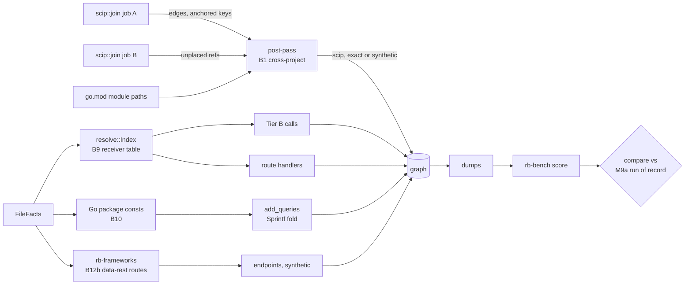

# M9b contract: cross-module SCIP, Go receivers, folded SQL, Spring Data REST (2026-10-16)

**Status:** contract written 2026-10-16 from `tasks/plan-m9.md` §2–§4 "M9b", `tasks/bench-findings.md` B1, B9, B10, B12 (part b), and M9a's hand-over of B13b. Every root cause below was re-read in the code at branch `m9` (`2b5e956` plus M9a's uncommitted P5). Not yet implemented. Commits go on branch `m9`, after M9a closes.

**Evidence limits at planning time.** The mattermost dumps (`mattermost.{noscip,scip}.jsonl`) were deleted from `var/bench/out/a038653b8478/` on 2026-10-16 03:19, and the raw SCIP indexes live only in `rb.scip_index` (`migrations/0004_scip_index.sql`), which could not be read while the Docker suite ran. So the mattermost numbers below come from the M8 findings, `mattermost.scip.status`, the scoreboard and scans of the pinned repository. Where a number needs the index, P0 measures it first.

## Why

| Finding | What is missing | Measured in M8b |
|---|---|---|
| B1 | SCIP mode drops calls from `server/` into `server/public/`, a second Go module and SCIP job. | `scip:mattermost:noscip:calls`: 6,108 of 6,147 fp are such calls |
| B9 | A Go method declared in another file than its receiver type is no member of that type. | hk_todo `handler_binding` 0 of 13 |
| B10 | `fmt.Sprintf("… FROM %s …", todoListsTable)` with a package `const` gives no `QUERIES`. | hk_todo `table_queries` 0/26, `table_ops` 0/26 |
| B12b | `@RepositoryRestResource` repositories serve endpoints rb never emits. | mse_jferrater endpoints 0 of 5 |
| B13b | scip-go relates 5 test-suite types to interfaces they do not implement. | 277 `IMPLEMENTS` on mattermost, 264 of them from the 4 types in `_test.go` files (M9a amendment 2) |

## Root causes, verified (file:line at `2b5e956`)

- **B1, the join.** `lib.rs:1032-1094` runs `scip::join` once per SCIP job, with only the files that job owns (`owner_of`, `lib.rs:1015`). Inside, `defined` is the global symbols defined by that job's accepted documents (`scip.rs:326-331`) and `nodes` its anchored keys (`scip.rs:417-421`). A reference whose symbol is not in `defined` is counted `references_undocumented` when its package is one of the job's own, else `references_external` (`scip.rs:549-556`), and gives no edge. Tier B adds nothing either: it skips exact files (`resolve::add_edges(…, &exact_files)`, `lib.rs:1167`).
- **B1, the symbols cannot be equal.** `server/go.mod:50` requires `github.com/mattermost/mattermost/server/public v0.4.3`. There is no `replace`, and `go.work` is gitignored (`.gitignore:59`, `server/.gitignore:26`; the Makefile generates it). The module cache holds `server/public/@v/v0.4.3.zip` (`var/scip/cache/bench_mattermost_scip/gomod/cache/download/…`). So server's index names `scip-go gomod github.com/mattermost/mattermost/server/public v0.4.3 …`, while server/public's own job defines the same descriptors under version `.` (the form every own-module symbol has in the dumps, e.g. `scip-go gomod github.com/bxcodec/go-clean-arch . …`). A union of `defined` sets compared by string joins nothing. The compiler also resolved these calls to v0.4.3 from the proxy, not to the repository's source.
- **B1, where the references land today is unknown.** Every scip-go status line reads `external 0`, including go_clean_arch, which calls echo and logrus and has 10 `Package` nodes. Server reads `undocumented 14312`, `unmatched 217117`. So scip-go dependency references either fail `names_token` (`scip.rs:1136-1149`) or the span lookup before the `defined` test, or are counted elsewhere. Lesson "print the input before theorizing": P0 reads the index.
- **B1, the reference.** The SCIP reference is every `scip`-provenance `CALLS` row of the SCIP dump, whatever its certainty (`rb-bench/src/scip_ref.rs:44-50`), judged where both ends lie in covered files (`scip_ref.rs:70-76`). server and server/public are both covered, so joined calls enter `gold`.
- **B9.** `attach_go_methods` (`rb-syntax/src/lib.rs:1145-1161`) makes a method a child of its receiver type only when the type is top-level in the same file. Otherwise it keeps `parent: None, receiver: Some(T)` (test at `lib.rs:1494`). `Index::members` (`resolve.rs:963`) looks only at `named(file, Some(type), …)`, which sees same-file children. Route handlers resolve through `handler_targets` (`routes.rs:1003`) → `Index::handler_targets` (`resolve.rs:494`) → `call`, the Tier B path. In hk_todo, `h` in `h.signUp` is the receiver of `func (h *Handler) InitRoutes()` (`pkg/handler/handler.go:21`), already bound to `Handler`. Only the member lookup fails. `route_handler_unresolved` is pushed at `routes.rs:637-650`.
- **B9, a second defect.** The bare-name package table (`resolve.rs:441-451`) takes every definition with `parent.is_none()`, so a cross-file method is listed as a package-level name. A bare call `signUp()` in the package can resolve to it, which Go forbids. No such edge exists in the four Go dumps we have.
- **B10.** Go string literals keep `%s` as text (`rb-syntax/src/strings.rs:85-96`, `holes: &[]`). `rb_sql::tables_of` retries a failed parse after `positional()` rewrites `%s` to `$n` (`rb-sql/src/lib.rs:278-288`), and `FROM $1` fails too. `add_queries` (`rb-indexer/src/sql.rs:332`) gets no tables. `Sprintf` is not a sink, so the statement would be `heuristic` (`sql.rs:366-370`), and no `unparsed_sql` is pushed (`sql.rs:352`). The candidate holds no arguments (`SqlCandidate`, `rb-syntax/src/lib.rs:256-265`); the call's arguments are in `facts.chains` (`rb-syntax/src/calls.rs:103-124`). No fold resolves an unqualified Go `const` from a sibling file (`constants.rs:87-111`, `resolve.rs:525-568`), and `add_queries` runs before `resolve::Index::new` (`lib.rs:1129`, `lib.rs:1162`).
- **B10, the data.** hk_todo's 5 table names are a package-level `const ( … )` block (`pkg/repository/postgres.go:8-14`), declared once, used only as `Sprintf` arguments in sibling files. 14 non-test SQL strings, all `fmt.Sprintf`. 12 use only these constants. The 2 `Update` functions also pass `setQuery` and `argId` (`todo_list_postgres.go:94-95`, `todo_item_postgres.go:101-103`); they carry 5 of the 26 key rows.
- **B12b.** No code reads `@RepositoryRestResource` (no match in `crates/`). The 5 jferrater repositories (`AccountRepository.java:7-8`, `PriceRepository.java:12-13`, `StoreRepository.java:14-15`, `CustomerRepository.java:14-15`, `ItemRepository.java:15-16`) each extend `CrudRepository<X, Long>` and set a literal `path`. Each service's pom has `spring-boot-starter-data-rest`. rb already maps their entities and emits `synthetic` `QUERIES` from them (dump rows 267, 292, 383, 407, 440).
- **B12b, the key.** The model lists `/accounts`, `/customers`, `/stores`, `/items/search/findByItemCode?itemCode={itemCode}`, `/prices/search/findByItemCode?itemCode={itemCode}`. Matching drops the method (`rb-bench/src/msecend.rs:354-367`) and the query string (`structural.rs:19`). An in-scope rb endpoint not in gold is an fp at its certainty (`msecend.rs:373-389`, `score.rs:121-127`).
- **B13b.** The 5 types are, by a source scan, exactly those that embed testify's `suite.Suite` directly or through `common.CommonTestSuite` (`MmctlUnitTestSuite`, `CommonTestSuite`, `ElasticsearchInterfaceTestSuite`, `OpensearchInterfaceTestSuite`, `FileBackendTestSuite`). None declares `MakeWorker` or `AppIface`'s methods. That points at scip-go's method-set computation for embedded dependency types, but it is a pattern, not a reading of the index.

## Plan corrections

1. **B1 mechanism:** a repo-wide `defined` set compared by string joins nothing on mattermost, because the referencing module requires a published version (`v0.4.3`) and the defining job's symbols carry `.`. The join must also look at other jobs' *anchored* keys (`nodes`), not just `defined`.
2. **B1 certainty:** the compiler bound these calls to v0.4.3 from the proxy. An edge to the repository's own declaration of the same name is a convention (Mattermost's generated `go.work`), so it is `synthetic`, not `exact`.
3. **B1 restructure:** no two-pass rewrite of `join` is needed. Each job already computes its anchored keys; references it cannot place are handed back and resolved after the job loop.
4. **B1 numbers:** agreement precision today is 72.4 % (16,155 / 22,302), not 74.3 %. "~7,700 exact CALLS" is unknown until P0, and they will not be exact. "`compare` flags `gold` rising" is false: it flags `gold` falling and `fn` rising (`compare.rs:200-213`). A reference change inside the dumps needs no base re-score; only key or pin changes do (`compare.rs:66-79`).
5. **B9:** `Index::new` starts at `resolve.rs:406`, not 453. The plan misses the bare-name defect above.
6. **B10 mechanism:** rb-syntax does not turn `%s` into `$1`; `rb_sql`'s retry does. `add_queries` is at `sql.rs:332`. No existing fold handles a sibling-file constant, and the SQL stage runs before the index. `rb-syntax/src/strings.rs` need not change.
7. **B10 target:** 26/26 is impossible without inventing SQL for `SET %s`. A constant-only fold gives at most **21/26** on each class.
8. **B10 certainty:** "`Exact` for same-file `const`" applies to 0 hk_todo sites and contradicts design §7.1 (`exact` means a recognised sink). Java `String.format` SQL occurs 0 times on the bench; out of scope.
9. **B12b:** the scope that recovers 5/5 also emits real endpoints the model does not list (6 search paths, 5 item resources). They score as `synthetic` fp unless adjudicated. The plan's "→ 100 %" ignores them.
10. **Scope:** the plan omits B13b, `lib.rs`, `rb-store/src/query.rs` (its `exact calls (scip)` count reads provenance only, `query.rs:559`) and the jferrater adjudication file.

## Design

**State, derived state, invariants.**
- **B1.** State: each job's index (unchanged) and `Content.go_modules` (`lib.rs:405`). Derived: per job, references whose global symbol the job does not define, with source and evidence; repo-wide, each job's anchored keys. Invariant: a cross-project edge has `scip` provenance and points at a key anchored in exactly one other job; it is `exact` only when the symbol strings are equal. Every handed-back reference ends in one counted bucket.
- **B9.** State: definitions (unchanged). Derived: `(package_key, receiver, method) → defs` over Go definitions with `parent: None, receiver: Some`. Invariant: such a definition is a member of the same-package type its receiver names, and never a bare package-level name. Symbol keys do not change.
- **B10.** State: Go top-level `const` bindings (unchanged). Derived: `(package_key, name) → value` over non-test files. Invariant: a `%s`/`%v` hole is replaced only by a constant that has exactly one declaration in the package and no visible binding of its name at the call. Anything else leaves the candidate as it is today.
- **B12b.** State: Java interface facts and decorations (unchanged). Derived: Spring Data REST route registrations. Invariant: they are `synthetic`, never `exact`; nothing is emitted without a literal `path`.

**Trade-offs, with this system's numbers.**
- **B1, two-pass join or post-pass.** `join` is 6,853 lines with per-document state; a split would touch every coverage counter. A post-pass reuses each job's output. Cost: mattermost's two big jobs anchor about 17,250 definitions (13,288 + 3,962, status line), and at most 14,312 + 217,117 references are candidates. A `BTreeMap` of anchored keys plus one lookup per handed-back reference is a few MB and well under a second. **Chosen:** post-pass.
- **B1, version-insensitive match.** Matching `(manager, package name, descriptors)` while ignoring the version is right only when the package name is the module path of another job's `go.mod` and that job's symbols carry the empty version. Other managers are not measured. **Chosen:** scip-go only, module path checked, `synthetic`. Equal strings in any indexer are `exact`.
- **B9, index table or attach in rb-syntax.** `parent` is a same-file index, so rb-syntax cannot attach across files. **Chosen:** the index. Mattermost has 10,132 Go methods (3,085 cross-file); the table is linear and small.
- **B10, Index-based fold or a local table.** Moving `add_queries` after the index changes the order of every SQL edge producer. A Go-only `(package_key, name) → value` table built from facts before `add_queries` needs no index. **Chosen:** the table. Certainty stays `heuristic` (the callee is not a sink), so the `exact` `sql` sample is untouched.
- **B12b, which repositories.** Spring's default strategy also exports unannotated public repositories, and the default path needs Evo Inflector pluralisation. On mse_mdeket that would add in-scope fp (`UserRepo.java:14`). **Chosen:** annotated repositories with a literal `path` only.

**NFRs.**
- Warm full bench ≤ 20 min. Scoring ≤ 30 s. Two scorings are `cmp`-identical.
- `compare --perf` against the M9a run of record's perf file prints no warning (fresh wall ≤ 1.25×, RSS ≤ 1.15×). In M8b terms, mattermost `scip` was 21.54 s and 2,135,392,256 B, `noscip-fresh` 24.73 s and 1,801,732,096 B. A warning is re-measured once; if it persists, it blocks the close.
- Each new table is built in one pass over its inputs, and each lookup is a map access.

## Decisions

- **D1 (B1, hand-back).** `join` returns, beside its edges, each reference it does not place because its global symbol is not in `defined` (both the `undocumented` and the `external` case), with source key, edge kind and evidence. The job's coverage counters keep today's meaning.
- **D2 (B1, post-pass).** After the job loop, each handed-back reference is resolved against the anchored keys of every other ok job:
  - The same string anchored in exactly one other job: `exact`.
  - Else, for scip-go only: the reference's package name equals the module path of another job's root (`go_modules`), that job anchors the symbol with the empty version and the same descriptors, and exactly one job does: `synthetic`.
  - Two or more candidate jobs: no edge, counted `ambiguous`.
  - A symbol defined there but not anchored: counted `unanchored`. Otherwise left as today.
  - Each edge has provenance `scip`. The source is the referencing job's key.
- **D3 (B1, report).** One `scip_cross_project` diagnostic per (from root, to root) pair with an edge or a count: `{exact, synthetic, ambiguous, unanchored}`. `rb status`'s `exact calls (scip)` counts certainty `exact` only (`query.rs:559`). `DEPENDS_ON` packages are unchanged.
- **D4 (B1, gate).** B1 is built only if P0 shows server→server/public reference occurrences that reach the `defined` test. If they fail earlier (`names_token`, span), B1 moves to M9c with the probe output, and this contract gets an amendment.
- **D5 (B9).** `resolve::Index` keeps `(package_key, receiver, method) → defs` for Go definitions with `parent: None` and `receiver: Some`. `members` adds these for a Go type, keyed by the type's own file's `package_key`. Such definitions leave the bare-name package table. `_test.go` methods of an internal test package attach like any other (2 cases on mattermost, recorded).
- **D6 (B10).**
  - **Candidate:** a Go `SqlCandidate` whose call is `fmt.Sprintf` (qualifier `fmt` bound to the `fmt` import) and whose format literal is `args[0]`, matched by span to `facts.chains`.
  - **Verbs:** `%s` and `%v` take the next argument, `%%` becomes `%`. Any other verb, flag, width or index (`%d`, `%q`, `%[1]s`, `%5s`) leaves the candidate unfolded.
  - **Arguments:** each must be `Arg::Name` naming a constant of the table. The table holds Go top-level `const` string bindings of non-test files, keyed `(package_key, name)`, with exactly one declaration of that name at package level (any kind). The call's file must have no visible binding of the name at the call (`binding_index_at`).
  - **Output:** the folded text goes to `rb_sql::analyze` in place of the literal. Certainty, source and evidence follow today's rules (`heuristic`). One `sql_folded` diagnostic per file `{sites, constants}`.
- **D7 (B12b).**
  - **When:** a Java interface annotated `@RepositoryRestResource` (import-checked through `org.springframework.data.rest.core.annotation`) whose `path` is a non-blank string literal, `exported` not `false`, which directly extends a `REPOSITORY_BASES` type (`rb-frameworks/src/lib.rs:194-201`), in a service whose build manifest names `spring-boot-starter-data-rest` or `spring-data-rest-webmvc`.
  - **Emit**, each `synthetic`:
    - `GET /{path}`;
    - for `CrudRepository`, `ListCrudRepository` or `JpaRepository` bases, also `POST /{path}` and `GET|PUT|PATCH|DELETE /{path}/{id}`;
    - `GET /{path}/search/{m}` for each declared method `m` named `find…By`, `read…By`, `get…By`, `query…By`, `count…By` or `exists…By`, except `@RestResource(exported = false)`, `@RestResource(path = "…")` replacing the name, and except CRUD names (`findById`, `findAll`, `findOne`, `count`, `existsById`), whose meaning depends on the Spring Data version.
  - **Handlers:** collection and item endpoints bind to the interface, search endpoints to the method.
  - **Base path:** a local `spring.data.rest.base-path` (or `basePath`) prefixes the path. A `RepositoryRestConfigurer` in the service caps the endpoints at `heuristic` and pushes one `data_rest_base_unread`. `prefix_maybe_incomplete` follows today's rule.
- **D8 (B13b).** Not fixed in M9b. P0 records, from the raw index, the relationships and symbol information of the 5 suite types and of one true embedded-method implementer. The fix goes to M9c with that record.
- **D9 (gate).** M9b's base is the M9a run of record (`bench/scoreboard/m9a.json`, its dumps and perf). The jferrater key gains an adjudication file (`bench/keys/microsecend/mse_jferrater.md`) made under M8b's protocol: the adjudicator gets `endpoint_review`'s side-blind list, judges each entry against the pinned source and the Spring Data REST reference, and only ADD and REMOVE lines are written. The microSecEnD key hash then changes, so the base is re-scored with HEAD's rb-bench over the M9a dumps (`var/m9b/m9a-rescored.json`). It must equal `m9a.json` except the key hash and the `mse_jferrater` endpoints cell. If drawn `exact` edges lack verdicts, M9a D6 applies unchanged.

## Claims

| # | Claim | Test |
|---|---|---|
| C1 | P0 probe recorded: per scip-go job of mattermost, the count of reference occurrences into another job's module path, their versions, how many name a descriptor the other job defines, and where today's join puts them; the reason for `external 0`; B13b's relationships. | `var/m9b/probe-scip.txt`, script in `bench/probe/` |
| C2 | B9 per D5. Two files, `type H` in one and `func (h *H) M()` in the other: `h.M()` resolves; a second package with its own `H` does not; a bare `M()` gives no edge. A gin `r.POST("/x", h.M)` binds `HANDLED_BY` to `M`. | unit `go_methods_in_sibling_files_are_members` (resolve), `gin_method_value_handlers_bind_across_files` (routes) |
| C3 | B10 per D6. Folds: sibling-file constant, `%v`, `%%`. Refuses: local shadow, `var`, two declarations, a test-file constant, `%d`, `%[1]s`, a non-`fmt` `Sprintf`, a non-constant argument. Each refusal gives today's output. | unit `sprintf_sql_folds_package_constants` (sql) |
| C4 | B12b per D7. A `CrudRepository` with `path="accounts"` and two finders gives 8 endpoints; `exported=false`, a non-literal path, no data-rest dependency, an unimported homonym annotation each give none; a bare `Repository` base gives search endpoints only; `findById` gives none; all are `synthetic`. | unit `spring_data_rest_repositories_expose_endpoints` (rb-frameworks), `data_rest_endpoints_are_synthetic` (rb-indexer routes) |
| C5 | B1 per D1–D3 (if D4 passes). Two jobs: equal symbol → `exact`; `v0.4.3` vs `.` with matching module path → `synthetic`; non-matching module path → none; two anchoring jobs → `ambiguous`; the diagnostic counts each. | unit `references_into_another_project_join_by_module_path` (lib) |
| C6 | `rb status` `exact calls (scip)` excludes non-exact `scip` rows. | e2e scip-status goldens unchanged |
| C7 | `PIPELINE` `m9a-1` → `m9b-1` before the verify build; the binary of record is built from a clean `crates/`. | Result: HEAD, sha256, scratch check |
| C8 | Invariant over all target dumps and PyCG case dumps, base the M9a run of record, by row identity, byte counts non-zero. Every differing row is in a C2–C5 bucket; 0 unclassified. | `var/m9b/logs/invariant.txt` |
| C9 | `compare var/m9b/m9a-rescored.json bench/scoreboard/m9b.json --accept bench/accept-m9b.tsv --perf` exits 0, each `changed` and `accepted` line classified against the edge-set diff. Two scorings `cmp`-identical. | Result, pasted output |
| C10 | NFRs above. | `compare --perf` output |
| C11 | Mutants m248–m271 all KILLED, none STALE or INVALID; `m8b.json` and `m9a.json` batteries re-run KILLED. | battery output |
| C12 | B13b recorded in bench-findings with C1's evidence and moved to M9c. | records |

**Predicted movement (predicted from the M8 dumps, keys and repo scans; the close reports the measured diff of every cell beside these).**

| Cell (`bench:target:mode:class`) | m8b (M9a predicts no change) | Predicted m9b | Claim |
|---|---|---|---|
| `handkey:hk_todo:noscip:handler_binding` (and `handkey_raw`) | tp 0, fn 13 | tp heuristic 12, fn 1 (swagger library handler) | C2 |
| `handkey:hk_todo:noscip:table_queries` (and `_raw`) | tp 0, fn 26 | tp heuristic 21, fn 5 (`Update` rows); fp possible, each classified | C3 |
| `handkey:hk_todo:noscip:table_ops` (and `_raw`) | tp 0, fn 26 | tp heuristic 21, fn 5 | C3 |
| `microsecend:mse_jferrater:noscip:endpoints` | tp 0, fn 5 | tp synthetic 5, fn 0; extras scored per the adjudication (up to 10 more gold, or fp synthetic) | C4 |
| `scip:mattermost:noscip:calls` | gold 33,312, tp 16,155, fp 6,147, fn 17,157 | if D4 passes: gold +X, tp up to +6,108, fp down to ~39, fn +(X − joined tp); X from C1 | C5 |
| `scip:mattermost:noscip:calls_file_scope` | gold 978 | possible gold and tp rise, same cause | C5 |
| `scip:microservices_demo:noscip:calls` | | possible tp rise: about 27 call sites of 22 cross-file `frontendServer` methods | C2 |
| `scip:mattermost:noscip:calls` (Tier B side) | | tp rise from 2,766 non-test cross-file methods; fp may rise; classified | C2 |
| all other cells | | identical | |

- **`compare` (predicted):** `fn` rises on `scip:mattermost:noscip:calls` if X exceeds the joined tp; that needs an accept line naming C5 and the diff. Any `fp synthetic` rise on jferrater not covered by the adjudication needs one too. No `exact` fp can rise: every new edge is `heuristic` or `synthetic`, except equal-string B1 joins, predicted 0 on the bench.
- **`exact` sample (predicted):** no pool changes, so no redraw. B9 and B10 add `heuristic` rows, B12b and cross-version B1 `synthetic` ones.

## Phases

Rules for every phase: the failing test is written and seen failing first; one file, one edit per message; no `git checkout --`; `cargo build -p rb-cli` before any e2e; no `cargo` while a container suite runs; every bless is followed by a row-by-row `git diff` of the golden.

**P0. Probes and baseline.**
- **Files:** `bench/probe/scip_cross.py` (new, `python3 -I`, reads an `index.scip` with a minimal protobuf reader).
- **Action:** after the Docker suite is idle, export the mattermost `server` and `server/public` indexes and the go_clean_arch index from `rb.scip_index` to `var/m9b/` with `psql \copy` (read-only). Write C1 and D8's record. Decide D4. Re-score the M9a run of record with HEAD's rb-bench.
- **Verify:** the probe prints non-zero document and occurrence counts before any ratio. The re-score is `cmp`-identical to `bench/scoreboard/m9a.json`.
- **Done:** `var/m9b/probe-scip.txt` exists; D4's outcome is written in an amendment.

**P1. B9.**
- **Files:** `crates/rb-indexer/src/resolve.rs`, `crates/rb-indexer/src/routes.rs` (test only).
- **Action:** C2 tests first, then D5.
- **Verify:** `cargo test -p rb-indexer --lib resolve` and `routes`. Probe: index `var/bench/repos/hk_todo` with `target/debug/rb --no-scip` as `t_m9b_todo`; 12 `HANDLED_BY` to `pkg/handler/{auth,list,item}.go` methods and 1 `route_handler_unresolved` (`swaggerFiles.Handler`). Delete the repo. Mutants m248–m251.
- **Done:** green, probe in the Result.

**P2. B10.**
- **Files:** `crates/rb-indexer/src/sql.rs`, `crates/rb-indexer/src/lib.rs`, `crates/rb-indexer/src/resolve.rs` (`package_key` visibility only).
- **Action:** C3 test first, then D6.
- **Verify:** `cargo test -p rb-indexer --lib sql`. Probe on hk_todo: `QUERIES` from the 12 repository functions, 0 from the 2 `Update` functions. Mutants m252–m258.
- **Done:** green, probe in the Result.

**P3. B12b.**
- **Files:** `crates/rb-frameworks/src/routes.rs`, `crates/rb-frameworks/src/lib.rs`, `crates/rb-indexer/src/routes.rs`, `crates/rb-indexer/src/lib.rs`.
- **Action:** C4 tests first, then D7.
- **Verify:** `cargo test -p rb-frameworks --lib routes`, `cargo test -p rb-indexer --lib routes`. Probe on mse_jferrater: 5 × (collection, item, search) endpoints as D7 lists, all `synthetic`; FoodTray's Feign calls to `/items/search/findByItemCode` and `/prices/search/findByItemCode` now match. Mutants m259–m265.
- **Done:** green, probe in the Result.

**P4. B1 (only if D4 passed).**
- **Files:** `crates/rb-indexer/src/scip.rs`, `crates/rb-indexer/src/lib.rs`, `crates/rb-store/src/query.rs`, scip-status goldens if any change.
- **Action:** C5 test first, then D1–D3.
- **Verify:** `cargo test -p rb-indexer --lib scip` and `lib`. The SCIP e2e suites: goldens unchanged (no fixture has two jobs that reference each other), or each changed row classified. Mutants m266–m271.
- **Done:** green, diff classified.

**P5. Close the code.**
- **Files:** `crates/rb-indexer/src/lib.rs` (`PIPELINE`), `bench/mutants/m9b.json`, `README.md`, `docs/usage-and-testing.md`, `docs/repository-brain-design.md`.
- **Action:** `PIPELINE` `m9b-1`; design notes for D2's `synthetic` cross-version join, D6 and D7; usage guide for `scip_cross_project`, `sql_folded`, `data_rest_base_unread`.
- **Verify:** `cargo fmt --all --check && cargo clippy --workspace --all-targets -- -D warnings && echo CLEAN`. The full real-Docker run of usage guide §5.2, log kept: 0 failed, `grep -c 'skipping:'` = 0. `SELECT name, checkout FROM rb.repo` identical before and after. The three batteries all KILLED, re-run after the last fmt.
- **Done:** committed on `m9`.

**P6. Bench.**
- **Build:** `var/m9b/bin/rb` from the committed tree; refuse a dirty `crates/` or `migrations/`; print HEAD and sha256.
- **Run:** `nohup bench/run.sh var/m9b/bin/rb` (detached).
- **Adjudicate:** jferrater per D9, before scoring.
- **Invariant:** C8. **Sample:** `rb-bench sample` lists drawn edges without a verdict (predicted none).
- **Score:** twice, then `cmp`. Write `bench/scoreboard/m9b.json` and `m9b-perf.json`.
- **Gate:** re-score the base (D9), then C9 and C10.
- **Done:** measured and predicted cells side by side.

**P7. Records and evaluators.**
- **Records:** `CHANGELOG.md`, `IMPLEMENT.md`, this Result, `tasks/todo.md`, `tasks/bench-findings.md` (B1, B9, B10, B12b with measured numbers; B13b's probe), `tasks/lessons.md`, README status line, usage guide, design doc milestone row.
- **Evaluators:** pass 1 (full, hostile), then pass 2 (verification only).

## Mutants (`bench/mutants/m9b.json`, from m248)

Each spec mutates one line that survives a reflow and compiles. A kill counts only from a compiling tree.

| Id | Crate | Mutation | Killed by |
|---|---|---|---|
| m248 | rb-indexer | receiver table not consulted in `members` | `go_methods_in_sibling_files_are_members`, `gin_method_value_handlers_bind_across_files` |
| m249 | rb-indexer | receiver table keyed without `package_key` | `go_methods_in_sibling_files_are_members` (second package) |
| m250 | rb-indexer | receiver-carrying defs kept in the bare-name table | same (bare `M()` row) |
| m251 | rb-indexer | lookup by the caller's file instead of the type's | same |
| m252 | rb-indexer | fold disabled | `sprintf_sql_folds_package_constants` |
| m253 | rb-indexer | shadow check removed | same |
| m254 | rb-indexer | `var` bindings enter the table | same |
| m255 | rb-indexer | duplicate declarations keep the first | same |
| m256 | rb-indexer | unknown verbs skipped instead of refusing | same |
| m257 | rb-indexer | `%%` kept as `%%` | same |
| m258 | rb-indexer | `fmt` qualifier check removed | same |
| m259 | rb-frameworks | import check on the annotation removed | `spring_data_rest_repositories_expose_endpoints` |
| m260 | rb-frameworks | `exported = false` ignored | same |
| m261 | rb-frameworks | non-literal `path` accepted | same |
| m262 | rb-frameworks | item resources for a bare `Repository` base | same |
| m263 | rb-frameworks | CRUD-named finders emitted | same |
| m264 | rb-indexer | data-rest certainty `Synthetic` → `Exact` | `data_rest_endpoints_are_synthetic` |
| m265 | rb-indexer | data-rest dependency gate removed | same |
| m266 | rb-indexer | hand-back ignored (no cross-project edges) | `references_into_another_project_join_by_module_path` |
| m267 | rb-indexer | module-path check removed | same |
| m268 | rb-indexer | cross-version join labelled `Exact` | same |
| m269 | rb-indexer | two anchoring jobs: first wins | same |
| m270 | rb-indexer | `scip_cross_project` not pushed | same |
| m271 | rb-store | `exact calls` counts every `scip` row | scip-status e2e row with a synthetic edge (rb-store test DB, lesson of 2026-10-13) |

If D4 fails, m266–m271 are dropped and the battery is m248–m265.

## Verification (closing bar)

- Tests first. Mutants m248–m271 (or m248–m265) killed; `m8b.json` and `m9a.json` re-run killed.
- fmt and clippy clean. Real-Docker suites: 0 failed, 0 skipped, full log kept. `rb.repo` unchanged.
- `PIPELINE` `m9b-1`. The binary of record is built from the last code change (C7).
- Invariant C8: every differing row classified.
- `rb-bench compare` against the re-scored M9a run of record: exit 0, or every accepted cell classified. No `exact` fp rise.
- Every changed cell reported measured beside predicted. Two scorings `cmp`-identical.
- Evaluator pass 1, then pass 2 (verification only).

## Out of scope

- **M9c:** B2, B3, B5 (Tier B call recall). B13b's fix, with P0's record. B1, if D4 fails.
- **Later, recorded:**
  - Cross-project `IMPLEMENTS` (a server type implementing a server/public interface); P0 counts them.
  - Version-insensitive joins for scip-typescript and scip-java workspaces (unmeasured).
  - Unannotated Spring Data REST repositories (`DEFAULT` strategy) and default paths through Evo Inflector.
  - `SET %s` and other non-constant SQL holes; Java `String.format` SQL (0 on the bench).
  - Go methods in internal `_test.go` files attaching to production types (2 on mattermost).

## Amendments

Append each amendment after the previous one's last sentence (lesson of 2026-10-11).

## Result

Not yet built.
