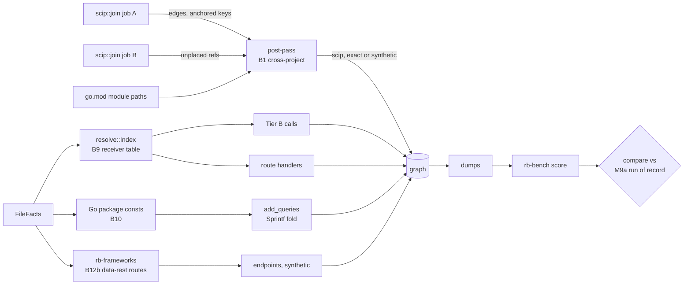

# M9b contract: cross-module SCIP, Go receivers, folded SQL, Spring Data REST (2026-10-16)

**Status:** **closed 2026-10-16.** Evaluator pass 1 PASS answered (amendment 7); evaluator pass 2 (`tasks/eval-m9b-pass2.md`, verification only) VERDICT PASS with 0 blocking, 3 should-fix and 4 notes, answered in amendment 8. The contract was written 2026-10-16 (amendment 0 before the build) from `tasks/plan-m9.md` §2–§4 "M9b", `tasks/bench-findings.md` B1, B9, B10, B12 (part b), and M9a's hand-over of B13b. Every root cause below was re-read in the code at branch `m9` (`2b5e956` plus M9a's uncommitted P5). Commits go on branch `m9`.

**Evidence limits at planning time.** The mattermost dumps (`mattermost.{noscip,scip}.jsonl`) were deleted from `var/bench/out/a038653b8478/` on 2026-10-16 03:19, and the raw SCIP indexes live only in `rb.scip_index` (`migrations/0004_scip_index.sql`), which could not be read while the Docker suite ran. So the mattermost numbers below come from the M8 findings, `mattermost.scip.status`, the scoreboard and scans of the pinned repository. Where a number needs the index, P0 measures it first.

## Why

| Finding | What is missing | Measured in M8b |
|---|---|---|
| B1 | SCIP mode drops calls from `server/` into `server/public/`, a second Go module and SCIP job. | `scip:mattermost:noscip:calls`: 6,108 of 6,147 fp are such calls |
| B9 | A Go method declared in another file than its receiver type is no member of that type. | hk_todo `handler_binding` 0 of 13 |
| B10 | `fmt.Sprintf("… FROM %s …", todoListsTable)` with a package `const` gives no `QUERIES`. | hk_todo `table_queries` 0/26, `table_ops` 0/26 |
| B12b | `@RepositoryRestResource` repositories serve endpoints rb never emits. | mse_jferrater endpoints 0 of 5 |
| B13b | scip-go relates 5 test-suite types to interfaces they do not implement. | 277 `IMPLEMENTS` on mattermost, 264 of them from the 4 types in `_test.go` files (M9a amendment 2) |

## Root causes, verified (file:line at `2b5e956`)

- **B1, the join.** `lib.rs:1032-1094` runs `scip::join` once per SCIP job, with only the files that job owns (`owner_of`, `lib.rs:1015`). Inside, `defined` is the global symbols defined by that job's accepted documents (`scip.rs:326-331`) and `nodes` its anchored keys (`scip.rs:417-421`). A reference whose symbol is not in `defined` is counted `references_undocumented` when its package is one of the job's own, else `references_external` (`scip.rs:549-556`), and gives no edge. Tier B adds nothing either: it skips exact files (`resolve::add_edges(…, &exact_files)`, `lib.rs:1167`).
- **B1, the symbols cannot be equal.** `server/go.mod:50` requires `github.com/mattermost/mattermost/server/public v0.4.3`. There is no `replace`, and `go.work` is gitignored (`.gitignore:59`, `server/.gitignore:26`; the Makefile generates it). The module cache holds `server/public/@v/v0.4.3.zip` (`var/scip/cache/bench_mattermost_scip/gomod/cache/download/…`). So server's index names `scip-go gomod github.com/mattermost/mattermost/server/public v0.4.3 …`, while server/public's own job defines the same descriptors under version `.` (the form every own-module symbol has in the dumps, e.g. `scip-go gomod github.com/bxcodec/go-clean-arch . …`). A union of `defined` sets compared by string joins nothing. The compiler also resolved these calls to v0.4.3 from the proxy, not to the repository's source.
- **B1, where the references land today is unknown.** Every scip-go status line reads `external 0`, including go_clean_arch, which calls echo and logrus and has 10 `Package` nodes. Server reads `undocumented 14312`, `unmatched 217117`. So scip-go dependency references either fail `names_token` (`scip.rs:1136-1149`) or the span lookup before the `defined` test, or are counted elsewhere. Lesson "print the input before theorizing": P0 reads the index.
- **B1, the reference.** The SCIP reference is every `scip`-provenance `CALLS` row of the SCIP dump, whatever its certainty (`rb-bench/src/scip_ref.rs:44-50`), judged where both ends lie in covered files (`scip_ref.rs:70-76`). server and server/public are both covered, so joined calls enter `gold`.
- **B9.** `attach_go_methods` (`rb-syntax/src/lib.rs:1145-1161`) makes a method a child of its receiver type only when the type is top-level in the same file. Otherwise it keeps `parent: None, receiver: Some(T)` (test at `lib.rs:1494`). `Index::members` (`resolve.rs:963`) looks only at `named(file, Some(type), …)`, which sees same-file children. Route handlers resolve through `handler_targets` (`routes.rs:1003`) → `Index::handler_targets` (`resolve.rs:494`) → `call`, the Tier B path. In hk_todo, `h` in `h.signUp` is the receiver of `func (h *Handler) InitRoutes()` (`pkg/handler/handler.go:21`), already bound to `Handler`. Only the member lookup fails. `route_handler_unresolved` is pushed at `routes.rs:637-650`.
- **B9, a second defect.** The bare-name package table (`resolve.rs:441-451`) takes every definition with `parent.is_none()`, so a cross-file method is listed as a package-level name. A bare call `signUp()` in the package can resolve to it, which Go forbids. No such edge exists in the four Go dumps we have.
- **B10.** Go string literals keep `%s` as text (`rb-syntax/src/strings.rs:85-96`, `holes: &[]`). `rb_sql::tables_of` retries a failed parse after `positional()` rewrites `%s` to `$n` (`rb-sql/src/lib.rs:278-288`), and `FROM $1` fails too. `add_queries` (`rb-indexer/src/sql.rs:332`) gets no tables. `Sprintf` is not a sink, so the statement would be `heuristic` (`sql.rs:366-370`), and no `unparsed_sql` is pushed (`sql.rs:352`). The candidate holds no arguments (`SqlCandidate`, `rb-syntax/src/lib.rs:256-265`); the call's arguments are in `facts.chains` (`rb-syntax/src/calls.rs:103-124`). No fold resolves an unqualified Go `const` from a sibling file (`constants.rs:87-111`, `resolve.rs:525-568`), and `add_queries` runs before `resolve::Index::new` (`lib.rs:1129`, `lib.rs:1162`).
- **B10, the data.** hk_todo's 5 table names are a package-level `const ( … )` block (`pkg/repository/postgres.go:8-14`), declared once, used only as `Sprintf` arguments in sibling files. 14 non-test SQL strings, all `fmt.Sprintf`. 12 use only these constants. The 2 `Update` functions also pass `setQuery` and `argId` (`todo_list_postgres.go:94-95`, `todo_item_postgres.go:101-103`); they carry 5 of the 26 key rows.
- **B12b.** No code reads `@RepositoryRestResource` (no match in `crates/`). The 5 jferrater repositories (`AccountRepository.java:7-8`, `PriceRepository.java:12-13`, `StoreRepository.java:14-15`, `CustomerRepository.java:14-15`, `ItemRepository.java:15-16`) each extend `CrudRepository<X, Long>` and set a literal `path`. Each service's pom has `spring-boot-starter-data-rest`. rb already maps their entities and emits `synthetic` `QUERIES` from them (dump rows 267, 292, 383, 407, 440).
- **B12b, the key.** The model lists `/accounts`, `/customers`, `/stores`, `/items/search/findByItemCode?itemCode={itemCode}`, `/prices/search/findByItemCode?itemCode={itemCode}`. Matching drops the method (`rb-bench/src/msecend.rs:354-367`) and the query string (`structural.rs:19`). An in-scope rb endpoint not in gold is an fp at its certainty (`msecend.rs:373-389`, `score.rs:121-127`).
- **B13b.** The 5 types are, by a source scan, exactly those that embed testify's `suite.Suite` directly or through `common.CommonTestSuite` (`MmctlUnitTestSuite`, `CommonTestSuite`, `ElasticsearchInterfaceTestSuite`, `OpensearchInterfaceTestSuite`, `FileBackendTestSuite`). None declares `MakeWorker` or `AppIface`'s methods. That points at scip-go's method-set computation for embedded dependency types, but it is a pattern, not a reading of the index.

## Plan corrections

1. **B1 mechanism:** a repo-wide `defined` set compared by string joins nothing on mattermost, because the referencing module requires a published version (`v0.4.3`) and the defining job's symbols carry `.`. The join must also look at other jobs' *anchored* keys (`nodes`), not just `defined`.
2. **B1 certainty:** the compiler bound these calls to v0.4.3 from the proxy. An edge to the repository's own declaration of the same name is a convention (Mattermost's generated `go.work`), so it is `synthetic`, not `exact`.
3. **B1 restructure:** no two-pass rewrite of `join` is needed. Each job already computes its anchored keys; references it cannot place are handed back and resolved after the job loop.
4. **B1 numbers:** agreement precision today is 72.4 % (16,155 / 22,302), not 74.3 %. "~7,700 exact CALLS" is unknown until P0, and they will not be exact. "`compare` flags `gold` rising" is false: it flags `gold` falling and `fn` rising (`compare.rs:200-213`). A reference change inside the dumps needs no base re-score; only key or pin changes do (`compare.rs:66-79`).
5. **B9:** `Index::new` starts at `resolve.rs:406`, not 453. The plan misses the bare-name defect above.
6. **B10 mechanism:** rb-syntax does not turn `%s` into `$1`; `rb_sql`'s retry does. `add_queries` is at `sql.rs:332`. No existing fold handles a sibling-file constant, and the SQL stage runs before the index. `rb-syntax/src/strings.rs` need not change.
7. **B10 target:** 26/26 is impossible without inventing SQL for `SET %s`. A constant-only fold gives at most **21/26** on each class.
8. **B10 certainty:** "`Exact` for same-file `const`" applies to 0 hk_todo sites and contradicts design §7.1 (`exact` means a recognised sink). Java `String.format` SQL occurs 0 times on the bench; out of scope.
9. **B12b:** the scope that recovers 5/5 also emits real endpoints the model does not list (6 search paths, 5 item resources). They score as `synthetic` fp unless adjudicated. The plan's "→ 100 %" ignores them.
10. **Scope:** the plan omits B13b, `lib.rs`, `rb-store/src/query.rs` (its `exact calls (scip)` count reads provenance only, `query.rs:559`) and the jferrater adjudication file.

## Design



**State, derived state, invariants.**
- **B1.** State: each job's index (unchanged) and `Content.go_modules` (`lib.rs:405`). Derived: per job, references whose global symbol the job does not define, with source and evidence; repo-wide, each job's anchored keys. Invariant: a cross-project edge has `scip` provenance and points at a key anchored in exactly one other job; it is `exact` only when the symbol strings are equal. Every handed-back reference ends in one counted bucket.
- **B9.** State: definitions (unchanged). Derived: `(package_key, receiver, method) → defs` over Go definitions with `parent: None, receiver: Some`. Invariant: such a definition is a member of the same-package type its receiver names, and never a bare package-level name. Symbol keys do not change.
- **B10.** State: Go top-level `const` bindings (unchanged). Derived: `(package_key, name) → value` over non-test files. Invariant: a `%s`/`%v` hole is replaced only by a constant that has exactly one declaration in the package and no visible binding of its name at the call. Anything else leaves the candidate as it is today.
- **B12b.** State: Java interface facts and decorations (unchanged). Derived: Spring Data REST route registrations. Invariant: they are `synthetic`, never `exact`; nothing is emitted without a literal `path`.

**Trade-offs, with this system's numbers.**
- **B1, two-pass join or post-pass.** `join` is 6,853 lines with per-document state; a split would touch every coverage counter. A post-pass reuses each job's output. Cost: mattermost's two big jobs anchor about 17,250 definitions (13,288 + 3,962, status line), and at most 14,312 + 217,117 references are candidates. A `BTreeMap` of anchored keys plus one lookup per handed-back reference is a few MB and well under a second. **Chosen:** post-pass.
- **B1, version-insensitive match.** Matching `(manager, package name, descriptors)` while ignoring the version is right only when the package name is the module path of another job's `go.mod` and that job's symbols carry the empty version. Other managers are not measured. **Chosen:** scip-go only, module path checked, `synthetic`. Equal strings in any indexer are `exact`.
- **B9, index table or attach in rb-syntax.** `parent` is a same-file index, so rb-syntax cannot attach across files. **Chosen:** the index. Mattermost has 10,132 Go methods (3,085 cross-file); the table is linear and small.
- **B10, Index-based fold or a local table.** Moving `add_queries` after the index changes the order of every SQL edge producer. A Go-only `(package_key, name) → value` table built from facts before `add_queries` needs no index. **Chosen:** the table. Certainty stays `heuristic` (the callee is not a sink), so the `exact` `sql` sample is untouched.
- **B12b, which repositories.** Spring's default strategy also exports unannotated public repositories, and the default path needs Evo Inflector pluralisation. On mse_mdeket that would add in-scope fp (`UserRepo.java:14`). **Chosen:** annotated repositories with a literal `path` only.

**NFRs.**
- Warm full bench ≤ 20 min. Scoring ≤ 30 s. Two scorings are `cmp`-identical.
- `compare --perf` against the M9a run of record's perf file prints no warning (fresh wall ≤ 1.25×, RSS ≤ 1.15×). In M8b terms, mattermost `scip` was 21.54 s and 2,135,392,256 B, `noscip-fresh` 24.73 s and 1,801,732,096 B. A warning is re-measured once; if it persists, it blocks the close.
- Each new table is built in one pass over its inputs, and each lookup is a map access.

## Decisions

- **D1 (B1, hand-back).** `join` returns, beside its edges, each reference it does not place because its global symbol is not in `defined` (both the `undocumented` and the `external` case), with source key, edge kind and evidence. The job's coverage counters keep today's meaning.
- **D2 (B1, post-pass).** After the job loop, each handed-back reference is resolved against the anchored keys of every other ok job:
  - The same string anchored in exactly one other job: `exact`.
  - Else, for scip-go only: the reference's package name equals the module path of another job's root (`go_modules`), that job anchors the symbol with the empty version and the same descriptors, and exactly one job does: `synthetic`.
  - Two or more candidate jobs: no edge, counted `ambiguous`.
  - A symbol defined there but not anchored: counted `unanchored`. Otherwise left as today.
  - Each edge has provenance `scip`. The source is the referencing job's key.
- **D3 (B1, report).** One `scip_cross_project` diagnostic per (from root, to root) pair with an edge or a count: `{exact, synthetic, ambiguous, unanchored}`. `rb status`'s `exact calls (scip)` counts certainty `exact` only (`query.rs:559`). `DEPENDS_ON` packages are unchanged.
- **D4 (B1, gate).** B1 is built only if P0 shows server→server/public reference occurrences that reach the `defined` test. If they fail earlier (`names_token`, span), B1 moves to M9c with the probe output, and this contract gets an amendment.
- **D5 (B9).** `resolve::Index` keeps `(package_key, receiver, method) → defs` for Go definitions with `parent: None` and `receiver: Some`. `members` adds these for a Go type, keyed by the type's own file's `package_key`. Such definitions leave the bare-name package table. `_test.go` methods of an internal test package attach like any other (2 cases on mattermost, recorded).
- **D6 (B10).**
  - **Candidate:** a Go `SqlCandidate` whose call is `fmt.Sprintf` (qualifier `fmt` bound to the `fmt` import) and whose format literal is `args[0]`, matched by span to `facts.chains`.
  - **Verbs:** `%s` and `%v` take the next argument, `%%` becomes `%`. Any other verb, flag, width or index (`%d`, `%q`, `%[1]s`, `%5s`) leaves the candidate unfolded.
  - **Arguments:** each must be `Arg::Name` naming a constant of the table. The table holds Go top-level `const` string bindings of non-test files, keyed `(package_key, name)`, with exactly one declaration of that name at package level (any kind). The call's file must have no visible binding of the name at the call (`binding_index_at`).
  - **Output:** the folded text goes to `rb_sql::analyze` in place of the literal. Certainty, source and evidence follow today's rules (`heuristic`). One `sql_folded` diagnostic per file `{sites, constants}`.
- **D7 (B12b).**
  - **When:** a Java interface annotated `@RepositoryRestResource` (import-checked through `org.springframework.data.rest.core.annotation`) whose `path` is a non-blank string literal, `exported` not `false`, which directly extends a `REPOSITORY_BASES` type (`rb-frameworks/src/lib.rs:194-201`), in a service whose build manifest names `spring-boot-starter-data-rest` or `spring-data-rest-webmvc`.
  - **Emit**, each `synthetic`:
    - `GET /{path}`;
    - for `CrudRepository`, `ListCrudRepository` or `JpaRepository` bases, also `POST /{path}` and `GET|PUT|PATCH|DELETE /{path}/{id}`;
    - `GET /{path}/search/{m}` for each declared method `m` named `find…By`, `read…By`, `get…By`, `query…By`, `count…By` or `exists…By`, except `@RestResource(exported = false)`, `@RestResource(path = "…")` replacing the name, and except CRUD names (`findById`, `findAll`, `findOne`, `count`, `existsById`), whose meaning depends on the Spring Data version.
  - **Handlers:** collection and item endpoints bind to the interface, search endpoints to the method.
  - **Base path:** a local `spring.data.rest.base-path` (or `basePath`) prefixes the path. A `RepositoryRestConfigurer` in the service caps the endpoints at `heuristic` and pushes one `data_rest_base_unread`. `prefix_maybe_incomplete` follows today's rule.
- **D8 (B13b).** Not fixed in M9b. P0 records, from the raw index, the relationships and symbol information of the 5 suite types and of one true embedded-method implementer. The fix goes to M9c with that record.
- **D9 (gate).** M9b's base is the M9a run of record (`bench/scoreboard/m9a.json`, its dumps and perf). The jferrater key gains an adjudication file (`bench/keys/microsecend/mse_jferrater.md`) made under M8b's protocol: the adjudicator gets `endpoint_review`'s side-blind list, judges each entry against the pinned source and the Spring Data REST reference, and only ADD and REMOVE lines are written. The microSecEnD key hash then changes, so the base is re-scored with HEAD's rb-bench over the M9a dumps (`var/m9b/m9a-rescored.json`). It must equal `m9a.json` except the key hash and the `mse_jferrater` endpoints cell. If drawn `exact` edges lack verdicts, M9a D6 applies unchanged.

## Claims

| # | Claim | Test |
|---|---|---|
| C1 | P0 probe recorded: per scip-go job of mattermost, the count of reference occurrences into another job's module path, their versions, how many name a descriptor the other job defines, and where today's join puts them; the reason for `external 0`; B13b's relationships. | `var/m9b/probe-scip.txt`, script in `bench/probe/` |
| C2 | B9 per D5. Two files, `type H` in one and `func (h *H) M()` in the other: `h.M()` resolves; a second package with its own `H` does not; a bare `M()` gives no edge. A gin `r.POST("/x", h.M)` binds `HANDLED_BY` to `M`. | unit `go_methods_in_sibling_files_are_members` (resolve), `gin_method_value_handlers_bind_across_files` (routes) |
| C3 | B10 per D6. Folds: sibling-file constant, `%v`, `%%`. Refuses: local shadow, `var`, two declarations, a test-file constant, `%d`, `%[1]s`, a non-`fmt` `Sprintf`, a non-constant argument. Each refusal gives today's output. | unit `sprintf_sql_folds_package_constants` (sql) |
| C4 | B12b per D7. A `CrudRepository` with `path="accounts"` and two finders gives 8 endpoints; `exported=false`, a non-literal path, no data-rest dependency, an unimported homonym annotation each give none; a bare `Repository` base gives search endpoints only; `findById` gives none; all are `synthetic`. | unit `spring_data_rest_repositories_expose_endpoints` (rb-frameworks), `data_rest_endpoints_are_synthetic` (rb-indexer routes) |
| C5 | B1 per D1–D3 (if D4 passes). Two jobs: equal symbol → `exact`; `v0.4.3` vs `.` with matching module path → `synthetic`; non-matching module path → none; two anchoring jobs → `ambiguous`; the diagnostic counts each. | unit `references_into_another_project_join_by_module_path` (lib) |
| C6 | `rb status` `exact calls (scip)` excludes non-exact `scip` rows. | e2e scip-status goldens unchanged |
| C7 | `PIPELINE` `m9a-1` → `m9b-1` before the verify build; the binary of record is built from a clean `crates/`. | Result: HEAD, sha256, scratch check |
| C8 | Invariant over all target dumps and PyCG case dumps, base the M9a run of record, by row identity, byte counts non-zero. Every differing row is in a C2–C5 bucket; 0 unclassified. | `var/m9b/logs/invariant.txt` |
| C9 | `compare var/m9b/m9a-rescored.json bench/scoreboard/m9b.json --accept bench/accept-m9b.tsv --perf var/m9b/m9a-rescored-perf.json bench/scoreboard/m9b-perf.json` exits 0, each `changed` and `accepted` line classified against the edge-set diff. Two scorings `cmp`-identical. | Result, pasted output |
| C10 | NFRs above. | `compare --perf` output |
| C11 | Mutants m248–m271 all KILLED, none STALE or INVALID; `m8b.json` and `m9a.json` batteries re-run KILLED. | battery output |
| C12 | B13b recorded in bench-findings with C1's evidence and moved to M9c. | records |

**Predicted movement (predicted from the M8 dumps, keys and repo scans; the close reports the measured diff of every cell beside these).**

| Cell (`bench:target:mode:class`) | m8b (M9a predicts no change) | Predicted m9b | Claim |
|---|---|---|---|
| `handkey:hk_todo:noscip:handler_binding` (and `handkey_raw`) | tp 0, fn 13 | tp heuristic 12, fn 1 (swagger library handler) | C2 |
| `handkey:hk_todo:noscip:table_queries` (and `_raw`) | tp 0, fn 26 | tp heuristic 21, fn 5 (`Update` rows); fp possible, each classified | C3 |
| `handkey:hk_todo:noscip:table_ops` (and `_raw`) | tp 0, fn 26 | tp heuristic 21, fn 5 | C3 |
| `microsecend:mse_jferrater:noscip:endpoints` | tp 0, fn 5 | tp synthetic 5, fn 0; extras scored per the adjudication (up to 10 more gold, or fp synthetic) | C4 |
| `scip:mattermost:noscip:calls` | gold 33,312, tp 16,155, fp 6,147, fn 17,157 | if D4 passes: gold +X, tp up to +6,108, fp down to ~39, fn +(X − joined tp); X from C1 | C5 |
| `scip:mattermost:noscip:calls_file_scope` | gold 978 | possible gold and tp rise, same cause | C5 |
| `scip:microservices_demo:noscip:calls` | | possible tp rise: about 27 call sites of 22 cross-file `frontendServer` methods | C2 |
| `scip:mattermost:noscip:calls` (Tier B side) | | tp rise from 2,766 non-test cross-file methods; fp may rise; classified | C2 |
| all other cells | | identical | |

- **`compare` (predicted):** `fn` rises on `scip:mattermost:noscip:calls` if X exceeds the joined tp; that needs an accept line naming C5 and the diff. Any `fp synthetic` rise on jferrater not covered by the adjudication needs one too. No `exact` fp can rise: every new edge is `heuristic` or `synthetic`, except equal-string B1 joins, predicted 0 on the bench.
- **`exact` sample (predicted):** no pool changes, so no redraw. B9 and B10 add `heuristic` rows, B12b and cross-version B1 `synthetic` ones.

## Phases

Rules for every phase: the failing test is written and seen failing first; one file, one edit per message; no `git checkout --`; `cargo build -p rb-cli` before any e2e; no `cargo` while a container suite runs; every bless is followed by a row-by-row `git diff` of the golden.

**P0. Probes and baseline.**
- **Files:** `bench/probe/scip_cross.py` (new, `python3 -I`, reads an `index.scip` with a minimal protobuf reader).
- **Action:** after the Docker suite is idle, export the mattermost `server` and `server/public` indexes and the go_clean_arch index from `rb.scip_index` to `var/m9b/` with `psql \copy` (read-only). Write C1 and D8's record. Decide D4. Re-score the M9a run of record with HEAD's rb-bench.
- **Verify:** the probe prints non-zero document and occurrence counts before any ratio. The re-score is `cmp`-identical to `bench/scoreboard/m9a.json`.
- **Done:** `var/m9b/probe-scip.txt` exists; D4's outcome is written in an amendment.

**P1. B9.**
- **Files:** `crates/rb-indexer/src/resolve.rs`, `crates/rb-indexer/src/routes.rs` (test only).
- **Action:** C2 tests first, then D5.
- **Verify:** `cargo test -p rb-indexer --lib resolve` and `routes`. Probe: index `var/bench/repos/hk_todo` with `target/debug/rb --no-scip` as `t_m9b_todo`; 12 `HANDLED_BY` to `pkg/handler/{auth,list,item}.go` methods and 1 `route_handler_unresolved` (`swaggerFiles.Handler`). Delete the repo. Mutants m248–m251.
- **Done:** green, probe in the Result.

**P2. B10.**
- **Files:** `crates/rb-indexer/src/sql.rs`, `crates/rb-indexer/src/lib.rs`, `crates/rb-indexer/src/resolve.rs` (`package_key` visibility only).
- **Action:** C3 test first, then D6.
- **Verify:** `cargo test -p rb-indexer --lib sql`. Probe on hk_todo: `QUERIES` from the 12 repository functions, 0 from the 2 `Update` functions. Mutants m252–m258.
- **Done:** green, probe in the Result.

**P3. B12b.**
- **Files:** `crates/rb-frameworks/src/routes.rs`, `crates/rb-frameworks/src/lib.rs`, `crates/rb-indexer/src/routes.rs`, `crates/rb-indexer/src/lib.rs`.
- **Action:** C4 tests first, then D7.
- **Verify:** `cargo test -p rb-frameworks --lib routes`, `cargo test -p rb-indexer --lib routes`. Probe on mse_jferrater: 5 × (collection, item, search) endpoints as D7 lists, all `synthetic`; FoodTray's Feign calls to `/items/search/findByItemCode` and `/prices/search/findByItemCode` now match. Mutants m259–m265.
- **Done:** green, probe in the Result.

**P4. B1 (only if D4 passed).**
- **Files:** `crates/rb-indexer/src/scip.rs`, `crates/rb-indexer/src/lib.rs`, `crates/rb-store/src/query.rs`, scip-status goldens if any change.
- **Action:** C5 test first, then D1–D3.
- **Verify:** `cargo test -p rb-indexer --lib scip` and `lib`. The SCIP e2e suites: goldens unchanged (no fixture has two jobs that reference each other), or each changed row classified. Mutants m266–m271.
- **Done:** green, diff classified.

**P5. Close the code.**
- **Files:** `crates/rb-indexer/src/lib.rs` (`PIPELINE`), `bench/mutants/m9b.json`, `README.md`, `docs/usage-and-testing.md`, `docs/repository-brain-design.md`.
- **Action:** `PIPELINE` `m9b-1`; design notes for D2's `synthetic` cross-version join, D6 and D7; usage guide for `scip_cross_project`, `sql_folded`, `data_rest_base_unread`.
- **Verify:** `cargo fmt --all --check && cargo clippy --workspace --all-targets -- -D warnings && echo CLEAN`. The full real-Docker run of usage guide §5.2, log kept: 0 failed, `grep -c 'skipping:'` = 0. `SELECT name, checkout FROM rb.repo` identical before and after. The three batteries all KILLED, re-run after the last fmt.
- **Done:** committed on `m9`.

**P6. Bench.**
- **Build:** `var/m9b/bin/rb` from the committed tree; refuse a dirty `crates/` or `migrations/`; print HEAD and sha256.
- **Run:** `nohup bench/run.sh var/m9b/bin/rb` (detached).
- **Adjudicate:** jferrater per D9, before scoring.
- **Invariant:** C8. **Sample:** `rb-bench sample` lists drawn edges without a verdict (predicted none).
- **Score:** twice, then `cmp`. Write `bench/scoreboard/m9b.json` and `m9b-perf.json`.
- **Gate:** re-score the base (D9), then C9 and C10.
- **Done:** measured and predicted cells side by side.

**P7. Records and evaluators.**
- **Records:** `CHANGELOG.md`, `IMPLEMENT.md`, this Result, `tasks/todo.md`, `tasks/bench-findings.md` (B1, B9, B10, B12b with measured numbers; B13b's probe), `tasks/lessons.md`, README status line, usage guide, design doc milestone row.
- **Evaluators:** pass 1 (full, hostile), then pass 2 (verification only).

## Mutants (`bench/mutants/m9b.json`, from m248)

Each spec mutates one line that survives a reflow and compiles. A kill counts only from a compiling tree.

| Id | Crate | Mutation | Killed by |
|---|---|---|---|
| m248 | rb-indexer | receiver table not consulted in `members` | `go_methods_in_sibling_files_are_members`, `gin_method_value_handlers_bind_across_files` |
| m249 | rb-indexer | receiver table keyed without `package_key` | `go_methods_in_sibling_files_are_members` (second package) |
| m250 | rb-indexer | receiver-carrying defs kept in the bare-name table | same (bare `M()` row) |
| m251 | rb-indexer | lookup by the caller's file instead of the type's | same |
| m252 | rb-indexer | fold disabled | `sprintf_sql_folds_package_constants` |
| m253 | rb-indexer | shadow check removed | same |
| m254 | rb-indexer | `var` bindings enter the table | same |
| m255 | rb-indexer | duplicate declarations keep the first | same |
| m256 | rb-indexer | unknown verbs skipped instead of refusing | same |
| m257 | rb-indexer | `%%` kept as `%%` | same |
| m258 | rb-indexer | `fmt` qualifier check removed | same |
| m259 | rb-frameworks | import check on the annotation removed | `spring_data_rest_repositories_expose_endpoints` |
| m260 | rb-frameworks | `exported = false` ignored | same |
| m261 | rb-frameworks | non-literal `path` accepted | same |
| m262 | rb-frameworks | item resources for a bare `Repository` base | same |
| m263 | rb-frameworks | CRUD-named finders emitted | same |
| m264 | rb-indexer | data-rest certainty `Synthetic` → `Exact` | `data_rest_endpoints_are_synthetic` |
| m265 | rb-indexer | data-rest dependency gate removed | same |
| m266 | rb-indexer | hand-back ignored (no cross-project edges) | `references_into_another_project_join_by_module_path` |
| m267 | rb-indexer | module-path check removed | same |
| m268 | rb-indexer | cross-version join labelled `Exact` | same |
| m269 | rb-indexer | two anchoring jobs: first wins | same |
| m270 | rb-indexer | `scip_cross_project` not pushed | same |
| m271 | rb-store | `exact calls` counts every `scip` row | scip-status e2e row with a synthetic edge (rb-store test DB, lesson of 2026-10-13) |

If D4 fails, m266–m271 are dropped and the battery is m248–m265.

## Verification (closing bar)

- Tests first. Mutants m248–m271 (or m248–m265) killed; `m8b.json` and `m9a.json` re-run killed.
- fmt and clippy clean. Real-Docker suites: 0 failed, 0 skipped, full log kept. `rb.repo` unchanged.
- `PIPELINE` `m9b-1`. The binary of record is built from the last code change (C7).
- Invariant C8: every differing row classified.
- `rb-bench compare` against the re-scored M9a run of record: exit 0, or every accepted cell classified. No `exact` fp rise.
- Every changed cell reported measured beside predicted. Two scorings `cmp`-identical.
- Evaluator pass 1, then pass 2 (verification only).

## Out of scope

- **M9c:** B2, B3, B5 (Tier B call recall). B13b's fix, with P0's record. B1, if D4 fails.
- **Later, recorded:**
  - Cross-project `IMPLEMENTS` (a server type implementing a server/public interface); P0 counts them.
  - Version-insensitive joins for scip-typescript and scip-java workspaces (unmeasured).
  - Unannotated Spring Data REST repositories (`DEFAULT` strategy) and default paths through Evo Inflector.
  - `SET %s` and other non-constant SQL holes; Java `String.format` SQL (0 on the bench).
  - ~~Go methods in internal `_test.go` files attaching to production types (2 on mattermost).~~ Withdrawn after pass 1 (E9): D5 attaches them, as built and tested (row `T`); see amendment 7.
- **Residue recorded here (evaluator pass 1, amendment 7):**
  - **CRUD hidden by `@RestResource(exported = false)` (E7).** D7 emits a collection or item resource from the base alone. Spring Data REST's reference ("Repository resources", each HTTP method's "Methods used for invocation" and its `405` rule) picks one method per operation, "if present (descending order)": `findAll(Pageable)`, `findAll(Sort)`, `findAll()` for `GET /{path}`; `save(…)` for `POST`, `PUT`, `PATCH`; `findById(…)` (`findOne(…)` on 2.x) for `GET /{path}/{id}`; `delete(T)`, `delete(ID)`, `delete(Iterable)` for `DELETE` (`deleteById` on 3.x). The operation answers `405` when the picked method is not exported. Which overload is picked depends on the Spring Data version and on which overloads the repository redeclares, so the reference itself says to override all of them. A rule that omits an operation on any `exported = false` declaration would drop real operations when only one overload is hidden. Not built; 0 on the bench. Fixture: `var/m9b/eval/fx/b12h`.
  - **Exposure that follows declared CRUD methods (E7).** A bare `Repository` that declares `findAll`, `save` or `findOne` gets collection and item resources in Spring, none from rb. `PagingAndSortingRepository` extends `CrudRepository` on Spring Data 2.x and earlier, so it has `POST` and item resources there; rb gives `GET /{path}` only. `@Query` methods of any name are exported; rb exports `subject…By` names only. These cost recall, not precision.
  - **Query methods with CRUD names on Spring Data 1.x (E5).** Commons 1.12.5's `CrudRepository` has `findOne`, `exists` and `findAll`, and no `findById`. So a declared `findById` is a derived query, and Spring Data REST 2.5.5 exports it as a search resource. D7's version-blind CRUD-name rule drops it. On the bench this is `GET /customers/search/findById` on mse_jferrater's CustomerService (`CustomerRepository.java:17`). It is in neither rb's output nor the key (see amendment 7, E5).
  - **Kotlin repositories (E8).** `@RepositoryRestResource` on a Kotlin interface gives no endpoint, because the Spring pack reads Java only (D7 says "a Java interface"). Fixture: `var/m9b/eval/fx/b12` `svcb/…/KRepo.kt`.
  - **A Kotlin `@Bean` configurer with a declared return type and an `object :` body (E2).** It is not seen, because Kotlin facts carry no return type and an object expression is not a definition. A Kotlin class extending a configurer, and `withConfig` in Kotlin, are seen. Probe: `var/m9b/logs/r2/probe/summary.txt` (`kres`, 6 `synthetic`, no cap).
  - **The dependency gate reads raw build-file text (E8).** A starter named only inside an XML comment still gates a service in (`var/m9b/eval/fx/b12` `svcd/pom.xml`: 6 `synthetic` endpoints in a service that serves none). The same applies to Spring Cloud Config's client gate, which uses the same raw-text test (`CONFIG_CLIENT_DEPENDENCIES` in `rb-indexer/src/lib.rs`).
  - **Go type-alias receivers and promoted methods (E9).** `type Al = Real` with `func (a Al) M()` in another file leaves `r.M()` and `a.M()` unresolved, because the method is keyed under `Al`. A method promoted from an embedded type (`Outer{ *Base }`, `o.Hello()`) is unresolved whether or not it is in `Base`'s file; this predates M9b. Neither makes a false edge. Fixtures: `var/m9b/eval/fx/b9` `alias/`, `b9e`.

## Amendments

Append each amendment after the previous one's last sentence (lesson of 2026-10-11).

**Amendment 0 (2026-10-16, before the build; M9a closed at `b158555`).** M9a moved four of this contract's inputs.
- **Mutant ids.** M9a's battery took m230–m260 (amendment 3 there). Every M9b id shifts by 13: the table's m248–m271 read **m261–m284** (m248 → m261, …, m271 → m284), and the D4-fail battery is m261–m278. `bench/mutants/run.py` now requires a `test` filter outside rb-bench, and a kill must come from a failing test that matches it (M9a E2).
- **Base.** The M9a run of record is `var/bench/out/2e36cd607eab/` (binary `2e36cd60…`, HEAD `624da45`, `PIPELINE` `m9a-2`), scored as `bench/scoreboard/m9a.json` and `m9a-perf.json`. C7 reads `m9a-2` → `m9b-1`. Before P0's re-score, check that every dump of that run exists (M9a lesson: base dumps can vanish).
- **Carried from M9a pass 2.** P5 also adds (N1) a test pinning that a remote context-path value is trimmed, with a mutant, and (N2) a runner rule: a spec whose filter selects a known wall-clock test (`stay_fast`, and every `#[test]` whose name the usage guide lists as timing-based) is INVALID, with the usage guide updated. Both are in `bench/mutants/m9b.json`.
- **Perf rule (M9a N4).** A perf warning is re-measured as an A/B of the base and M9b binaries alternating under the same load, until the difference is classified as noise (CPU time within 1.1×, medians within the limit) or as a regression, which blocks the close. Every re-measure is logged and disclosed.

**Amendment 1 (2026-10-16, P0; D4 decided: B1 moves to M9c).** P0's records are `var/m9b/probe-scip.txt` (written by `var/m9b/scripts/probe.sh` with `bench/probe/scip_cross.py`) and the logs in `var/m9b/logs/`.
- **Base.** All dumps of `var/bench/out/2e36cd607eab/` exist and none is empty: 27 `noscip.jsonl`, 11 `scip.jsonl`, 119 `pycg/*.jsonl`. HEAD's rb-bench re-scores the run (`--milestone m9a --rb-commit 624da45…`) `cmp`-identical to `bench/scoreboard/m9a.json` and `m9a-perf.json`, in 7.9 s (`logs/p0-rescore.txt`).
- **Indexes.** The read-only `psql \copy` export from `rb.scip_index` worked (`var/m9b/export_scip{,2}.sql`, each in a `READ ONLY` transaction that ends in `ROLLBACK`). 13 `ok` rows of `rb-scip-go 0.2.7` (`sha256:d70c5ea7…`) were created between 15:10 and 16:03 UTC on 2026-10-13: the rows the warm M9a run reused. Matched by their documents to jobs, they are server (`ad9e1f9a…`, 1,830 documents, 1,418,316 occurrences), server/public (`d4e98b9f…`, 568 documents, 232,407 occurrences), tools/mattermost-govet, tools/mmgotool and go_clean_arch (`5867f228…`, 23 documents, 3,002 occurrences). The raw files are in `var/m9b/idx/`, which is gitignored.
- **C1, the references.** server's index holds 541,830 global reference occurrences. 104,594 are in package `github.com/mattermost/mattermost/server/public`, all at version `v0.4.3`, and all 104,594 name a descriptor server/public defines (version ignored). Every one of them is a **namespace** occurrence: an import path or a package qualifier such as `model` in `model.NewId`. None is a member occurrence. At the 101,726 `pkg.Name` sites after such a qualifier, the member token is where a Tree-sitter call or type reference sits. Only 47 of them have any occurrence starting at `Name`: 43 are server's own embedded-field definitions (`` email`/EmailMessageAttachment#MessageAttachment. ``) and 4 are locals, and none names a server/public symbol (`logs/probe-member47.txt`).
- **C1, where the join puts them.** A Tree-sitter reference at `model.NewId` finds no non-definition occurrence at its span (`scip.rs`, the `by_span` lookup in `join`), so it is counted `references_unmatched` and never reaches the `defined` test. The qualifier and import-path occurrences would pass the package test as `external` (101,890 name their token). But no Tree-sitter reference sits on them, as server's status line shows: `external 0`.
- **C1, why `external 0`.** In all 13 exported scip-go indexes, the occurrences of packages an index defines nothing in are namespace occurrences, and member occurrences number 0. The one exception is server/public, with 4 occurrences of `` github.com/mattermost/ldap`/CompileFilter(). `` at `model/config.go:4938–4956`. For example, server has 249,054 namespace and 0 member occurrences, and go_clean_arch 454 and 0 (echo and logrus included). A dependency's members carry no occurrence, so every Tree-sitter reference to one is `unmatched`, in every Go project. It is still open whether scip-go 0.2.7 always does this or only in rb's job environment.
- **D4: fails.** No server→server/public reference reaches the `defined` test: all of them fail at the span lookup. The contract's premise for B1 (version-mismatched member symbols) does not hold either: no member symbol of server/public occurs in server's index, at any version. Matching on anchored keys cannot join an occurrence that does not exist. So **B1 moves to M9c** with this probe as its input. **P4 is not built**, C5 is withdrawn, and mutants m279–m284 are dropped: the M9b battery is m261–m278 (Amendment 0). The `scip:mattermost:noscip:calls` prediction for C5 becomes "unchanged by B1". C6's goldens are untouched. M9c needs another mechanism. Two options: index server and server/public in one scip-go run under the generated `go.work`, or a heuristic, version-insensitive link from the qualifier occurrence's package to server/public's anchored definitions. Either is a new decision.
- **D8 (B13b).** The symbol information and relationships of the suite types and of a control are in `probe-scip.txt` (D8 sections). The 277 suite `IMPLEMENTS` of the M9a dump come from **`MmctlUnitTestSuite` 136, `MmctlE2ETestSuite` 84, `OpensearchInterfaceTestSuite` 27, `ElasticsearchInterfaceTestSuite` 17 and `CommonTestSuite` 13** (`logs/probe-implements-dump.txt`). The root-cause list above names `FileBackendTestSuite` instead of `MmctlE2ETestSuite`, which is wrong. `FileBackendTestSuite` has 10 `is_implementation` relationships in the raw index but gives 0 `IMPLEMENTS` in the dump. In the raw index the pattern is wider than suites. `mockSuite` relates to `SuiteIFace` (1). The `email/mocks` `ServiceInterface`, which embeds testify's `mock.Mock` and declares no `Process`, relates to `platform.BroadcastHook` and 18 other interfaces. rb emits 0 `IMPLEMENTS` from `mocks` packages, for a reason not yet classified. The control is `properties.FieldLimitHook` (`channels/app/properties/field_limit.go:40`). It declares 2 methods, embeds `BasePropertyHook` (31 methods) and relates to `PropertyHook` (1 relationship), which it truly implements through the embedded type. Across struct types, 564 `is_implementation` links to an interface of the index are covered by the type's own declared methods, and 1,325 need methods it does not declare (embedded or false; `var/m9b/scripts/embed.py`). As decided, the fix goes to M9c.

**Amendment 2 (2026-10-16, P1).** D5 holds as written, with three precisions measured while building it.
- **Two bare-name tables.** A cross-file method was a top-level name in two places. One is the package table (`packages`, the sibling-file case the contract names). The other is its own file's top scope (`scopes.top`): a bare `M()` in the method's own file resolved to it as well. Both now leave out definitions with `receiver: Some`. Each table has its own row in `go_methods_in_sibling_files_are_members` and its own mutant: m263 for the package table, and **m285 (new)** for the top scope. m279–m284 are dropped (amendment 1), so new ids continue at m285.
- **m264 replaced.** "Lookup by the caller's file instead of the type's" cannot be written: `members` receives the type, never the caller's file. m264 is instead "looked up by directory only". Its biting row is an external `svc_test` package in the same directory, with its own `H` and a call `h.M()` that must not reach `svc`'s `M`.
- **Test rows.** The resolve test also holds an internal `_test.go` method (`T`), which attaches (D5), and an external test package's method (`N`), which does not attach to `svc.H`. The routes test binds `h.signUp` from another file. Both tests were seen failing before the fix: the resolve test directly, the routes test under m261's mutation (`var/m9b/logs/p1-routes-failfirst.log`).

**Amendment 3 (2026-10-16, P2).** D6 is built as written, with four precisions.
- **Same-file constant.** A Go top-level `const` is a binding only, not a definition, and it is visible from the end of its declaration to the end of the file. So a constant declared in the call's own file is a "visible binding" at the call. D6's shadow test is read as "a visible binding *other than the constant's own declaration*". A same-file constant folds (row `S`), and a local of the same name refuses (row `D`).
- **Declarations counted.** "Exactly one declaration at package level (any kind)" counts top-level `const` and `var` bindings and top-level definitions (`parent: None`, `receiver: None`) over every file of the package key, test files included. Only a non-test file's `const` with a one-literal value gives a value.
- **`fmt`.** "Qualifier `fmt` bound to the `fmt` import" has two guards. The chain root must be `fmt` (m271). The file must import `fmt` under that name, no import may bind `fmt` to another module, and no binding of `fmt` may be in effect (**m286**, new: row `M` with `import fmt "example.com/notfmt"`). The test-file refusal also gets its own mutant (**m287**, new). The C3 row for `%%` inside SQL (`id %% 2`) did not tell `%` from `%%`, because both parse to the same table, and m270 survived. The test now pins the verb reader that `fold` calls (`%%` → `%`, missing or extra values, a width), and m270 is killed.
- **Probe numbers.** hk_todo's 12 constant-only strings are 12 **sites** in **10** functions (each `Create` holds two `Sprintf` statements), not "12 repository functions". The probe folds exactly those 12: `sql_folded` sites 2 + 5 + 5. It gives 21 heuristic `QUERIES` from 10 functions, and 0 from the 2 `Update` functions (`var/m9b/logs/p2-probe.txt`).

**Amendment 4 (2026-10-16, P3).** D7 is built, with these readings and one conflict resolved.
- **Bare `Repository` (conflict).** D7 emits `GET /{path}` for every base, but C4 says "a bare `Repository` base gives search endpoints only". C4 is right for Spring Data REST: a collection resource needs `findAll`, which a bare `Repository` does not declare. So a bare `Repository` gives search resources only. A `PagingAndSortingRepository` gives `GET /{path}`, and only `CrudRepository`, `ListCrudRepository` and `JpaRepository` add `POST` and the item resources (mutants m275, **m290**).
- **Stricter than written.** The repository base must be qualified or imported from `org.springframework.data.repository` or `.jpa.repository` (**m292**; row: `com.acme.CrudRepository`). `findAllById` joins the CRUD names (it is `CrudRepository`'s own method). A query method is a subject (`find`, `read`, `get`, `query`, `count`, `exists`), an optional capitalised part, then `By` and a capitalised property. An `exported` attribute other than absent or `true`, or a non-literal method `@RestResource(path)`, exports nothing. Method-level `exported = false` and `path` get their own mutants (**m288**, **m289**).
- **Where each check lives.** The pack (rb-frameworks) emits `Framework::SpringDataRest` facts (endpoint attribute `frameworks: ["spring-data-rest"]`). The indexer gates them on the service's build file naming `spring-boot-starter-data-rest` or `spring-data-rest-webmvc` (m278). It prefixes the context path and `spring.data.rest.base-path`/`basePath` from the configuration already read (**m293**), and labels the endpoints `synthetic` (m277). A service with a definition whose supertype is `RepositoryRestConfigurer` (or `…Adapter`) caps them at `heuristic`, with one `data_rest_base_unread` per service (**m291**). `HANDLED_BY` is capped by the path certainty as before, so it is `synthetic` as well.
- **Probe numbers** (`var/m9b/logs/p3-probe.txt`). 37 endpoints: 5 × 6 collection and item resources, plus **7** search resources, not the "6" of plan correction 9 (accounts 3, items 2, prices 1, stores 1; `CustomerRepository.findById` is a CRUD name). All 37 are `synthetic`, with 37 `synthetic` `HANDLED_BY`. All 37 carry `prefix_maybe_incomplete`, because each service has `config_unread` (bootstrap and YAML) under today's rule. FoodTray's two Feign calls now `CONSUMES` `/items/search/findByItemCode` and `/prices/search/findByItemCode` (heuristic).

**Amendment 5 (2026-10-16, P5).** The code is closed. Logs are in `var/m9b/logs/`.
- **`PIPELINE`** is `m9b-1`. No golden embeds it.
- **N1.** `config_server_context_path_values_are_trimmed` (lib) pins that a remote value is trimmed: a quoted `" /acct "` becomes `/acct`, and a whitespace-only `"   "` clears a local path. **m294** is M9a pass 2's v03 (`value.to_owned()`) and is KILLED.
- **N2.** `bench/mutants/timing_tests.py` writes the one list, `bench/mutants/timing_tests.txt`. A test is listed when an assertion (up to its `;`) reads the clock (`.elapsed()`, `Instant`) or bounds a duration (`<`/`>` with `elapsed` or `Duration`), or when its name holds `stay_fast`. It lists 17 tests in 6 crates (rb-cli 3, rb-frameworks 4, rb-indexer 4, rb-scip 3, rb-server 2, rb-syntax 1; "7 crates" before pass 1's E4 was a miscount; this cross-reference said E5 until pass 2, N2). 8 more only print a duration and are recorded as comments. Two first-pass hits were false positives and are excluded by that rule: a stored `elapsed_ms` compared across runs (`projects.rs`) and a configured `Duration` (`orchestrate.rs`).
- **N2 in the runner.** `bench/mutants/run.py` reports a spec whose filter selects a listed test as INVALID, before mutating anything. A filter selects a test when its last `::` segment occurs in the name; a spec without a filter selects its whole crate. On a scratch spec (`var/m9b/logs/n2-{before,after}.log`), the filters `stay_fast` and `resolve::tests::field_chains` were SURVIVED before the change and INVALID after it. A control filter stayed SURVIVED. No spec of `m8b.json`, `m9a.json` or `m9b.json` selects a listed test.
- **Docs.** Design §5.4 (D5), §7 (D6) and §10.1 (D7), plus the §13 row "M9b, in progress". The usage guide gets the data-rest, `sql_folded` and Go-method entries and the N2 runner rule (§5.4). README: the Java and Go rows and the status line.
- **m253 re-anchored.** M9a's m253 anchored on the bare text `trim_matches('/')`. P3's `data_rest_services` added a second occurrence, so the spec went STALE. It now anchors on its own line (`.map(|d| match d.trim_matches('/') {`) with the same mutation.
- **Verification.**
  - `cargo fmt --all --check && cargo clippy --workspace --all-targets -- -D warnings`: CLEAN.
  - The real-Docker suite (usage guide §5.2, `test.log`) exited 0. Summed by awk over 26 `test result` lines: 1,135 passed, 0 failed, 0 ignored, and `grep -c 'skipping:'` is 0.
  - `SELECT name, checkout FROM rb.repo` is identical before and after (`repo-diff-p5.txt` is empty), and equal to M9b's starting snapshot.
  - Batteries, run after the last fmt and after the suite: m9b 28/28, m9a 31/31, m8b 29/29 KILLED; none STALE or INVALID.

**Amendment 6 (2026-10-16, P6).** The bench run, the jferrater adjudication and the gate. Logs are in `var/m9b/logs/`.
- **Binary (C7).** `var/m9b/bin/rb`, sha256 `3fc098445243a4ed9a4079bb6586f7574894a4b94ca5ebc092a68e9d60fc850a`, built from HEAD `3b83d68` with `crates/` and `migrations/` clean. A scratch index prints `"pipeline": "m9b-1"` (`c7-pipeline.txt`). The build's own log is empty (`p5-build.log`, 0 bytes). So the build was re-checked after the run: at `3b83d68`, with 0 changed lines under `crates/` and `migrations/`, `cargo build --release -p rb-cli` finds `target/release/rb` up to date, and its sha256 equals the binary's (`c7-rebuild.txt`).
- **Run.** Outputs in `var/bench/out/3fc098445243/`, `failures: 0`, and all 27 `noscip` fresh/cached pairs identical (`bench-run.log`). Base and head each have 38 manifest dumps (27 `noscip`, 11 `scip`) and 119 PyCG cases, none missing or empty (`base-check.txt`). `SELECT name, checkout FROM rb.repo` is identical before and after (`repo-{before,after}-p6.txt`).
- **Adjudication (D9).** `rb-bench review` printed 17 side-blind statements for mse_jferrater. A blind adjudicator judged all 17 TRUE against the pinned checkout (`3ad20b8`) and the Spring Data REST 2.5.5 reference. 2.5.5 is the version the project's Spring Boot 1.4.2 parent (`pom.xml:14`) brings. One deviation from D9: the adjudicator wrote TRUE/FALSE verdicts, not ADD and REMOVE lines. The entries were derived from the verdicts with `bench/adjudicate.py`'s rules (`var/m9b/scripts/adjudicate_m9b.py`, output `adjudicate.txt`): 12 ADD, 0 REMOVE. The other 5 TRUE statements are the model's own entries. The 12 are 5 item resources, 2 collection resources (`/prices`, `/items`) and 5 search resources (`var/m9b/logs/r2/e5-split.txt`); the other 3 collection and 2 search resources were already the model's. The prediction said "up to 10 more gold". (Corrected after pass 1, E5: this line first said "5 item resources and 7 search resources", and derived 12 from plan correction 9's 11 and amendment 4's 7 search resources. That arithmetic was wrong. Matching drops the method, so rb's 37 endpoints are 17 paths: 5 collection, 5 item and 7 search. These are the review's 17 statements. The model's 5 are 3 collection and 2 search paths, which leaves 2 collection, 5 item and 5 search; see amendment 7.)
  - **Citations.** 90 citations in 17 verdicts: 84 OK, 6 MISMATCH, 0 UNRESOLVED. All 6 hold on reading. 5 cite a whole `application.yml` for an absence of base path or context path, confirmed by a `grep` with no match. 1 cites the external config repository line, which reads as stated (`citations-jfer.txt`).
  - **Transcript.** 19 tool calls. The only project path outside the checkout is the adjudicator's own output directory, and `gold.txt` and `statements.txt` were never opened (`adjudicator-audit.txt`). Inputs, verdicts, notes and transcript are in `var/bench/labels/msecend-m9b/`.
- **Base re-score (D9).** `var/m9b/m9a-rescored.json` differs from `bench/scoreboard/m9a.json` in 3 leaves: the microSecEnD key hash (`913d7028…` → `e5626bf3…`) and the jferrater endpoints `gold` and `fn`, both 5 → 17 (`base-rescore-diff.txt`). `var/m9b/m9a-rescored-perf.json` is `cmp`-identical to `m9a-perf.json`.
- **Invariant (C8).** C2 7,568 rows, C3 28, C4 117, META 0, unclassified 0. No added or changed row is `exact`. The same script run on M8 → M9a, whose rows come from other mechanisms, gives 1,866 unclassified rows (`invariant-control.txt`), so the bucket rules do reject foreign rows.
- **B9's bare-name defect did make edges.** The root-cause list says of it: "No such edge exists in the four Go dumps we have." Those four did not include mattermost, whose dumps were gone at planning time. On mattermost, D5 removed 41 ambiguous `CALLS` (31 `noscip`, 10 `scip`) and took a candidate from 40 more, which became heuristic (30 and 10; `invariant.txt`). In the gate this is `fp ambiguous 19 → 0`, `tp ambiguous 56 → 36` and `ambiguous_sites 70 → 46`.
- **mattermost SQL.** D6 folds 2 sites in each mode, one each in `sqlstore/access_control_policy_store.go` and `sqlstore/user_access_token_store.go`. They add no `QUERIES`: the only C3 rows on mattermost are the 2 `sql_folded` diagnostics per mode.
- **Gate (C9).** Without `--accept`, `compare` prints 3 REGRESSION lines (`compare-noaccept.txt`). With `bench/accept-m9b.tsv` it exits 0 with 2 accepted cells (`compare.txt`):
  - jferrater `service_flows` `found_out_of_scope{not_in_model} 0 → 2`. FoodTrayService's two Feign clients now `CONSUMES` the new search endpoints `/items/search/findByItemCode` and `/prices/search/findByItemCode`. The model has both flows but marks foodtray_service infrastructural, as with M9a's piggymetrics line.
  - mattermost `scip` `calls` `fp heuristic 6,128 → 6,141` and `found_out_of_scope{not_covered} 21,644 → 22,872`. The fp change is 14 new and 1 gone (`agreement-diff.txt`). The 14 are new `CALLS` to methods declared in another file than their receiver type, and each receiver reads right in source (`fp-new-sources.txt`). Server's scip-go index has no occurrence on any of their 15 call tokens (`fp-occurrences.txt`). 11 of the 14 go into server/public, which amendment 1 explains: dependency members carry no occurrence. 3 go to `App#GetClusterId` in server's own module (`audit.go:109`, `command_mobile_logs.go:48`, `web/context.go:67`). Amendment 1 does not explain those, and the accept line's B1 reason covers only the 11. The one occurrence on each of the 3 lines is the `model` qualifier of the map key. Why scip-go records none on `GetClusterId` there is not classified. The fp that left is the self-call `App#NewPluginAPI` at `plugin.go:164`, now bound to the function and a tp. `not_covered` is +1,240 new heuristic `CALLS` with an end in a file SCIP does not cover, and -12 removed ambiguous candidates.
- **Perf (C10).** One warning: mattermost `scip` peak RSS 2,259,025,920 → 2,662,825,984 B (1.18×). Re-measured once under amendment 0's rule as an A/B, 3 alternating runs per mode, load 1.92 to 4.70 (`perf-ab.txt`). `scip` medians, M9a / M9b: wall 19.18 / 19.26 s (1.004×), CPU 12.20 / 12.21 s (1.001×), RSS 2,712,600,576 / 2,643,787,776 B (0.975×). `noscip`: wall 1.026×, CPU 0.993×, RSS 0.991×. The M9a binary itself peaks at 2,680,389,632 to 2,715,222,016 B, so the base's recorded 2,259,025,920 B was a low reading. The warning is noise.
- **C6 withdrawn.** Its code was P4's `rb-store/src/query.rs` change, and P4 was not built (amendment 1). `rb status` still counts every `scip` `CALLS` row as an exact call. On the bench the count is right either way: all 37,031 `scip` `CALLS` rows of the 11 SCIP dumps are `exact` (`c6-scip-certainty.txt`). The change moves to M9c, whose C10 carries it.

**Amendment 7 (2026-10-16, evaluator pass 1 answered; code `b651523`).** Pass 1 (`tasks/eval-m9b-pass1.md`) gave PASS with 6 should-fix findings (E1–E6) and 4 notes (E7–E10). Each is answered below. Logs are in `var/m9b/logs/` (new ones in `var/m9b/logs/r2/`).
- **E3 (wrong edge; fixed, test first).** A Go constant folds into `fmt.Sprintf` only when it is untyped or declared `string`. A constant of any named type is refused, since `%s`/`%v` print it through its `String()`, `Error()` or `Format` method. `type_name` is empty for both untyped and `string` constants, so the rule is `b.constant && b.type_name.is_empty()` (`sql.rs`, `GoConsts::new`). A probe showed that a `"" | "string"` form had a dead `"string"` arm (its mutant survived), so it was simplified.
  - The test uses the evaluator's fixture shape: `type Tbl string` with a `String()` method, `tStringer Tbl` (row `N`, refused) and `tTyped string` (row `O`, folds).
  - Red before the fix (`r2/e3-red.log`): `N(). -> public.t_typed` was emitted. Green after (`r2/e3-green.log`). Mutant **m296**.
  - On the evaluator's fixture `b10`, `Stringer()` now has no `QUERIES`, `Typed()` keeps its edge, and `repo/use.go`'s `sql_folded` is `{sites 6, constants 6}` (was 7/7; `r2/probe/summary.txt`).
- **E2 (fixed, test first).** A service is "configured" (cap at `heuristic`, one `data_rest_base_unread`) when a Java or Kotlin file holds any of these (`routes.rs`, `configured`):
  - a class extending `RepositoryRestConfigurer` or `…Adapter`, as before, now also in Kotlin (rb has Kotlin supertypes);
  - a Java method whose declared return type is either one: the `@Bean` form, including the 2.5.5 reference's anonymous `…Adapter`. `@Bean` itself is not checked: a cap only lowers certainty, and checking it would need a 12th mutant slot;
  - a `RepositoryRestConfigurer.withConfig(…)` call (3.1+). This is how a Kotlin `@Bean` with an inferred type is seen, because Kotlin facts carry no return type.
  - Test rows in `data_rest_endpoints_are_synthetic`: `adpt` (Adapter subclass), `bean` (the reference's `@Bean` + anonymous Adapter), `kcfg` (Kotlin class), `kwith` (Kotlin `withConfig`), and the negative `neg` (another type's `withConfig`, another return type). Red before the fix on `bean`, `kcfg` and `kwith` (`r2/e2-red.log`). Mutants **m297** (return type), **m298** (`withConfig`), **m299** (Kotlin).
  - On the evaluator's fixtures, `b12` `svcc` (`withConfig`) and `b12a` `svci` (anonymous Adapter) now give 6 `heuristic` endpoints and one `data_rest_base_unread` each (`r2/probe/summary.txt`).
  - Residue: a Kotlin `@Bean` with a declared return type and an `object :` body is not seen (probe `kres`: 6 `synthetic`, no cap; Out of scope).
- **E7 note, CRUD hidden by `@RestResource(exported = false)`: residue, not built.** Spring Data REST's reference ("Repository resources", each method's "Methods used for invocation", read 2026-10-16 at docs.spring.io/spring-data/rest/reference/repository-resources.html) picks one method per operation, "if present (descending order)". The operation answers `405` when that method is not exported. The pick depends on which overloads exist (`delete(T)`, `delete(ID)`, `delete(Iterable)`, `deleteById` by version) and on which the repository redeclares. A rule that hides `DELETE` on any `exported = false` `delete` would be wrong when only one overload is hidden. The rule is neither clear nor small, so it is recorded under Out of scope with the mapping, and the bench has 0 such cases.
- **E1 (tests).** Every surviving evaluator mutant now dies through the public path. The evaluator's own specs re-run 7 of 7 KILLED (`r2/eval-mutants-r2.log`).
  - `sprintf_sql_folds_package_constants`: row `P` (`"SELECT id FROM %d", usersTable`) refuses for `%d` alone, one verb and one value; row `H` stays as the count-mismatch row. Row `Q` has a local `fmt := struct{…}{}`.
  - `go_methods_in_sibling_files_are_members`: `svc/loc.go`'s function-local `type H` gets none of the package `H`'s methods.
  - `spring_data_rest_repositories_expose_endpoints`: `findAllById` is no search.
  - New lib test `data_rest_services_need_the_dependency_and_read_the_base_path`: a pom, a `build.gradle` and a `build.gradle.kts` with the dependency, and a pom without it but with a base path. It reads `basePath=/rest/` from `application.properties`, `base-path: /api/` from `application.yml`, and a blank `"  /  "` as none.
  - Mutants (free slots only): **m279** (e1), **m280** (e2), **m281** (e3), **m282** (e4), **m283** (e5), **m284** (e6), **m295** (e7), plus m296–m299 above. **m267** went STALE because E3 rewrote its line. It is re-anchored on that line with the same mutation (`var` bindings enter the table: the `const` requirement dropped).
  - Battery m261–m299: 39 of 39 KILLED (`r2/mutants-m9b-r2.log`; the first run, `r2/mutants-m9b-r2-try1.log`, had 38 KILLED and m267 STALE).
- **E4 (runner).** `bench/mutants/timing_tests.txt` now keeps each test's full path as `cargo test -- --list` prints it (`resolve::tests::…_stay_fast`). `timing_tests.py` reads the paths from cargo, because a static scan of `mod` blocks broke on a raw string with `}` at column 0 in `resolve.rs`. It lists the same 17 tests, in **6** crates, not 7.
  - `run.py`'s `selects_timing` is cargo's rule: a spec is INVALID when a listed test's full path contains its filter.
  - On a scratch spec file (`r2/e4-specs.json`, log `r2/e4-runner-check.log`), the filters `resolve`, `resolve::tests`, `tests`, `di::tests` and `stitch` are INVALID, each naming the timing tests it selects. The precise filter `resolve::tests::go_methods_in_sibling_files_are_members` runs (KILLED).
  - No spec of `m8a`, `m8b`, `m9a` or `m9b` selects a timing test under the new rule (`r2/e4-existing.txt`).
  - "7 crates" is corrected in amendment 5, and the usage guide §5.4 states the rule.
- **E5 (records).** The 12 ADD lines are **5 item, 2 collection and 5 search** resources (`r2/e5-split.txt`, by script from `logs/adjudicate.txt`). This is corrected in amendment 6 and in `tasks/bench-findings.md`. The key file's own prose (`bench/keys/microsecend/mse_jferrater.md:27`, "5 item resources and 7 search resources") is wrong too, but the key is not edited, because it was adjudicated blind (lesson "blind keys stay blind"). Its entries are right; only that sentence is not.
  - **The missing endpoint.** `CustomerRepository.java:17` declares `Customer findById(Long id)`. On the pinned Boot 1.4.2 (Commons 1.12.5, Spring Data REST 2.5.5), `findById` is no `CrudRepository` method, so it is a query method exported at `GET /customers/search/findById`. rb drops it under D7's version-blind CRUD-name rule. The key lacks it, because the side-blind list held only rb's and the model's endpoints.
  - So "17 of 17" (R 100.0 %) overstates jferrater's recall: it is 17 of 18. microSecEnD endpoints would read 74 of 75 (98.7 %). This is said in the Result and in bench-findings, and recorded under Out of scope.
- **E6 (records).**
  - C9 and the Result quote the full command (`--perf var/m9b/m9a-rescored-perf.json bench/scoreboard/m9b-perf.json`).
  - `compare` re-run with the committed `bench/accept-m9b.tsv` (`c85835a`) writes `var/m9b/logs/compare-r2.txt`, with HEAD, the accept file's sha256 and `exit=0`. Its lines equal `compare-acceptfix.txt`.
  - The 3 `App#GetClusterId` fp are now an open item in `tasks/contract-m9c.md` ("Out of scope", recorded not fixed), with `fp-occurrences.txt` and `fp-new-sources.txt` as evidence. So the accept line's "recorded for M9c" holds.
- **E8, E9 (notes).** Recorded under Out of scope: Kotlin repositories, the raw-text dependency gate (an XML comment counts), Go type-alias receivers and promoted methods. E9's contradiction is resolved: D5 attaches internal `_test.go` methods, so the Out-of-scope line saying otherwise is withdrawn. The "2 on mattermost" count was a planning figure and was not re-measured.
- **E10 (note).** The r2 suite log `var/m9b/logs/e2e-r2.log` opens with HEAD, the sha256 of `git diff HEAD -- crates migrations` (`42adc898…`), the porcelain list and the debug binary's mtime. The committed `b651523` has the same `crates/` diff from `c85835a` (sha256 `42adc898…`), so the suite ran on the committed code.
- **Verification (code commit).**
  - fmt and clippy CLEAN (`r2/fmt-clippy-r2.log`).
  - Unit tests: rb-indexer 363/0, rb-frameworks 205/0, rb-bench 79/0 (`r2/unit-*-r2.log`).
  - Real-Docker e2e (`e2e-r2.log`): 52 passed, 0 failed, 0 `skipping:`, with no Maven timeout.
  - `rb.repo` identical before and after the probes, the suite and the bench (`r2/repo-{before,after-probe,after-e2e,after-bench}-r2.txt`).
  - Batteries: m9b 39/39, m9a 31/31, m8b 29/29 KILLED (`r2/mutants-*-r2.log`).
- **Binary of record (r2).** `var/m9b/bin/rb`, sha256 `36ed5ea46ddf03410f0bec53062072becc6a3dbed63e2383afd62f5791ab2903`, built from `b651523bdfaeb62e428b4cf47528f8b951d1917a` with `crates/` and `migrations/` clean, `PIPELINE` `m9b-2` (`build-r2.log`). The r1 binary is kept as `var/m9b/bin/rb.r1` (`3fc09844…`).
  - Bench: `var/bench/out/36ed5ea46ddf/`, `failures: 0`, all 27 `noscip` fresh/cached pairs identical, 0 `bench_` repositories left (`bench-run-r2.log`). Outputs were written 18:30:22–18:44:25, under 20 min.
- **r2 diff.** By row identity, `var/m9b/scripts/r2diff.py` finds all 157 dumps identical to r1's `3fc098445243`: **0 differing rows**, so 0 to classify as E2, E3 or CRUD (`r2/r2-diff.txt`). No bench target has a configurer, a named-type Go constant in a fold, or a hidden CRUD method. The same script over the M9a base and r1 finds the invariant's 7,713 rows (7,568 + 28 + 117) in 5 dumps, so the 0 is not vacuous (`r2/r2-diff-control.txt`).
- **Score and gate.**
  - Two scorings are `cmp`-identical (`var/m9b/score/m9b-r2-second{,-perf}.json`). `bench/scoreboard/m9b.json` differs from r1's only in `rb` (commit and binary sha).
  - `rb-bench sample`: 0 drawn edges without a verdict, and the drawn list is byte-identical to r1's (`r2/sample-missing-r2.txt`).
  - Scoring with the release `rb-bench` took 8.19 s and 7.48 s (`r2/score{5,6}-r2-release.time`), under 30 s. The debug build took 33–39 s and is not the NFR's tool.
  - `compare … --accept bench/accept-m9b.tsv --perf bench/scoreboard/m9a-perf.json bench/scoreboard/m9b-perf.json` exits 0 with the same 25 `changed` and 3 `accepted` lines (2 cells) as r1 (`compare-r3.txt`).
- **Perf warnings, re-measured.** `compare-r3.txt` warned on 24 `noscip-fresh` walls; the run's load was 5.15–8.74 (`.meta` `load_start`/`load_end`, `r2/bench-run-load.txt`).
  - `perf_ab5.sh` (`r2/perf-ab5.txt`, summary `r2/perf-ab5-summary.txt`) alternated the M9a binary of record (`2e36cd60…`, the gate's base) and r2, 3 runs each on the 24 targets: 144 runs, all exit 0.
  - Median wall ratio r2 / M9a is 0.897–1.111 on every target. mattermost: 126.36 / 117.20 s (1.078×), CPU 117.26 / 116.22 s (1.009×), RSS 1.037×. Small targets spend under 1.5 s of CPU in 3.6–5.2 s of wall, so the database dominates there.
  - The rule applied is amendment 0's: noise when the median CPU (user+sys) ratio is at most 1.10 and the median wall ratio at most 1.25 (`compare`'s fresh-wall limit). On this A/B, 18 of the 24 meet it. Six do not, on CPU: express_ts_boilerplate 1.303, mse_callista 1.300, mse_anilallewar 1.228, go_gin_example 1.135, nestjs_realworld 1.125 and mse_mdeket 1.105 (3 runs per side; base CPU 0.19–0.92 s; median walls 0.897–1.069). `perf_ab5_summary.py` had written `noise` on them through an exemption that amendment 0 does not have (a base CPU under 1 s let wall decide alone). The script now prints both rules and a strict column (`r3/perf-ab5-summary-strict.txt`). The six were re-measured with 20 runs per side and are noise under the rule as written (amendment 8, S1). (Corrected after pass 2, S1: this line said "All 24 are noise under amendment 0's rule".)
  - No `scip` warning remains: r1's mattermost RSS warning does not recur (1,529,020,416 B).

**Amendment 8 (2026-10-16, evaluator pass 2 answered; M9b closed).** Pass 2 (`tasks/eval-m9b-pass2.md`) re-verified every pass 1 answer and gave VERDICT PASS with 0 blocking, 3 should-fix (S1–S3) and 4 notes (N1–N4). Each is answered below. Logs are in `var/m9b/logs/r3/`; scripts in `var/m9b/scripts/`. Code commit `15baa12` (one test, N1).
- **S1 (perf rule; re-measured).** Amendment 7 called all 24 warnings noise, but six had a median CPU ratio over amendment 0's 1.1× (its perf sentence is corrected in place). They were re-measured under amendment 0 as an A/B of the M9a binary of record (`var/m9a/bin/rb`, `2e36cd60…`) and r2 (`var/m9b/bin/rb`, `36ed5ea4…`).
  - Method: `perf_ab6.sh` (`r3/perf-ab6.txt`) is `perf_ab5.sh`'s `noscip-fresh` command line and database, on the six targets only, with 20 runs per side and the order alternating per run (ABBA, so neither binary always runs second). It also keeps `/usr/bin/time -l`'s `instructions retired`. 240 runs, all exit 0, load 4.46–9.43, 20:38–20:48. Repositories `bench_ab6_*` were removed (0 left).
  - Rule, printed by `perf_ab6_summary.py` as its first line (`r3/perf-ab6-summary.txt`): noise when the median CPU (user+sys) ratio r2/M9a is at most 1.10 and the median wall ratio at most 1.25, with no exemption.

    | target | wall M9a / r2 (ratio) | CPU M9a / r2 (ratio) | CPU ratio, bootstrap 95 % | instructions M9a / r2, millions (ratio) | RSS ratio | verdict |
    |---|---|---|---|---|---|---|
    | express_ts_boilerplate | 1.53 / 1.58 s (1.029) | 0.36 / 0.40 s (1.097) | 0.939–1.290 | 1,320.3 / 1,323.2 (1.002) | 1.004 | noise |
    | mse_callista | 1.61 / 1.52 s (0.944) | 0.22 / 0.21 s (0.932) | 0.769–1.073 | 825.0 / 826.5 (1.002) | 0.998 | noise |
    | mse_anilallewar | 2.75 / 2.73 s (0.991) | 1.07 / 1.00 s (0.935) | 0.769–1.142 | 3,908.1 / 3,904.3 (0.999) | 0.997 | noise |
    | go_gin_example | 2.55 / 2.61 s (1.024) | 0.45 / 0.44 s (0.989) | 0.896–1.159 | 1,676.1 / 1,674.3 (0.999) | 1.000 | noise |
    | nestjs_realworld | 2.04 / 2.05 s (1.005) | 0.34 / 0.32 s (0.955) | 0.779–1.259 | 1,048.8 / 1,051.8 (1.003) | 1.002 | noise |
    | mse_mdeket | 2.12 / 2.10 s (0.995) | 0.18 / 0.20 s (1.083) | 0.842–1.200 | 511.8 / 500.8 (0.978) | 1.002 | noise |

  - All six meet the rule as written, so none is a regression and none blocks the close. The margin is thin for express_ts_boilerplate (1.097), and every CPU interval straddles 1.0: at 0.2–1.1 s of CPU, `/usr/bin/time`'s user+sys is coarse, and the bootstrap intervals are 0.26–0.48 wide. The instruction counts are the steadier measure, and they settle it: r2 retires the same work as M9a within 0.3 % on five targets, and 2.2 % less on mse_mdeket.
  - The code agrees. On these targets M9b's passes add little work: B12b's `data_rest_services` tests build-file texts already in memory for two strings (no new file read); the configurer scan skips every file that is not Java or Kotlin; B10's fold runs only at Go `fmt.Sprintf` calls; B9's `go_methods_of` returns at once outside Go. The two TypeScript targets run none of them past the language check.
  - Amendment 7's 3-run medians (`r2/perf-ab5.txt`) ran at load 3.99–10.16 and walls of 3.6–5.2 s; these ran at 1.5–2.8 s. Read the earlier ratios as noisier, not as a different result.
- **S2 (records).** The Result's perf table showed r1's numbers under the committed `m9b-perf.json`'s name. It now has m9a, r1 (`b651523:bench/scoreboard/m9b-perf.json`) and r2 (the committed file) columns with each run's load.
- **S3 (tests on a loaded host).** The three tests were re-run with the host's state logged first (`s3_rerun.sh`; `uptime`, swap, `vm_stat`, top processes):
  - Tries 1 and 2 (20:50 and 20:57, HEAD `2a9c7d6` plus N1's then-uncommitted rows, load 4.2–5.6, 2.9 GB swap, a game-streaming app at 45 % CPU) failed as in pass 2: rb-syntax `JavaScript: 6.86 s` and `6.48 s` against its 5 s bound, and both e2e tests on `cypher query cancelled by its statement timeout of 2000 ms` (`r3/s3-try1.log`, `s3-try2.log`). The host ran on battery throughout.
  - **Try 3 (21:34, HEAD `15baa12`, load 2.92) passed all three:** rb-syntax 1 passed in 4.81 s, e2e 2 passed in 9.74 s (`r3/s3-try3.log`).
  - Full suite at `15baa12` from 20:59 to 21:34, load 5.43 at start and 3.60 at end (`r3/test-r3.log`): **1,134 passed, 2 failed, 0 ignored, 0 `skipping:`** over 26 result lines. The failures are the two e2e tests, on the same statement timeout (`check_gates` this time at its text golden, whose `rb check` printed nothing). Every listed timing test passed in it, the rb-syntax one included. 1,136 tests, as in pass 2: N1 adds rows, not tests.
  - **Full suite at `15baa12` again from 21:35 to 21:56, load 3.60 at start and 3.98 at end (`r3/test-r3b.log`): 1,136 passed, 0 failed, 0 ignored, 0 `skipping:`, exit 0**, over 26 result lines (rb-indexer 363, rb-frameworks 205, rb-bench 79, e2e 52, api 1). Every listed timing test passed. Summary with HEAD, times, load and totals: `r3/s3-green.txt`.
  - **The cause is outside M9b.** Since the M9a close (`b158555`), only `crates/rb-frameworks` and `crates/rb-indexer` changed; `rb-syntax`, `rb-model`, `rb-store`, `rb-cli` and `Cargo.lock` are byte-identical. So the rb-syntax test runs M9a's code. A worktree build of M9a's code was not possible: 8.1 GiB free, under the 10 GiB floor. Instead, `s3_check_ab.sh` (`r3/s3-check-ab.txt`) indexed check_gates' four fixtures with the M9a binary of record and with r2 (`bench_m9b_chk_*`, removed). It found the dumps identical on all four. It then ran `rb check --json` 3 times per binary at the default and at `--timeout-ms 30000`. Both binaries hit the 2,000 ms statement timeout in 9 of 12 default runs, and both take 2.0–2.8 s per check at 30,000 ms.
  - **Where the 2 s goes** (`r3/s3-limit-probe.txt`). Of the three rules, `orphan_endpoints` and `service_cycles` take 0.06–0.08 s and `unowned_table_writes` 2.06–2.47 s, on a 44-node graph. In `psql` as `rb_reader`, that rule's Cypher (`rb-store/src/check.rs:38`) executes in 52–67 ms without a `LIMIT`. With a `LIMIT` like the one `rb-store` appends to every Cypher statement (rows + 1: 10,001 for `rb check`, 1,001 in the probe) it takes 1,846–1,883 ms. Almost all of that is in the `Limit` node (actual 1,807–1,826 ms, over a sort child that finishes at about 2 ms). The `rb-store` code is unchanged since M7i (`77675c8`, 2026-10-13), and on this host the rule sits right at the 2,000 ms default. It is recorded as an open item in `tasks/todo.md` (M9c or later), not as an M9b regression.
- **N1 (test).** `data_rest_endpoints_are_synthetic` gains two services with no import: `fqb`, a `@Bean` whose declared return type is the fully qualified `org.springframework.data.rest.webmvc.config.RepositoryRestConfigurer`, and `fqs`, a class implementing it by that name. Each caps at `heuristic` with one `data_rest_base_unread`. Green (`r3/n1-green.log`, on the tree committed as `15baa12`). rb-indexer's lib tests are 363/0 with `--test-threads=1` (`r3/unit-rb-indexer-r3-t1.log`). A parallel run just before failed only the wall-clock test `resolve::tests::field_chains_binding_chains_and_big_packages_stay_fast`, under load (`r3/unit-rb-indexer-r3.log`). fmt and clippy (`-D warnings`) are CLEAN (`r3/fmt-clippy-r3.log`). The evaluator's x1 (`name.rsplit('.').next()` → `Some(name)`, spec `var/m9b/eval2/mut/eval2-m9b.json`), which survived pass 2, is now **KILLED** (`r3/n1-x1.log`). No new mutant id: M9b's range m261–m299 is full and m300+ belongs to M9c, so x1 is recorded here as killed by the new rows.
- **N2 (records).** Amendment 5's "7 crates" correction cited pass 1's E5; it was E4 (`eval-m9b-pass1.md:82`). Corrected in place.
- **N3 (records).** "17 of 17" read as fact in todo's Review, IMPLEMENT's M9b results and the CHANGELOG's 16:55 entry. Each now says 17 of 18 (17 of 17 against the key, which lacks the served `/customers/search/findById` that rb also misses), as the later lines do. C4's cell in the Result is worded the same way. Every other "17 of 17" in the repository is either an older milestone's e2e count (`17/17`) or a sentence that names this correction.
- **N4 (known hazard, no code change).** The e2e start-up clean-up deletes every `t_*` repository (`crates/rb-cli/tests/common/mod.rs:53-65`). A probe named `t_*` that is still present when a suite starts is deleted by it. Probes for this answer were named `bench_*` and removed with `bench/cleanup.sh`. The user's repositories have no `t_` prefix. Lesson added. The lesson on debug-built scoring now says host load explains part of its 36 s.
- **Safety.** `SELECT * FROM rb.repo ORDER BY 1` is identical to `r3/repo-before.txt` after the A/B (`r3/repo-after-ab6.txt`) and after the probes and both suites (`r3/repo-after-r3.txt`). Every `bench_*` probe was removed (`bench/cleanup.sh`: 0 left). The user's `alvorabackend`, `fx_date`, `fx_full` and `fx_man` were not touched. No mutant touched a DB write path (x1 mutates `routes.rs`'s `configurer`). No release rebuild: the binary of record stays `36ed5ea4…`.

## Result

**Commits (branch `m9`):** `7a82313` contract (with M9a's todo), `d445940` amendment 0, `18a49a6` P0, `5a310aa` P1, `77f694d` M9c contract, `6f41d33` P2, `193e4ec` P3, `3b83d68` P5, `00e3737` P6/P7 records, `c85835a` accept-line reason, `b651523` the pass 1 answer (E1–E6), `2a9c7d6` the re-close after pass 1, `15baa12` the pass 2 answer (N1's test), then the close commit `M9b: closed`. P4 was not built (amendment 1).

**Binary of record (C7):** `var/m9b/bin/rb`, sha256 `36ed5ea46ddf03410f0bec53062072becc6a3dbed63e2383afd62f5791ab2903`, built from `b651523bdfaeb62e428b4cf47528f8b951d1917a` with `crates/` and `migrations/` clean (`var/m9b/logs/build-r2.log`). `PIPELINE` `m9b-2`. Bench outputs: `var/bench/out/36ed5ea46ddf/`, `failures: 0`, all 27 `noscip` fresh/cached pairs identical (`bench-run-r2.log`), and all 157 dumps identical by row to the first run's (amendment 7). The first binary of record (`3fc09844…`, from `3b83d68`, `PIPELINE` `m9b-1`, `c7-rebuild.txt`, `c7-pipeline.txt`, outputs `var/bench/out/3fc098445243/`) is kept as `var/m9b/bin/rb.r1`. The numbers below come from the first run and hold unchanged for r2.

**Claims.**

| # | Met | Evidence |
|---|---|---|
| C1 | met | `var/m9b/probe-scip.txt`, written with `bench/probe/scip_cross.py` (`18a49a6`). server's index has 104,594 occurrences into server/public, all at `v0.4.3`, all namespace occurrences; none reaches the `defined` test. `external 0` holds because a dependency's members carry no occurrence in any of the 13 scip-go indexes. B13b's sources and a control are recorded (amendment 1). |
| C2 | met | `go_methods_in_sibling_files_are_members` and `gin_method_value_handlers_bind_across_files` green (`test.log`). Probe: 12 heuristic `HANDLED_BY`, 1 `route_handler_unresolved` (`swaggerFiles.Handler`; `p1v-probe.txt`). Invariant C2: 7,568 rows, 0 new `exact`. |
| C3 | met | `sprintf_sql_folds_package_constants` green (`test.log`). Probe: 12 sites in 10 functions fold, 21 heuristic `QUERIES`, 0 from the 2 `Update` functions (`p2-probe.txt`, amendment 3). Invariant C3: 28 rows (hk_todo 24, mattermost 2 per mode). After pass 1: a named-type constant is refused (E3), and rows `P` (`%d`) and `Q` (local `fmt`) bite (E1; amendment 7). |
| C4 | met | `spring_data_rest_repositories_expose_endpoints` and `data_rest_endpoints_are_synthetic` green (`test.log`). Probe: 37 endpoints, all `synthetic` (`p3-probe.txt`, amendment 4). Invariant C4: 117 rows, all on mse_jferrater. After pass 1: a configurer registered by a method, by `withConfig` or in Kotlin caps too (E2), and the `data_rest_services` gate and base path have their own test (E1; amendment 7). jferrater is 17 of 18: its 17 of 17 is against a key without the served `/customers/search/findById`, which rb misses too (E5). |
| C5 | withdrawn | D4 failed (amendment 1); B1 moved to M9c. |
| C6 | withdrawn | Part of P4, not built (amendment 6). All 37,031 `scip` `CALLS` rows on the bench are `exact` (`c6-scip-certainty.txt`); the change is M9c's C10. |
| C7 | met | HEAD, sha256 and `PIPELINE` above. |
| C8 | met | 157 dumps compared (27 `noscip`, 11 `scip`, 119 PyCG cases), all non-empty; 0 unclassified (`invariant.txt`). |
| C9 | met | `compare` exits 0 with 2 accepted cells, each classified against the edge-set diff (amendment 6). Two scorings: `var/m9b/score/m9b-second{,-perf}.json` are `cmp`-identical to the committed `m9b{,-perf}.json`. r2 (amendment 7): the committed accept file gives exit 0 (`compare-r2.txt`); the r2 binary's scoreboard gives the same `changed` and `accepted` lines, exit 0 (`compare-r3.txt`); two r2 scorings `cmp`-identical. |
| C10 | met | The warm run wrote its outputs from 16:28:23 to 16:31:05, under 20 min. Scoring took 1.51 s and 1.34 s (`score1.txt`, `score2.txt`), under 30 s. One perf warning, re-measured as noise (amendment 6). r2: outputs 18:30:22–18:44:25; release scoring 8.19 s and 7.48 s; 24 `noscip-fresh` wall warnings under load, re-measured A/B (worst median wall 1.111×; amendment 7); six were over 1.1× CPU on 3 runs and are noise on 20 ABBA runs per side (median CPU 0.932–1.097×, instructions 0.978–1.003×; amendment 8). |
| C11 | met | m261–m278 and m285–m294: 28 of 28 KILLED (`p5-mutants-m9b.log`); m9a 31 of 31 (`p5-mutants-m9a.log`); m8b 29 of 29 (`p5-mutants-m8b.log`); none STALE or INVALID. m279–m284 were dropped with P4. After pass 1 (amendment 7), m279–m284 and m295–m299 hold the evaluator's e1–e7 and the E2/E3 guards: m261–m299, 39 of 39 KILLED (`r2/mutants-m9b-r2.log`); m9a 31 of 31, m8b 29 of 29 (`r2/mutants-m9a-r2.log`, `r2/mutants-m8b-r2.log`). After pass 2: the evaluator's x1 is KILLED by N1's rows, with no new id (amendment 8). |
| C12 | met | B13b's probe record is in `tasks/bench-findings.md`. The fix is in M9c's contract (`77f694d`). |

**Invariant (C8, `var/m9b/logs/invariant.txt`).** Base `2e36cd607eab`, head `3fc098445243`. 119 of 119 PyCG cases identical. Buckets: C2 7,568, C3 28, C4 117, META 0, unclassified 0; new `exact` rows 0. Differing dumps: microservices_demo `noscip` (C2 31), mattermost `noscip` (C2 6,843, C3 2) and `scip` (C2 662, C3 2), mse_jferrater (C4 117), hk_todo (C2 32, C3 24). Every other dump is byte-identical. The control run (M8 → M9a) gives 1,866 unclassified.

**Cells, measured beside predicted.** 10 of the 314 cells changed; 304 are identical (`cells-diff.txt`).

| Cell (`bench:target:mode:class`) | Base (re-scored m9a) | Predicted | Measured | Claim |
|---|---|---|---|---|
| `handkey:hk_todo:noscip:handler_binding` (and `handkey_raw`) | tp 0, fn 13 | tp heuristic 12, fn 1 | tp heuristic 0 → 12, fn 13 → 1 | C2 |
| `handkey:hk_todo:noscip:table_queries` (and `handkey_raw`) | tp 0, fn 26 | tp heuristic 21, fn 5 | tp heuristic 0 → 21, fn 26 → 5, no fp | C3 |
| `handkey:hk_todo:noscip:table_ops` (and `handkey_raw`) | tp 0, fn 26 | tp heuristic 21, fn 5 | tp heuristic 0 → 21, fn 26 → 5 | C3 |
| `microsecend:mse_jferrater:noscip:endpoints` | gold 17, tp 0, fn 17 | tp synthetic 5, fn 0, up to 10 more gold | tp synthetic 0 → 17, fn 17 → 0 (12 more gold); the key lacks the served `GET /customers/search/findById`, which rb misses too, so true recall is 17 of 18 (amendment 7, E5) | C4 |
| `microsecend:mse_jferrater:noscip:service_flows` | found_out_of_scope 0 | identical | found_out_of_scope{not_in_model} 0 → 2 (accepted) | C4, not predicted |
| `scip:mattermost:noscip:calls` (B1 side) | gold 33,312, tp 16,155, fp 6,147, fn 17,157 | unchanged by B1 (amendment 1) | gold 33,312 unchanged | C5 withdrawn |
| `scip:mattermost:noscip:calls` (Tier B side) | as above | tp rise; fp may rise; classified | tp heuristic 16,099 → 20,604, tp ambiguous 56 → 36, fp heuristic 6,128 → 6,141 (accepted), fp ambiguous 19 → 0, fn 17,157 → 12,672, found_out_of_scope{not_covered} 21,644 → 22,872 (accepted), ambiguous sites and hits 70 → 46 | C2 |
| `scip:mattermost:noscip:calls_file_scope` | gold 978 | possible rise (C5) | unchanged | C5 withdrawn |
| `scip:microservices_demo:noscip:calls` | tp heuristic 181, fn 27 | about 27 more tp | tp heuristic 181 → 208, fn 27 → 0 | C2 |
| all other cells | | identical | identical | |

**Gate (`var/m9b/logs/compare.txt`; with the committed accept file, `compare-r2.txt`; r2 binary, `compare-r3.txt`, amendment 7).** `rb-bench compare var/m9b/m9a-rescored.json bench/scoreboard/m9b.json --accept bench/accept-m9b.tsv --perf var/m9b/m9a-rescored-perf.json bench/scoreboard/m9b-perf.json` printed (the accept reasons are elided here; they are in `bench/accept-m9b.tsv`):

```
changed handkey:hk_todo:noscip:handler_binding: tp heuristic 0 → 12
changed handkey:hk_todo:noscip:handler_binding: fn 13 → 1
changed handkey:hk_todo:noscip:table_ops: tp heuristic 0 → 21
changed handkey:hk_todo:noscip:table_ops: fn 26 → 5
changed handkey:hk_todo:noscip:table_queries: tp heuristic 0 → 21
changed handkey:hk_todo:noscip:table_queries: fn 26 → 5
changed handkey_raw:hk_todo:noscip:handler_binding: tp heuristic 0 → 12
changed handkey_raw:hk_todo:noscip:handler_binding: fn 13 → 1
changed handkey_raw:hk_todo:noscip:table_ops: tp heuristic 0 → 21
changed handkey_raw:hk_todo:noscip:table_ops: fn 26 → 5
changed handkey_raw:hk_todo:noscip:table_queries: tp heuristic 0 → 21
changed handkey_raw:hk_todo:noscip:table_queries: fn 26 → 5
changed microsecend:mse_jferrater:noscip:endpoints: tp synthetic 0 → 17
changed microsecend:mse_jferrater:noscip:endpoints: fn 17 → 0
changed microsecend:mse_jferrater:noscip:service_flows: found_out_of_scope{not_in_model} 0 → 2
accepted microsecend:mse_jferrater:noscip:service_flows: found_out_of_scope{not_in_model} 0 → 2 (…)
changed scip:mattermost:noscip:calls: tp ambiguous 56 → 36
changed scip:mattermost:noscip:calls: tp heuristic 16099 → 20604
changed scip:mattermost:noscip:calls: fp ambiguous 19 → 0
changed scip:mattermost:noscip:calls: fp heuristic 6128 → 6141
changed scip:mattermost:noscip:calls: fn 17157 → 12672
changed scip:mattermost:noscip:calls: found_out_of_scope{not_covered} 21644 → 22872
changed scip:mattermost:noscip:calls: ambiguous_sites 70 → 46
changed scip:mattermost:noscip:calls: ambiguous_hits 70 → 46
accepted scip:mattermost:noscip:calls: fp heuristic 6128 → 6141 (…)
accepted scip:mattermost:noscip:calls: found_out_of_scope{not_covered} 21644 → 22872 (…)
changed scip:microservices_demo:noscip:calls: tp heuristic 181 → 208
changed scip:microservices_demo:noscip:calls: fn 27 → 0
warning: perf mattermost:scip: peak RSS 2259025920 → 2662825984 bytes (over 1.15×)
exit=0
```

The aggregates follow in the log. The perf warning is re-measured in amendment 6.

**Aggregates (from `compare.txt`).**
- handkey handler_binding: R 66.7 % → 97.4 %, P 100.0 % (handkey_raw the same).
- handkey table_queries: P 75.0 % → 84.9 %, R 44.4 % → 83.3 %. table_ops: P 42.9 % → 58.4 %, R 44.4 % → 83.3 % (handkey_raw the same).
- microsecend endpoints: R 77.0 % → 100.0 %, P 100.0 %. The base's 77.0 % is 57 of 74 after the 12 ADD; M9a's own figure was 91.9 % (57 of 62). The 100.0 % overstates recall: `/customers/search/findById` is served (a query method on Spring Data 1.x) and missing from both rb and the key, so it would read 74 of 75 (98.7 %); amendment 7, E5.
- scip calls agreement: P 74.3 % → 78.4 %, R 49.7 % → 62.4 %.
- Every other aggregate is unchanged, among them microsecend service_flows (R 42.9 %) and scip calls_file_scope (P 99.7 %, R 96.6 %).

**Certainty table (`rb-bench render --certainty`; `var/m9b/logs/certainty-m9a-rescored.txt`, `certainty-m9b.txt`).**

| Label | m9a (re-scored) | m9b | Predicted |
|---|---|---|---|
| `exact` | 100.0 % of 126 | 100.0 % of 126 | no `exact` fp rise |
| `synthetic` | 73.3 % of 30 | 83.0 % of 47 | the jferrater endpoints `synthetic` |
| `heuristic` | 99.2 % of 120; agreement 74.7 % of 24,179 | 99.3 % of 153; agreement 78.6 % of 28,724 | B9 and B10 rows `heuristic` |
| `ambiguous` | site hit 100.0 % of 1 site, 50.0 % of 2 edges; agreement site hit 100.0 % of 71 sites, 75.0 % of 76 edges | independent unchanged; agreement site hit 100.0 % of 47 sites, 100.0 % of 37 edges | not stated |
| `dispatch` | not stored | not stored | |

The 17 new `synthetic` edges are the jferrater endpoints, all right. The 33 new `heuristic` ones are hk_todo's 12 handler bindings and 21 `table_queries`.

**Sample families (`sample-missing.txt`).** No redraw, as predicted: the drawn list is identical in both runs (`var/m9b/sample/drawn-m9{a,b}.txt`, 1,245 lines each).

| Family | m9a | m9b | Wilson 95 % (m9b) | Without a verdict |
|---|---|---|---|---|
| manifest | 60 / 60 | 60 / 60 | 94.0–100.0 % | 0 |
| orm | 9 / 9 | 9 / 9 | 70.1–100.0 % | 0 |
| routes | 60 / 60 | 60 / 60 | 94.0–100.0 % | 0 |
| scip | 60 / 60 | 60 / 60 | 94.0–100.0 % | 0 |
| sql | 59 / 60 | 59 / 60 | 91.1–99.7 % | 0 |

**Perf (mattermost; `bench/scoreboard/m9a-perf.json` against r1, `b651523:bench/scoreboard/m9b-perf.json`, and r2, the committed `bench/scoreboard/m9b-perf.json`).** Until pass 2 (S2) this table showed only r1's numbers, under the committed file's name.

| mattermost | m9a wall | r1 wall | r2 wall | m9a peak RSS | r1 peak RSS | r2 peak RSS | load (m9a / r1 / r2, start–end) |
|---|---|---|---|---|---|---|---|
| `noscip-fresh` | 39.35 s | 20.89 s | 111.04 s | 2,041,479,168 B | 2,075,607,040 B | 960,151,552 B | 3.95–6.00 / 3.44–3.17 / 5.87–6.51 |
| `noscip-cached` | 15.72 s | 14.47 s | 70.43 s | 1,729,855,488 B | 1,863,598,080 B | 1,156,808,704 B | 6.00–6.16 / 3.17–3.08 / 6.51–6.01 |
| `scip` | 19.05 s | 18.43 s | 88.76 s | 2,259,025,920 B | 2,662,825,984 B | 1,529,020,416 B | 6.16–5.95 / 3.08–2.83 / 5.69–5.74 |

M9a's `noscip-fresh` wall is its r2 reading under a load of 4–6 (M9a amendment 3). r1's `scip` RSS warning is noise by the A/B in amendment 6. r2 ran under a load of 5.15–8.74 over the whole run (`r2/bench-run-load.txt`): its mattermost walls are 4.8–5.3× r1's and its RSS lower, on dumps byte-identical to r1's. Its 24 `noscip-fresh` wall warnings are re-measured A/B in amendments 7 and 8.

**Verification (P5, `var/m9b/logs/`).** Real-Docker suite: 1,135 passed, 0 failed, 0 ignored, 0 `skipping:` (`test.log`, `test-sum.txt`, exit 0). fmt and clippy CLEAN (`p5-fmt-clippy.log`). Mutants as in C11. `SELECT name, checkout FROM rb.repo` identical before and after P5 (`repo-diff-p5.txt` empty) and P6 (`repo-{before,after}-p6.txt`). After pass 2 (amendment 8): the real-Docker suite at `15baa12` gives 1,136 passed, 0 failed, 0 ignored, 0 `skipping:`, exit 0 (`r3/test-r3b.log`), and fmt and clippy are CLEAN (`r3/fmt-clippy-r3.log`).
